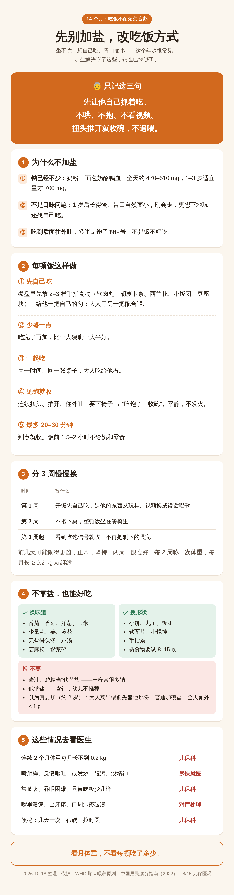
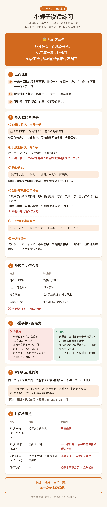

# 问答记录

每次单独问的问题和完整回答。**最新的在最上面**，时间为北京时间。与 `app.html`「问答」页签内容一致；新增问题时两处都加（格式：一句话结论 / 为什么 / 怎么做 / 常见误区 / 何时就医 / 相关图片）。

---

## 2026-11-03 21:56 · 皮肤

**问**：小狮子确诊特应性皮炎一年，对鸡蛋过敏（附 10/23 过敏原报告：蛋清 0.38 弱阳性，其余 18 项阴性）。下面 7 款身体乳，哪个更适合秋冬保湿和屏障修复？① 玉泽皮肤屏障修护身体乳 ② QV 小老虎润肤乳 ③ 薇诺娜宝贝倍护身体乳 ④ 一页婴童高保湿身体乳 ⑤ 华西珐玛桂花特护乳 ⑥ 咿儿润小天使特润霜 ⑦ 丝塔芙大白罐（成分表略，见原问题）

### 1. 一句话结论

**首选 ③ 薇诺娜宝贝倍护或 ② QV 小老虎；⑦ 丝塔芙大白罐也可以；④ 一页直接排除（含蛋黄油、水解蛋壳膜）。**③ 封闭剂（凡士林）排第二、还有乳木果、角鲨烷、神经酰胺，秋冬锁水最强；② 成分最少、没有植物提取物和食物来源的油，最不容易刺激或致敏。不过研究显示，**不同保湿剂之间效果差别不大，真正决定效果的是用得够不够多、够不够勤**：一天至少两次全身厚涂，一周 250–500 g。（置信度 中）

### 2. 为什么：科学依据

- **报告怎么读：**这是 10/23 那张（已记录在档案里）。吸入过敏原全阴，食物只有蛋清 0.38（1 级弱阳性），报告自己写 1 级「引起症状的可能性较小」。所以「对鸡蛋过敏」更准确的说法是「对鸡蛋弱致敏、还没确诊过敏」——但**皮肤科医嘱「皮肤不接触蛋」是合理、代价小的**，挑保湿剂时照这个来。
- **为什么要避开含食物成分的护肤品：**有湿疹、屏障受损的皮肤，接触食物蛋白容易「经皮致敏」——这是现在解释婴幼儿食物过敏最主要的理论。英国一项队列研究（Lack 2003，NEJM）发现，婴儿期用过含花生油护肤品的孩子，花生过敏风险明显更高（OR 约 6.8）。所以：**含蛋的产品不用；含坚果油的能避开就避开**（精炼油里蛋白很少，风险低，但有同样好的替代品时没必要冒这个险）。
- **不同保湿剂效果差别不大：**
  - Cochrane 系统综述（van Zuuren 2017，77 项研究）：规律用保湿剂能减少湿疹发作、减少激素用量；**没有证据显示哪一种明显更好**
  - 英国 BEE 试验（Ridd 2022，Lancet Child & Adolescent Health，550 名 6 个月–12 岁湿疹儿童随机分组）：乳液、霜、凝胶、膏四类 16 周效果相当，**选孩子愿意涂、家长能坚持涂的**
  - 「神经酰胺」听起来专业，但没有可靠证据证明含神经酰胺的比普通厚霜效果更好
- **所以挑选看三点：**
  - **封闭性**：凡士林（矿脂）是最强的锁水成分，排在成分表越前，秋冬效果越好
  - **少刺激、少致敏**：无香精、少植物提取物（菊科的金盏花、洋甘菊类在湿疹孩子里偶有接触过敏）、不含食物来源成分
  - **质地**：秋冬越厚越好；「身体乳」偏稀，膝窝肘窝等干的地方用霜或膏更好
- **逐个看：**
  - **③ 薇诺娜宝贝倍护**：✅ 矿脂排第二，乳木果、角鲨烷、神经酰胺 NP，无香精。⚠️ 有金盏花提取物（菊科，少数孩子会过敏）、野大豆油（他大豆阴性，精炼油风险很低）、澳洲坚果油的衍生酯（是化学改造过的酯，不是坚果油本身，风险很低）。**综合最适合秋冬**
  - **② QV 小老虎**：✅ 凡士林排第三，成分简单，无植物提取物、无食物油。⚠️ 有对羟基苯甲酸酯（尼泊金）类防腐剂——它在护肤品里的致敏率其实很低；是乳液，偏稀。**最「干净」，适合日常大面积用**
  - **⑦ 丝塔芙大白罐**：✅ 矿脂排第三，质地厚，老牌产品。⚠️ 含**甜扁桃油（杏仁，坚果）**，量很少；丙二醇有时会刺痛。**可以用，但在 ②③ 之后**
  - **⑥ 咿儿润小天使特润霜**：✅ 霜状、厚，角鲨烷、乳木果、蜂蜡、两种神经酰胺。⚠️ 没有凡士林；植物成分多（红没药醇来自洋甘菊类）；氢化卵磷脂可能来自大豆或蛋黄（标签没写来源）。**备选**
  - **① 玉泽身体乳**：✅ 无香精，含多种植物油。⚠️ 没有凡士林；含油橄榄果油——研究（Danby 2013）发现橄榄油会削弱皮肤屏障，不建议用于湿疹皮肤；植物油种类多。**不优先**
  - **⑤ 华西珐玛桂花特护乳**：⚠️ 桂花提取物（带香味的植物提取物）；没有凡士林和油脂类封闭剂，偏轻薄。**秋冬保湿力不够**
  - **④ 一页婴童高保湿**：❌ **含蛋黄油、水解蛋壳膜**（还有澳洲坚果籽油、氢化卵磷脂），与「皮肤不接触蛋」直接冲突。**排除**

出处：

- [van Zuuren EJ 等, Cochrane 2017 · 湿疹的保湿剂（77 项研究）](https://doi.org/10.1002/14651858.CD012119.pub2)
- [Ridd MJ 等, Lancet Child Adolesc Health 2022 · BEE 试验：四类保湿剂比较（n=550）](https://doi.org/10.1016/S2352-4642(22)00146-8)
- [Lack G 等, NEJM 2003 · 含花生油护肤品与花生过敏](https://doi.org/10.1056/NEJMoa013536)
- [Danby SG 等, Pediatr Dermatol 2013 · 橄榄油与葵花籽油对皮肤屏障的影响](https://doi.org/10.1111/j.1525-1470.2012.01865.x)
- [NICE QS44 · 儿童湿疹保湿剂用量（每周 250–500 g）](https://www.nice.org.uk/guidance/QS44/chapter/quality-statement-4-provision-of-emollients)
- 本页 10/24、10/31 两条皮肤问答

### 3. 怎么做

**现在（14 个月，湿疹维持期）：怎么搭配**

- **全身日常**：② QV 或 ③ 薇诺娜，每天至少早晚两次，洗澡后 3 分钟内厚涂
- **最干、最容易复发的地方**（膝窝、肘窝、手腕、脚踝）：用更厚的——③ 或 ⑦ 大白罐，干得厉害的晚上可以再薄薄加一层纯凡士林
- 用量：一周 250–500 g（相当于一周用掉 1–2 大瓶），**涂了一层亮亮的、不用揉到完全吸收**才算够
- 有泵头的比开口罐卫生；用罐装的拿干净勺子挖，不要手指直接伸进去
- **和药怎么错开**：周三艾洛松、周六克立硼罗的晚上，先涂药，**隔约 30 分钟**再涂保湿（NICE 建议两者分开时间用）；或者洗澡后先全身保湿，30 分钟后再在发过的部位涂药，每次顺序固定就行

**换新产品前：先试 3 天**

- 在没有湿疹的一小块皮肤（比如上臂外侧，一元硬币大小），每天涂两次，连续 3 天
- 没有发红、起疹、他抓 → 再全身用
- 一次只换一款，方便判断是哪个出问题

**18 个月–3 岁**

- 原则不变；冬天仍以厚霜为主，夏天出汗多可以换成稍轻的乳液，但不要停
- 学会自己涂的时候，可以让他参与，「一起涂香香」能减少抗拒

**买其他产品时怎么看成分表**

- ✅ 找：矿脂/凡士林、甘油、二甲硅油、角鲨烷、乳木果靠前；无香精
- ❌ 避开：蛋（蛋黄油、蛋清、卵磷脂来源不明的问一下）、花生油、坚果油（杏仁/甜扁桃、澳洲坚果）、燕麦（他未引入）、香精/香料、精油、橄榄油
- ⚠️ 少用：成分表里植物提取物一长串的（尤其菊科：金盏花、洋甘菊、山金车）

### 4. 常见误区

- ✗ 「越贵、成分越多、加了神经酰胺的越修复」 → ✓ 研究里不同保湿剂效果差不多；决定效果的是用量和频率。
- ✗ 「宝宝用的要纯天然、全植物」 → ✓ 植物提取物和天然油反而更容易致敏；橄榄油还会削弱屏障。凡士林这种「矿物油」最稳定。
- ✗ 「抹薄薄一层、揉到吸收就行」 → ✓ 湿疹皮肤要厚涂，表面留一层亮光；一周 250–500 g 才够。
- ✗ 「只是外用，含鸡蛋、坚果的成分没关系」 → ✓ 有湿疹的皮肤接触食物蛋白，可能反而让孩子对这种食物过敏。
- ✗ 「皮肤好了就不用天天涂了」 → ✓ 维持期和平时都要天天涂，保湿是防复发的底座。
- ✗ 「尼泊金（对羟基苯甲酸酯）防腐剂很危险」 → ✓ 它在护肤品里的致敏率很低；真正常见的致敏原是香精和某些植物成分。

### 5. 什么情况需要就医

- 换了新保湿剂后，涂过的地方发红、起小疹子、更痒 → 停用这款，症状不退就看皮肤科（可能是接触性皮炎）
- 涂保湿剂时明显刺痛、哭闹，且每次都这样 → 可能是皮肤有破损或炎症没控制住，联系皮肤科
- 涂了含蛋或含坚果成分的产品后，几分钟到 2 小时内出现风团、嘴唇眼皮肿、呕吐、咳嗽喘 → 立即急诊
- 维持期间保湿和药都按时用了，还是反复大发作 → 回皮肤科调整方案
- 成簇小水疱、打孔样破溃、发烧 → 当天就医（疱疹性湿疹）

### 6. 相关图片

家长附了 2026-10-23 成都儿童专科医院过敏原报告照片（数值已在 [records 二之三](records.md#二之三化验2026-10-23-采样14-月龄成都儿童专科医院特应性皮炎门诊)），因含姓名等个人信息，**照片不入库**。

---

## 2026-11-03 21:47 · 用品

**问**：（接上一条室内穿鞋）穿这种拖鞋可以吗？（网购图：针织鞋面、包头、后跟一根松紧带、厚的一体模压鞋底、鞋头立体恐龙冠装饰）

### 1. 一句话结论

**不太推荐作为他现在的室内鞋，偶尔穿可以，但比不上光脚、防滑袜或上一条那双软底地板鞋。**主要问题是**鞋底太厚**：14 个月刚走稳的孩子，厚底会让他感觉不到地面、脚抬得更高、更容易绊倒和崴脚。后跟松紧带、包头这两点倒是对的。如果已经买了，用下面三个小测试检查，通过了可以在冷的时候短时间穿；等 2–3 岁走跑都很稳了，这种棉拖会更合适。（置信度 中）

### 2. 为什么：科学依据

- **对这个年龄，好的室内鞋要「接近光脚」：**美国儿科学会建议学走路的孩子在家光脚或穿袜子，需要鞋时选**轻、软、前掌能弯、防滑**的。上一条讲过：鞋会改变步态（Wegener 2011 系统综述），鞋底越厚越硬，改变越大。
- **这双的问题在鞋底：**
  - 图上看是一体模压的厚底（目测 2 cm 左右，前后都翘），这类鞋底通常**不好弯、偏重**
  - 鞋底厚 → 脚离地面远，脚底感觉不到地面高低，他是靠这个找平衡的
  - 鞋底宽厚、前头上翘 → 走路时鞋头更容易蹭地、绊到台阶和地毯边；脚踝在厚底上更容易往外崴
  - 14 个月的孩子刚走稳不久，**跌倒的主要原因就是绊和滑**
- **这双做得对的地方：**
  - **包头**：比露脚趾的拖鞋好，不容易踢到脚趾
  - **后跟有松紧带**：不容易掉，比完全没后跟的拖鞋安全得多（没后跟的拖鞋是这个年龄最不推荐的）
  - 针织鞋面比较软，比抓绒透气一点
- **立体恐龙冠：**和上一条的扣子一样，是会被抠、被咬的小部件，要缝牢。
- **为什么等大一点更合适：**2–3 岁以后走、跑、上下台阶都很稳，平衡更多靠肌肉而不只靠脚底感觉，厚一点的棉拖带来的影响就小了，保暖的好处更明显。

出处：

- [美国儿科学会 HealthyChildren · Shoes for Active Toddlers](https://www.healthychildren.org/English/ages-stages/toddler/Pages/Shoes-for-Active-Toddlers.aspx)
- [Wegener C 等, J Foot Ankle Res 2011 · 儿童鞋对步态影响的系统综述](https://www.ncbi.nlm.nih.gov/pmc/articles/PMC3031211/)
- 本页 11/03「室内要不要穿鞋」一条

### 3. 怎么做

**如果已经买了：先做三个测试**

- **弯一弯**：一手捏鞋跟，一手按鞋头往上折。能在**前脚掌的位置**轻松弯起来 → 过；整只鞋硬邦邦弯不动，或者只能在中间弯 → 不适合他现在穿
- **掂一掂**：比上一条那双地板鞋明显重很多 → 不适合
- **看他走**：穿上让他走几分钟，**比平时更容易绊、走路抬脚特别高、或者一直想脱** → 先收起来

**现在（14–18 个月）怎么用**

- 三个测试都过：可以在地面凉、短时间（比如早晚洗澡前后）穿；平时仍然以光脚、防滑袜、软底地板鞋为主
- 有任何一个不过：先收起来，2 岁左右再试
- 每次穿前拽一下恐龙冠，松了就处理；后跟松紧带要能贴住脚跟、不勒出红印
- 尺码：脚趾前面留约一指宽（约 1 cm），不要买大一码「留着长」——大了更容易绊

**如果还没买，想买室内鞋**

- 选**薄底（几毫米）、整只能卷起来、轻、底部有防滑点、包头、有后跟或搭扣**的软底鞋或防滑袜鞋
- 鞋面纯棉或针织，少抓绒；他脚踝有湿疹，透气比厚实重要

**2–3 岁以后**

- 走跑稳定后，这种厚底棉拖可以作为冬天室内鞋；仍然选包头、有后跟带的款，防滑底

### 4. 常见误区

- ✗ 「鞋底厚一点软一点，摔了也不疼，更安全」 → ✓ 对刚会走的孩子，厚底让他感觉不到地面、更容易绊倒崴脚，反而更不安全。
- ✗ 「拖鞋好穿好脱，适合小孩」 → ✓ 没后跟的拖鞋最容易掉、最容易绊；要穿就选有后跟带的。
- ✗ 「买大一码，能多穿几个月」 → ✓ 鞋大了容易绊、脚在里面滑；前面留一指宽就够。
- ✗ 「冬天在家一定要穿厚棉鞋才不冷」 → ✓ 地面凉时防滑袜或薄底保暖鞋就够了；脚暖不暖摸后颈、手脚是否温热即可。

### 5. 什么情况需要就医

- 穿某双鞋后**反复在同一个地方摔**，或者摔后一直哭、不肯用那只脚、脚踝肿 → 当天看儿科或骨科
- 脚上磨出水疱、红肿破皮不好，或者脚踝湿疹在鞋口处加重 → 皮肤科
- 2 岁以后还总踮脚走、走路一瘸一拐 → 小儿骨科

---

## 2026-11-03 20:52 · 用品

**问**：小狮子现在这个年龄在室内需要穿鞋吗？像图片中这种地板鞋（抓绒鞋面、扣子搭扣、底部黑色防滑胶点）可以吗？还是直接穿防滑袜，或者光脚就可以？

### 1. 一句话结论

**室内不需要穿鞋。地面不凉、干净的时候光脚最好；凉的时候穿防滑袜，或者照片里这种软底地板鞋都可以。**这双鞋底软、轻、有防滑点，作为「室内保暖用」是合格的；只是不需要它来「帮助走路」，也要注意两点：抓绒容易让脚闷汗（他脚踝有湿疹），扣子要缝牢。照片里两只脚穿的是不同的两只鞋，最好成对穿。（置信度 中高）

### 2. 为什么：科学依据

- **权威建议：**美国儿科学会（AAP）家长网站：婴幼儿的脚**不被鞋包住时发育得最好**，在家穿袜子保暖就够了；**到户外走路才需要鞋来保护**，选轻、软、前掌能弯、防滑的鞋。
- **光脚为什么好：**刚会走的孩子靠脚底的感觉和脚趾抓地来找平衡。光脚时他能直接感受到地面，足底小肌肉也在用力。系统综述（Wegener 2011，Journal of Foot and Ankle Research）：孩子穿鞋走路时，步幅、速度、踝关节活动等约四分之三的步态指标都和光脚不同——**鞋会改变走路的方式**，所以学走路阶段，在安全的室内尽量少穿。
- **和足弓的关系（证据较弱，但方向一致）：**印度一项 2300 名 4–13 岁儿童的足印调查（Rao & Joseph 1992）：从小常穿鞋的孩子扁平足 8.6%，不穿鞋的 2.8%；包脚的鞋最多，拖鞋凉鞋次之，光脚最少。⚠️ 这是横断面观察研究，有生活环境等混杂，不能证明因果；但「光脚至少没有坏处」这一点是确定的。
- **「学步鞋要硬底、要有足弓支撑」没有依据：**1–3 岁孩子脚底有脂肪垫，看上去是扁平足，属于正常；硬底和足弓垫不会让足弓「长得更好」，反而限制脚的活动。他的轻度 O 型腿同理——**不需要矫正鞋或鞋垫**（见 8/15 儿保解读）。
- **那为什么有时还要穿：**
  - **保暖**：成都冬天室内没有暖气，木地板、瓷砖地会凉。脚凉本身不会让孩子「感冒」（感冒是病毒引起的），但脚冰凉他会不舒服
  - **防滑**：木地板上**普通袜子最滑**，比光脚和防滑袜都更容易摔
  - **保护**：地上有小碎物、在厨房阳台等硬或湿的地面
- **照片里这双鞋怎么样：**
  - ✅ 鞋底软、轻、整只能弯，底部有防滑胶点——这些都是对的
  - ✅ 开口大、搭扣固定，不容易掉
  - ⚠️ 鞋面是抓绒，保暖但不透气；他正在湿疹维持期，**脚踝是以前发过的部位**，闷汗会加重痒。屋里不冷时别整天穿，里面配纯棉袜
  - ⚠️ 扣子和毛绒贴布是小部件：这个年龄会抠、会咬，**扣子要缝牢**，松了就剪掉或换掉（窒息风险）
  - 另一只是网面鞋，更透气。两种都可以，但最好成对穿，两只脚的厚度和防滑一样，走路更稳

出处：

- [美国儿科学会 HealthyChildren · Shoes for Active Toddlers](https://www.healthychildren.org/English/ages-stages/toddler/Pages/Shoes-for-Active-Toddlers.aspx)
- [Wegener C 等, J Foot Ankle Res 2011 · 儿童鞋对步态影响的系统综述](https://www.ncbi.nlm.nih.gov/pmc/articles/PMC3031211/)
- [Rao UB, Joseph B, JBJS Br 1992 · 穿鞋与扁平足（n=2300）](https://pubmed.ncbi.nlm.nih.gov/1624509/)
- 本体系 [records 5.2 · O 型腿](records.md#52-体格检查2026-08-15)

### 3. 怎么做

**现在（14–18 个月）：室内**

- **地面不凉、干净（室温约 20 °C 以上，地上没有碎物）→ 光脚**，越多越好
- **地面凉 → 防滑袜**（底部有胶点的纯棉袜）**或这双地板鞋**，二选一；**不要只穿普通袜子**在木地板上走
- 地板鞋里面配一双薄纯棉袜，吸汗；穿一两个小时脱下来看看脚有没有出汗发红
- 每次穿之前拽一下扣子和贴布，松了就处理
- 鞋大小：脚趾前面留约一指宽（约 1 cm）；每 1–2 个月看一次，这个年龄脚长得快

**现在：出门**

- 需要一双真正的鞋来保护脚：**轻、软、前掌能轻松弯折、鞋底防滑、鞋头宽**，不要硬底、不要高帮硬靴、不要足弓垫
- 在小区平地、草地、沙地，天气暖和时也可以偶尔让他光脚走走（先看地上有没有碎玻璃、石子）

**18 个月–3 岁**

- 室内仍以光脚或防滑袜为主
- 户外鞋按同样标准选，跑跳多了以后鞋底可以稍厚一点，但仍然要软、能弯
- 3 岁前看起来扁平足是正常的，不用买足弓鞋垫

**湿疹期间的脚**

- 袜子选纯棉，洗干净、无香精洗衣液洗；出汗了就换
- 脚踝、脚背是他以前发过的地方，维持期药照样涂；鞋口、袜口勒出的红印处注意保湿

### 4. 常见误区

- ✗ 「孩子会走了就要穿学步鞋，帮他走稳」 → ✓ 室内光脚走得最稳，鞋会改变步态；学步鞋只在户外保护脚用。
- ✗ 「学步鞋要硬底、要有足弓支撑，不然会扁平足」 → ✓ 3 岁前看起来扁平足是正常的；硬底和足弓垫没有好处，软底能弯的才对。
- ✗ 「光脚会着凉感冒」 → ✓ 感冒是病毒引起的，不是脚凉；地面太凉时穿防滑袜是为了舒服，不是为了防感冒。
- ✗ 「穿袜子比光脚安全」 → ✓ 在木地板、瓷砖上，普通袜子最滑，最容易摔。
- ✗ 「O 型腿要穿矫正鞋」 → ✓ 1 岁左右轻度 O 型腿是生理性的，不需要矫正鞋或鞋垫。

### 5. 什么情况需要就医

- 2 岁以后**还总是踮着脚尖走**，或者只有一只脚踮 → 儿保或小儿骨科
- 走路一瘸一拐、喊疼、不肯走，或两条腿明显不对称 → 尽快就医
- 脚掌**一直很硬、足弓在踮脚时也出不来**，或者脚疼 → 小儿骨科（普通的「软扁平足」不用管）
- O 型腿越来越明显、两边不一样 → 按 8/15 医嘱看小儿骨科
- 脚上湿疹破皮渗液、脚趾间发红脱皮不好 → 皮肤科

---

## 2026-10-31 09:55 · 睡眠

**问**：小狮子这个年龄一般一天睡几个小时？

### 1. 一句话结论

1–2 岁一天（24 小时、含午睡）睡 **11–14 小时**都正常，大致是晚上 10–12 小时 + 白天 1–3 小时；小狮子按现在的作息约 **11.8–12.5 小时**，在正常范围中间，**不需要追求更多**。比小时数更重要的是：他白天精神好不好、早上是不是自己醒。（置信度 高）

### 2. 为什么：科学依据

- **几个权威推荐给的是同一个区间：**
  - 美国睡眠医学会（AASM）2016 共识（13 位专家、复核 864 篇文献）：**1–2 岁每 24 小时 11–14 小时（含小睡）**，规律地睡够这个量，与注意力、行为、学习、情绪调节和健康更好相关
  - 世界卫生组织 2019《5 岁以下儿童身体活动、久坐行为和睡眠指南》：1–2 岁 **11–14 小时**高质量睡眠（含小睡），入睡和起床时间规律
  - 美国国家睡眠基金会 2015：1–2 岁推荐 11–14 小时；**9–10 或 15–16 小时「可能也合适」**，少于 9 或多于 16 小时不推荐
  - 国内卫生行业标准《0 岁～5 岁儿童睡眠卫生指南》（WS/T 579—2017）也给出 1–2 岁的推荐时长，口径与上面一致（⚠️ 本次没能联网核对原表）
- **为什么是一个区间、不是一个数：**观察性研究汇总（Galland 2012 系统综述）显示，同年龄孩子的睡眠时长个体差异很大，差两三个小时都常见；作者也指出 1–2 岁的研究数据本来就少。所以**落在区间里就是正常**，不必和别人家孩子比。
- **这个年龄的睡眠结构：**
  - 晚上一整段约 10–12 小时，夜里短暂醒 1–2 次很常见，能自己或拍一拍接着睡就不算问题
  - 白天：12–18 个月大多数孩子从两次小睡并成一次，他已经是一次午睡（13:00–15:00）
- **小狮子算一算：**07:30 起、午睡 2 小时。按 21:00 睡着算约 12.5 小时；如果实际 21:40 才睡着，约 11.8 小时。**都在 11–14 小时内**。要注意的是：算的是「睡着的时间」，不是「躺在床上的时间」——这也是上一条让你们记 5–7 天作息的原因之一。
- **怎么判断够不够（比小时数更实用）：**早上多数时候自己醒、醒来情绪还行；白天玩得起劲；午睡容易睡着；傍晚不经常崩溃大哭；坐车、推车里不会在非睡觉时间频繁睡着。这些都对得上，就是睡够了。

出处：

- [Paruthi S 等, JCSM 2016 · 美国睡眠医学会儿童睡眠时长共识](https://jcsm.aasm.org/doi/10.5664/jcsm.5866)
- [WHO 2019 · 5 岁以下儿童身体活动、久坐行为和睡眠指南](https://www.who.int/publications/i/item/9789241550536)
- [Hirshkowitz M 等, Sleep Health 2015 · 美国国家睡眠基金会睡眠时长推荐](https://doi.org/10.1016/j.sleh.2014.12.010)
- [WS/T 579—2017《0 岁～5 岁儿童睡眠卫生指南》（标准目录页）](https://www.chinesestandard.net/Related.aspx/WST579-2017)
- [Galland BC 等, Sleep Med Rev 2012 · 婴幼儿正常睡眠模式系统综述](https://pubmed.ncbi.nlm.nih.gov/21784676/)

### 3. 怎么做

**现在（14–18 个月）**

- **总量 11–14 小时，作息规律比凑够小时数重要**：每天起床、午睡、上床时间尽量固定，前后不超过半小时左右
- 午睡一次 1.5–2.5 小时；最晚 15:00–15:30 醒，不影响晚上入睡
- 先按上一条说的**记 5–7 天作息**，算出他「实际睡着」的总时长，再决定上床时间该不该挪
- 偶尔一天睡得少不用补，第二天照常作息即可

**18–24 个月**

- 仍是 11–14 小时；多数一天一次午睡 1.5–2.5 小时，晚上 10.5–12 小时
- 午睡偶尔不睡的日子，晚上提前 30 分钟左右上床

**2–3 岁以后**

- 3–5 岁推荐 10–13 小时（含午睡）；午睡会慢慢变短、到 3–5 岁之间逐渐消失，个体差异很大

### 4. 常见误区

- ✗ 「睡得越多长得越高，能多睡就多睡」 → ✓ 睡够区间就行；生长激素依赖的是规律、连续的睡眠，不是越长越好。
- ✗ 「别人家孩子一天睡 14 小时，我们只睡 12 小时是不够」 → ✓ 个体差异很大，11–14 小时都正常，看白天精神比比小时数可靠。
- ✗ 「白天少睡点，晚上就睡得好」 → ✓ 午睡太少容易「越困越兴奋」，晚上反而更难睡；午睡要有，只是别太晚结束。
- ✗ 「在床上躺了 11 个小时就是睡了 11 个小时」 → ✓ 要减去入睡要花的时间和夜里醒着的时间。
- ✗ 「夜里醒就是睡眠有问题」 → ✓ 这个年龄夜里短暂醒 1–2 次很常见，能接着睡就不算问题。

### 5. 什么情况需要就医

- 经常打鼾（一周 3 晚以上），或有憋气、张口呼吸、睡觉时出很多汗 → 儿保或耳鼻喉科
- 长期每天少于 10 小时，同时白天烦躁、没精神、爱发脾气 → 儿保科
- 突然比平时多睡很多（经常超过 15–16 小时），叫醒困难、醒了也没精神 → 尽快就医
- 夜里经常因为痒醒、抓破皮 → 联系皮肤科
- 睡眠突然明显变差，伴发烧、老抓耳朵 → 先看是不是生病了

---

## 2026-10-31 09:35 · 睡眠

**问**：小狮子现在这个年纪，晚上应该怎么睡？是带他一起睡、培养他自己入睡，还是可以抱着睡？现在通常是大人陪他在床上直接入睡，他要在床上一起玩很久，一般半小时，甚至 40–50 分钟，睡得很慢。偶尔几次他比较困、还没上床时，竖抱着让他把头贴在肩膀上，稍微拍一下，不用怎么哄，2–3 分钟就能睡着。奶奶比较坚持要培养自主入睡，上床陪他玩、讲故事，说这个年纪不能再抱着睡；我和他妈妈因为哄睡太难、时间太久，偶尔会让他在肩膀上睡。这种哄睡会不会不好？和带到床上自己睡比，哪种更好？

### 1. 一句话结论

抱着睡着**没有害处**，也不会「惯坏」；现在的真正问题不是「抱还是不抱」，而是**上床时他还不够困、床上又在玩**——所以要 40–50 分钟。肩膀上 2–3 分钟就睡着，恰好说明那个时间点才是他真正困的时候。先把**上床时间往后挪到他真正困的点**、睡前流程固定、床上不玩，入睡时间多半能缩到 15–20 分钟以内；抱睡还是床上陪睡，家里选哪种都可以，**全家用同一套更重要**。（置信度 中）

### 2. 为什么：科学依据

- **「抱着睡会不会不好」：没有证据显示有害。**抱睡、摇睡、陪睡对依恋、情绪和发育没有已知的不良影响；它唯一可能的代价是「睡眠联想」——如果他是在肩膀上睡着、半夜醒来发现在床上，有的孩子会需要再被抱一次才能接着睡。**所以判断标准很实际：抱睡之后夜里睡得好不好、大人的腰和精力扛不扛得住。**夜里一觉到天亮，就不存在问题。
- **「自主入睡」确实有好处，但效果是中等的，而且不是靠「上床陪玩」得来的。**观察研究显示，晚上能自己在床上入睡的婴幼儿，夜醒后更容易自己接着睡（Mindell、Sadeh 等）；行为干预的随机对照试验（Hiscock 2008、Gradisar 2016 等）能缩短入睡时间、减少夜醒，随访到 6 岁（Price 2012，326 名 7 月龄起有睡眠问题的婴儿）未见对情绪、行为、亲子关系的任何不良影响。但这些「自主入睡」指的是：**流程结束后放进床里、关灯、大人不再互动**，不是在床上玩 40 分钟。
- **为什么现在要 30–50 分钟：**
  - **上床太早、还不够困。**睡眠驱动力（清醒越久越困）不够时，孩子躺下也睡不着，就会玩。他白天 13:00–15:00 午睡（[records 3.6](records.md#36-现行方案2026-08-18-定稿依据-815-儿保医嘱)），如果午睡偶尔睡得晚或长，晚上的困意就会往后推。肩膀上 2–3 分钟睡着的那几次，正好都是「他已经很困、还没上床」的时候。
  - **床变成了玩的地方。**行为睡眠医学的「刺激控制」原则：床和入睡联系得越紧，躺下越快睡着；在床上玩、讲故事，会把床和「兴奋」联系在一起。
  - **这个年龄本来就爱拖。**12–18 个月是分离焦虑和「刚会走、什么都想玩」的阶段，入睡变慢很常见。
- **一个直接对症的方法：「睡眠时间渐退法」（bedtime fading）。**先把上床时间定在他**实际睡着的时间附近**（比如现在 21:00 上床、21:40 才睡着，就改成约 21:30 上床），入睡变快后，每 2–3 晚提前 15 分钟，直到想要的时间。Gradisar 2016（Pediatrics，随机对照，6–16 月龄 43 名婴儿）：这个方法和渐进消退法一样能缩短入睡时间，而且**几乎不用让孩子哭**；12 个月随访两组的依恋和情绪行为与对照组无差别。⚠️ 样本很小，结论方向可信、具体效果大小不确定。
- **他的睡眠总量大概是够的。**按 07:30 起、午睡 2 小时、约 21:00 睡算，全天约 12.5 小时，在美国睡眠医学会 1–2 岁 11–14 小时的范围内。所以不需要「让他早点睡、多睡点」。
- **奶奶和你们的分歧，其实目标是一致的。**奶奶想要「自己在床上睡着」，你们想要「别哄 50 分钟」——用上面的方法，两件事可以同时做到。而「抱睡还是陪睡」本身，属于[隔代抚养](../04-grandparent-care.md)里「效应量低、可以让」的一类：**做 1000 人的随机试验也测不出长期差别**，不值得一次家庭冲突。比方法更重要的是：**每天同一套流程、同一个时间，谁哄都一样。**
- **大人的精力也是变量。**一个每晚哄 50 分钟、被耗空的家长，对孩子并不更好（见 [01 第五节](../01-what-parents-change.md)）。

出处：

- [Gradisar M 等, Pediatrics 2016 · 渐进消退法与睡眠时间渐退法的随机对照试验](https://pubmed.ncbi.nlm.nih.gov/27221288/)
- [Price AMH 等, Pediatrics 2012 · 婴儿睡眠干预随访到 6 岁（n=326）](https://doi.org/10.1542/peds.2011-3467)
- [Mindell JA 等, Sleep 2006 · 婴幼儿入睡与夜醒行为治疗综述（AASM）](https://pubmed.ncbi.nlm.nih.gov/17068979/)
- [Paruthi S 等, JCSM 2016 · 美国睡眠医学会儿童睡眠时长共识](https://jcsm.aasm.org/doi/10.5664/jcsm.5866)
- 本体系 [04 隔代抚养 · 主动让步](../04-grandparent-care.md)、[03 第 8 条 同睡](../03-open-questions.md)

### 3. 怎么做

**第一步：先记 5–7 天（不改任何做法）**

- 每天记 5 个时间：午睡几点睡着、几点醒；晚上几点上床；几点睡着；夜里醒几次、怎么接着睡的（自己、拍一拍、抱、喂奶）；早上几点醒
- 记的目的是找到他**真正困的时间**。如果他一般 21:40 前后才睡着，那上床就不该是 21:00

**第二步（14–18 个月，现在）：调时间 + 固定流程 + 床上不玩**

- **上床时间对准他实际睡着的时间**（比记录里的平均入睡时间早 10–15 分钟）。入睡能在 15–20 分钟内的话，每 2–3 晚提前 15 分钟，直到合适的时间（比如 21:00）
- **午睡最晚 15:00–15:30 叫醒**，午睡后到晚上入睡最好间隔约 5–6 小时
- **睡前流程 20–30 分钟，每晚同样的顺序、在卧室外或灯光调暗**：睡前奶（20:00）→ 刷牙 → 洗澡和全身保湿（他正在湿疹维持期，晚上本来就要做）→ 换睡衣 → 讲 1–2 本书 → 说「睡觉时间到了」→ 上床关灯
- **故事在床外讲完，上床后不玩、不讲新故事**：大人可以躺在旁边，安静、无聊、少说话；他坐起来玩，就平静地让他躺下，或者大人闭眼装睡。目标是让床只等于「睡觉」
- **抱睡可以继续用**，尤其是他已经很困的时候；想慢慢过渡，可以抱到他**迷迷糊糊、眼睛快闭上**再放到床上，大人在旁边拍一拍。放下就醒、哭得厉害也没关系，再抱一会儿，不必较劲
- **不要用**：手机、电视、会发光发声的玩具哄睡；也不需要让他一个人在房间里哭
- **皮肤痒会拖慢入睡**：睡前保湿厚涂、穿薄棉长袖长裤，房间别太热（约 20–22 °C）

**全家怎么分工**

- 奶奶、爸爸、妈妈用**同一套流程**：几点开始、什么顺序、上床后不玩。谁哄都一样，比谁的方法更「对」重要
- 可以这样跟奶奶说：「您说得对，是要让他自己在床上睡。我们一起试一个方法：故事在床外讲完，上床就关灯不玩，上床时间往后挪一点，等他真正困了再上床。」

**18–24 个月**

- 午睡多数仍是一次 1.5–2.5 小时，晚上约 20:00–21:00 睡；总量 11–14 小时
- 会出现「再喝一口水」「再讲一本」这类拖延：提前说好讲几本，讲完就关灯，温和但不加码
- 换小床或分床不急，等家里有需要时再做；同睡与否到这个年龄主要是偏好问题（见 [03 第 8 条](../03-open-questions.md)）

**2–3 岁**

- 午睡慢慢减少或消失；没午睡的日子晚上提前睡
- 可以用一张「睡前流程图」（刷牙 → 洗澡 → 讲书 → 关灯）让他自己按顺序走

**一起睡的安全底线（不管选哪种）**

- 床垫不过软；他睡的地方没有厚被、大枕头、毛绒玩具堆
- 防跌落：床边围栏或床靠墙；地上不放硬物
- 不与吸烟、喝酒或吃了让人犯困的药的大人同床

### 4. 常见误区

- ✗ 「这么大了还抱着睡，会惯坏、以后离不开」 → ✓ 没有证据显示抱睡有害；大多数孩子到 2–3 岁自然会在床上睡着。它唯一的代价是夜醒时可能还要抱，夜里睡得好就不是问题。
- ✗ 「在床上陪他玩、讲故事，就是在培养自主入睡」 → ✓ 自主入睡是指流程结束后在床上安静地自己睡着；在床上玩 40 分钟恰恰让床变成了游乐场。
- ✗ 「入睡慢是因为他精力旺盛，得陪玩到累」 → ✓ 更常见的原因是上床太早、还不够困；对准他真正困的时间，比陪玩到累更快。
- ✗ 「早睡早起身体好，越早上床越好」 → ✓ 上床早于他的困点，只会让入睡时间变长；他的总睡眠量已经在正常范围。
- ✗ 「培养自主入睡就得让他哭到睡着」 → ✓ 有不用哭的方法：睡眠时间渐退法、迷糊时放下、大人在旁边安静陪着。
- ✗ 「全家各哄各的，孩子会适应」 → ✓ 每天换一种方法最拖时间；同一套流程比哪套流程更重要。

### 5. 什么情况需要就医

- **打鼾**：一周有 3 晚以上打鼾，或者有憋气、张口呼吸、睡觉时头往后仰、出很多汗 → 儿保或耳鼻喉科（排查腺样体、扁桃体肥大）
- 夜里**经常因为痒醒**、抓破皮 → 联系皮肤科调整湿疹维持方案
- 按上面的方法调了 2–3 周，入睡仍要 30 分钟以上、夜里醒很多次，并且白天明显烦躁、没精神 → 儿保科或儿童睡眠门诊
- 夜里突然尖叫哭闹、喊不醒，频繁发生；或睡觉时有抽动、发呆、眼睛上翻 → 就医
- 睡眠突然明显变差，同时伴随发烧、耳朵疼（老抓耳朵）、出牙疼 → 先处理这些问题

---

## 2026-10-31 09:20 · 皮肤

**问**：坚持用了卤米松一周，每天早晚洗澡加保鲜膜缠，目前看下来他周身的皮肤基本上都已经恢复了。这是最新的照片（胸腹、背、两条腿的膝窝），你看一下。

### 1. 一句话结论

效果很好，可以结束强化期：胸、肚子、背、腿基本都平了，照片里那些一块深一块浅的斑驳是炎症退下去后留下的色素变化，不是湿疹，不用再涂药。**今天（10/31，周六）起停卤米松、停保鲜膜，按医嘱进入维持：今晚克立硼罗，下周三（11/4）艾洛松。**只有膝窝要用手摸一下再确认。（置信度 中——照片能看出颜色，看不出摸起来平不平）

### 2. 为什么：科学依据

- **照片里看到的：**
  - 胸、腹、背：10/24 那种密密的小疙瘩和暗红斑已经看不到了，皮肤表面平、没有渗液和结痂。留下的是**深浅不一的斑驳**：深一点的是炎症后色素沉着，浅一点的是炎症后色素减退。两种都是特应性皮炎好转后的常见「印子」，边界模糊、不痒不粗糙，几周到几个月会自己慢慢匀开。
  - 两侧膝窝：褶皱处颜色比周围深、纹理比别处粗一点，褶皱下方还有一小片淡粉红；大腿后侧有一道细细的抓痕。膝窝是最早发、最厚的地方之一（当时也包了保鲜膜），**这里最可能还有一点没完全退的炎症**，需要手摸确认。
  - 没看到激素副作用的迹象：没有皮肤变薄发亮、紫纹或细小血丝。
- **为什么今天就该停卤米松：**卤米松说明书写 2 岁以下连续不超过 7 天。7 天已经用满，效果也达到了，再用就是风险增加、收益很小。剩下一点没退干净的地方，应该换成中效药收尾（见「怎么做」），而不是继续用强效药。
- **停了会不会「反弹」：**7 天短程外用激素，停药后不需要为了身体（肾上腺）再慢慢减量。真正要防的是**湿疹本身复发**。他 8 月和 10 月两次复发都发生在停药或减药之后，所以接下来每周两次的维持就是「逐级减」的那一步，**一次都不能省**。Cochrane 系统综述（7 项试验、1149 人）：每周两次在易发部位维持，复发率从 58% 降到 25%。
- **浅色的斑是不是激素「涂白了」：**不是。激素引起的色素减退一般要长时间反复用在同一个地方才会出现。一周后出现的浅色斑，最常见的是湿疹本身留下的炎症后色素减退，皮肤颜色越深的孩子越明显，会自己恢复。
- **「好了」的标准是摸起来，不是看起来：**颜色深浅会持续几周到几个月；判断炎症退没退，看的是**粗糙、凸起、发红、他还抓不抓**。

出处：

- [卤米松乳膏（澳能）说明书 · 儿童用药](https://ypk.39.net/2033408/manual/)
- [Cochrane CD013356 · 外用激素的使用策略（周末维持）](https://www.cochranelibrary.com/cdsr/doi/10.1002/14651858.CD013356.pub2)
- [中华医学会皮肤性病学分会《中国特应性皮炎诊疗指南（2020版）》](https://gpedu.yiigle.com/uploads/guide_html/%E4%B8%AD%E5%9B%BD%E7%89%B9%E5%BA%94%E6%80%A7%E7%9A%AE%E7%82%8E%E8%AF%8A%E7%96%97%E6%8C%87%E5%8D%97%EF%BC%882020%E7%89%88%EF%BC%89.html)（主动维持治疗；色素改变）
- [NICE QS44 · 儿童湿疹保湿剂用量（每周 250–500 g）](https://www.nice.org.uk/guidance/QS44/chapter/quality-statement-4-provision-of-emollients)
- 本页 10/24「特应性皮炎大面积复发」一条

### 3. 怎么做

**今天（10/31，周六）：先摸膝窝，再换维持**

- 洗完澡后，用手指肚轻轻摸两侧膝窝、肘窝、手腕、脚踝这几处以前最厚的地方：
  - **摸起来平滑、不凸、他不去抓** → 只是颜色印子，直接进维持
  - **还粗糙、有小疙瘩、发红、他还在抓** → 这几处还没好。**今天给皮肤科打个电话**，问：「膝窝还没完全平，能不能用艾洛松每天一次、只涂这几处，再涂 3–5 天，平了再进每周两次？」
  - 联系不上医生之前：**不要自己继续用卤米松**；其他地方照常进维持，没平的地方厚涂保湿
- **停保鲜膜**：封包只用于强化期，维持期不需要
- **今晚：克立硼罗**，薄薄地涂在**所有以前发过的部位**（头、胸、腹、腰、臀、肘、腕、手背、膝窝、踝），即使现在看起来已经好了。刚涂时可能有点刺痛，一般几次后会减轻

**维持期 6 周（10/31 → 约 12/12）**

| | 周三晚 | 周六晚 | 其他日子 |
|---|---|---|---|
| 用什么 | 艾洛松 | 克立硼罗 | 只保湿 |
| 涂在哪 | 以前发过的部位 | 以前发过的部位 | 全身 |

- 第一次艾洛松：**11/4（周三）**；第一次克立硼罗：今晚
- **保湿现在是主角**：无香精厚霜，每天至少早晚两次全身厚涂；洗完澡 3 分钟内涂；用量参考英国 NICE，每周 250–500 g（一周用掉一大罐是正常的）
- 洗澡：温水（36–37 °C）、5–10 分钟，每天或隔天都可以；沐浴露、洗发水照医嘱每周一次
- **头 1–2 周盯紧**：从每天两次强效药一下降到每周两次，这是最容易复发的时候（8 月那次就是减药第二天复发）。**如果某处又出现红、粗、痒，不要等到周三**，当天联系医生；常见做法是在那一小块每天涂一次中效药（艾洛松）几天，压下去再回到每周两次，请医生确认
- 穿衣、温水擦汗、剪指甲照旧；腿上那道抓痕说明还有点痒，晚上睡觉可以穿薄棉长裤

**印子怎么办**

- 深色、浅色的印子**都不用涂药、不用买祛印产品**，几周到几个月会慢慢匀开
- 外出注意衣物遮挡、别暴晒，印子会退得更均匀

**接下来几件顺带的事**

- **11/7 左右称一次体重**（家秤，同样穿着），和 8/15 的 9.48 kg 比
- **10/18 的吃饭不耐烦**：现在不痒了，看看吃饭是不是好一些——如果好了，说明当时确实部分来自痒
- **流感疫苗**：皮肤稳定满 1–2 周（约 11/7–11/14）就可以去打第一针，11 月中旬儿保时一并问；首次 2 剂、间隔至少 4 周
- **鸡蛋**：皮肤控制 2–4 周后（约 11 月中下旬）请儿童过敏专科评估，和 11 月儿保一起安排
- **皮肤科复诊**：维持满 6 周，约 12/12 前后；**复诊前不要自己停**

### 4. 常见误区

- ✗ 「皮肤都好了，药可以停了」 → ✓ 现在平了是强化期的效果；不维持的话，他两次都是停药后很快复发。每周两次维持一次都别省。
- ✗ 「浅色的斑是激素把皮肤涂白了」 → ✓ 一周后出现的浅色斑最常见的是湿疹本身留下的炎症后色素减退，会自己恢复；激素引起的色素减退要长期反复用才会出现。
- ✗ 「还有印子，就要继续涂卤米松」 → ✓ 印子是颜色，不是炎症；判断要靠手摸。卤米松 2 岁以下不超过 7 天，已经用满。
- ✗ 「强效激素停了要慢慢减，不然身体受不了」 → ✓ 7 天外用短程不需要为了身体减量；要「逐级减」的是湿疹的治疗强度，这正是每周两次维持的作用。
- ✗ 「维持期只涂现在还红的地方」 → ✓ 要涂在以前发过、现在看起来已经好了的地方，这才是「主动维持」。

### 5. 什么情况需要就医

- 维持期间同一个地方反复发红变粗，或一周需要额外加药超过 1–2 次 → 回皮肤科调整方案（不必等 6 周）
- 膝窝等处涂了 3–5 天中效药仍不平 → 复诊
- 原来包保鲜膜的地方出现皮肤变薄发亮、紫纹、细小血丝，或成片小脓包 → 联系医生
- 浅色斑变成**奶白色、边界清楚**，或越来越大、越来越多 → 皮肤科看一下（排除白癜风等，可能性低）
- **当天就医**：成簇小水疱、打孔样破溃，尤其伴发烧（腋温 ≥ 37.3 °C）→ 疱疹性湿疹
- 大片渗液、蜜黄色结痂、按压疼 → 细菌感染

### 6. 相关图片

家长 2026-10-31 09:13–09:14 拍的胸腹、背、两侧膝窝照片（强化期第 7 天后），出于隐私**没有放进仓库**，家长手机里留存。建议每周同一位置、同样光线拍一张，复诊时给医生看变化。

---

## 2026-10-24 22:00 · 皮肤

**问**：特应性皮炎又大面积复发了（头、胸、肚子、腰、臀、肘、腕、手背、膝窝、踝），已经很久没用药。医生查了血（吸入过敏原全阴，蛋清 0.38 弱阳性），方案是：第一周卤米松 + 保鲜膜封包肘腕膝踝、早晚两次；之后周三艾洛松、周六克立硼罗维持 6 周再复诊；鸡蛋完全回避半年；不接种流感疫苗；注意过热和出汗。请整体分析一下。

### 1. 一句话结论

方案大方向是对的：先用一周强效激素把火压下去，再每周两次长期维持，维持是防复发最关键的一步。但有三处建议和医生确认：第一周卤米松的用法超出了说明书对 2 岁以下孩子的限制；「半年完全不吃蛋」和现行国际指南不一致；「不打流感疫苗」和 2026—2027 国家流感疫苗指南不一致。（置信度 中高）

### 2. 为什么：科学依据

- **这次查血说明了什么：**尘螨、蟑螂、猫狗毛、霉菌、花粉全部阴性，所以**不需要买防螨罩、空气净化这类「防过敏」东西**。食物只有蛋清 0.38（1 级），报告自己写着 1 级「引起症状的可能性较小」。总 IgE 25.24 和 3 月的 25.20 一样，两家医院参考范围不同，所以一家标高一家标正常，实际没变。
- **关键推理：这次复发不是鸡蛋引起的。**他从 3 月起完全没吃鸡蛋，7 个月后照样大面积复发。
- **真正的原因更可能是：**① 长时间停药——8 月那次是减到只用克立硼罗后第二天复发，这次是很久没用药后复发，两次都发生在停药或减药之后；② 换季——降温、穿得多、出汗、空气变干；③ 其他：感冒、出牙、新衣物或洗涤剂。换奶的可能性低：同样是牛奶蛋白，牛奶、鱼、大豆检测都阴性。
- **维持治疗为什么最关键：**Cochrane 系统综述（7 项试验、1149 人）：每周两次在易发部位用激素维持，复发率从 58% 降到 25%，证据中等确定性。所以医生方案里「6 周维持」比第一周更重要。
- **卤米松的说明书限制：**国内 2020 特应性皮炎指南把 0.05% 卤米松列为**强效**（艾洛松是中效）。说明书「儿童用药」写明：连续治疗不超过 2 周，**2 岁以下不超过 7 天；涂药面积不超过体表面积的 10%；不应使用密封包扎**；面部和皱褶处慎用、只能短期。这次的方案面积远超 10%，而且要用保鲜膜封包，超出了说明书两处。国内指南建议面颈和皱褶处短期用中弱效激素；封包用于肥厚的皮损；急性泛发严重时可短期湿包（通常 3 天，不超过 14 天）。
- **「6 节」大概是多少：**如果指 6 个指尖单位（成人食指尖到第一指节的量，约 0.5 g），1–2 岁孩子全身大约需要 13.5 个，6 个约等于全身面积的 45%，是说明书上限的 4 倍多；一天两次、7 天下来约 40 g。皮损面积确实大，儿科超说明书用药也很常见，**7 天短程的风险可控**，但值得和医生确认。
- **一天一次够不够：**Cochrane（15 项试验、1821 人）：强效激素一天一次和一天两次效果差不多（中等确定性），一天一次能让用药量减半。
- **鸡蛋忌口的证据：**2023 年美国过敏学会联合指南（AAAAI/ACAAI）**建议不要为治疗湿疹忌口**：获益很小，还会增加以后真的对这种食物过敏的风险。芝加哥一项 298 名儿童的回顾研究（Chang 2016）：忌口后 19% 出现新的速发过敏，其中 30% 是严重过敏，牛奶和鸡蛋最常见，而且越是回避的食物越容易出问题。日本 PETIT 试验：有湿疹的婴儿在湿疹控制好的前提下规律吃少量熟鸡蛋，1 岁时鸡蛋过敏 8%，不吃的一组 38%。
- **支持医生的一面：**1998 年一项 55 名对鸡蛋致敏的湿疹幼儿的小型随机试验（Lever），停蛋 4 周后湿疹面积改善更多——这可能是医生建议的依据。但他已经停了 7 个月仍然复发，再停半年对这次的皮肤帮助不大，长期回避的代价却在累积。
- **sIgE 低不等于一定能吃：**报告注 4 写着「长期回避可能使 sIgE 降解产生阴性结果」。所以能不能吃，要靠医院里的口服激发试验来判断，而不是一直等数字。
- **流感疫苗：**中国疾控中心《中国流感疫苗预防接种技术指南（2026—2027）》：所有 6 月龄以上、无禁忌的人都建议接种，**6 月龄–5 岁是优先人群**；**鸡蛋过敏不再是绝对禁忌**，可以选说明书没有把鸡蛋过敏列为禁忌的灭活疫苗；WHO 立场文件也支持鸡蛋过敏者接种。美国 CDC 2025–26：鸡蛋过敏者可以接种任何适龄流感疫苗，不需要额外措施。指南同时写着「慢性病急性发作期，建议病情稳定后再接种」——所以**这一两周先不打是对的，整季不打则没有依据**。他只是蛋清弱阳性、从来没对鸡蛋有过反应；湿疹本身不是禁忌，外用激素也不影响接种。

出处：

- [卤米松乳膏（澳能）说明书 · 儿童用药](https://ypk.39.net/2033408/manual/)
- [中华医学会皮肤性病学分会《中国特应性皮炎诊疗指南（2020版）》](https://gpedu.yiigle.com/uploads/guide_html/%E4%B8%AD%E5%9B%BD%E7%89%B9%E5%BA%94%E6%80%A7%E7%9A%AE%E7%82%8E%E8%AF%8A%E7%96%97%E6%8C%87%E5%8D%97%EF%BC%882020%E7%89%88%EF%BC%89.html)
- [Cochrane CD013356 · 外用激素的使用策略（一天一次 vs 两次；周末维持）](https://www.cochranelibrary.com/cdsr/doi/10.1002/14651858.CD013356.pub2)
- [2023 AAAAI/ACAAI 特应性皮炎指南要点（AAFP 摘要）](https://www.aafp.org/link_out?pmid=39418559)
- [Chang A 等, JACI In Practice 2016（忌口后新发速发过敏）](https://pmc.ncbi.nlm.nih.gov/articles/PMC4789144/)
- [PETIT 试验（Natsume 2017, Lancet）摘要](https://www.egginfo.co.uk/research/two-step-egg-introduction-prevention-egg-allergy-high-risk-infants-eczema-petit-randomised)
- [Lever R 等, Pediatr Allergy Immunol 1998（鸡蛋排除饮食 RCT）](https://pubmed.ncbi.nlm.nih.gov/9560837/)
- [中国疾控中心《中国流感疫苗预防接种技术指南（2026—2027）》](https://www.chinacdc.cn/jkts/202609/W020260903464415218209.pdf)
- [美国 CDC 2025–26 流感疫苗推荐摘要（鸡蛋过敏）](https://cdc.gov/flu/media/pdfs/2025-2026-summary-of-recommendations.pdf)
- [NICE QS44 · 儿童湿疹保湿剂用量（每周 250–500 g）](https://www.nice.org.uk/guidance/QS44/chapter/quality-statement-4-provision-of-emollients)
- [儿童指尖单位用量表（1–2 岁）· GPnotebook](https://gpnotebook.com/pages/dermatology/finger-tip-units-in-administration-of-topical-steroids)

### 3. 怎么做

**第一周（强化期，约 10/23–10/30）**

- **按医嘱用，但先问医生三件事**（打电话即可）：① 脸上、头上的皮疹是否改用中效的艾洛松？② 保鲜膜是否只包最厚的地方（比如脚踝、膝窝）？③ 能不能一天一次？
- **无论如何：不超过 7 天；也不要自己偷偷涂薄**——量不够、压不住是最常见的失败原因
- 擦干皮：温湿毛巾**轻拍轻擦**，不要搓，不要硬撕皮屑；涂药也是薄涂后轻轻抹匀，不必用力揉
- **保鲜膜安全**：松松地缠、不要绕得太紧；包着的一小时全程有人看着；发白、发紫、发凉马上拆；用完的保鲜膜收好，别让他够到（塑料膜有窒息风险）；包的时候屋里别太热
- 泡澡：36–37 °C、5 分钟，全程有人；出水后轻轻拍干，3 分钟内涂药和保湿
- 保湿：无香精的厚霜，每天至少两次全身厚涂；用量参考英国 NICE：儿童每周 250–500 g

**第 7 天：怎么判断能不能换维持**

- **用手摸**：还粗糙、凸起、发红、他还在抓的地方 = 还没好
- **褐色的印子不算**——那是炎症退去后的色素，几周到几个月会自己淡，不需要涂药
- 全部摸起来平滑了 → 按医嘱换成周三艾洛松、周六克立硼罗
- 还有没平的 → 问医生是否继续每天一次（换成中效）几天，平了再换维持，**不要按日历硬换**

**维持期（6 周）和以后**

- 周三晚艾洛松、周六晚克立硼罗，涂在**以前发过的部位**，即使看起来已经好了
- 克立硼罗刚涂时可能有点刺痛，一般会慢慢减轻
- **6 周复诊时不要自己停药**：两次复发都发生在停药或减药之后。问医生维持还要多久、怎么减
- 如果维持期间还是频繁大发作、经常需要强效激素，可以和皮肤科讨论系统治疗（5 月有医院提过的度普利尤单抗/达必妥）——这是指南里外用药控制不住时的标准升级路线，**不是现在**

**鸡蛋**

- **现在急性期照医嘱回避**（他本来也没在吃，没有额外代价）
- **皮肤不接触蛋**：合理，代价小——家人处理鸡蛋后洗手，台面擦干净
- 「家里不煎蛋炸蛋」：对他这个水平偏保守、证据弱；家里能做到就做，做不到不必焦虑
- **皮肤控制 2–4 周后**（或 11 月儿保时），请儿童过敏（变态反应）专科评估：能否在医院做鸡蛋口服激发试验，或从充分烘烤的蛋（蛋糕、烤蛋饼）开始一步步引入，而不是一律再等半年
- 回避期间看配料表：**面包（他早餐的面包条要查）**、鸡蛋面和部分挂面、蛋糕饼干、部分馄饨饺子皮、肉丸（常加蛋清）、蛋黄酱；配料写「全蛋粉 / 蛋清粉 / 蛋黄粉 / 溶菌酶」的都含蛋。爱他美奶粉不含蛋

**流感疫苗**

- **这一两周先不打**（急性发作期，国家指南也建议稳定后再接种）
- 皮肤稳定后去接种门诊，说明「蛋清 sIgE 0.38 弱阳性，从未对鸡蛋有过反应，正在外用激素」，请选**说明书没有把鸡蛋过敏列为禁忌**的疫苗
- **第一次接种要打 2 剂，间隔至少 4 周**；成都的流感高峰一般在冬春季，11 月打第一针、12 月打第二针来得及
- 打在没有皮疹的部位；如果接种点仍然犹豫，请儿保或接种门诊医生评估

**日常**

- 穿衣按医嘱（16 °C 以上短袖 + 外套，以下两件长袖）；纯棉、宽松
- 出汗用**温**湿毛巾擦（不要用热毛巾），擦完拍干再保湿
- 指甲剪短；痒得影响睡眠时问医生（一般不推荐常规吃抗组胺药止痒）
- 两周后称一次体重：5 月那次大发作时体重掉过
- 10/18 的吃饭不耐烦可能部分来自痒，等皮肤控制住再看；换奶继续，治疗期间不做其他改变

### 4. 常见误区

- ✗ 「查血能找出湿疹复发的原因」 → ✓ 查血只能看出对什么「致敏」。这次吸入过敏原全阴、蛋清弱阳性，而他已停蛋 7 个月照样复发——说明复发主要是皮肤屏障和停药的问题，不是某个过敏原。
- ✗ 「激素伤身体，能少用就少用」 → ✓ 量不够反而压不住、拖得更久，累计用得更多。正确做法是该用的时候用够，然后靠每周两次维持防复发。
- ✗ 「强效激素用了就会依赖」 → ✓ 不会成瘾。复发是因为特应性皮炎本身会反复，不是激素「依赖」。
- ✗ 「湿疹好了就可以停药」 → ✓ 两次复发都发生在停药或减药之后。维持期要涂在以前发过、现在看起来已经好了的地方。
- ✗ 「褐色印子也要继续涂药」 → ✓ 色素沉着不是炎症，会自己慢慢淡，不需要涂激素。
- ✗ 「过敏原阳性就要严格忌口，越久越好」 → ✓ 长期回避反而可能让孩子真的对这种食物过敏；1 级弱阳性、没吃过敏过的情况，更需要专科评估后有计划地引入。
- ✗ 「对鸡蛋过敏就不能打流感疫苗」 → ✓ 国家 2026—2027 指南：鸡蛋过敏不再是绝对禁忌，可选说明书未列鸡蛋过敏禁忌的产品；美国 CDC：无需额外措施。
- ✗ 「出汗了用热毛巾擦」 → ✓ 热水会加重痒，用温水。

### 5. 什么情况需要就医

- **当天就医：成簇的小水疱、密集的「打孔样」小破溃，尤其伴发烧**——可能是疱疹性湿疹（5 月可能得过）；卤米松说明书禁用于单纯疱疹皮损，这些地方先别涂
- 大片渗液、蜜黄色结痂、按压疼 → 细菌感染
- 发烧（腋温 ≥ 37.3 °C）+ 皮疹明显加重
- 封包处出现小脓包、成片痱子、皮肤变薄发亮或出现紫纹 → 停封包，联系医生
- 用满 7 天仍明显没有好转，或维持期间反复大发作 → 回皮肤科调整方案
- 接触或误吃含蛋食物后 2 小时内出现风团、嘴唇眼睑肿、反复呕吐；呼吸困难、声音嘶哑 → 立即急诊

---

## 2026-10-18 21:20 · 喂养

**问**：最近两顿辅食总是吃到 1/3 左右就不耐烦，要从餐椅里翻出来，得拿别的东西吸引注意力或者抱着才能慢慢喂进去；吃到后面有时会吐出来，但继续喂又能吃。要不要开始给辅食加一点盐？加多少、加哪种？食谱要不要调整？

### 1. 一句话结论

不建议加盐——这不是口味问题，而是 14 个月孩子很常见的「想自己做主、坐不住、胃口变小」，加盐解决不了，还会让钠超标；要改的是吃饭的方式：让他自己吃、缩短时间、停止追喂和逗引，再用盐以外的方法丰富味道和口感。（置信度 中高）

### 2. 为什么：科学依据

- **这个年龄胃口变小、坐不住是常态。**1 岁后生长速度比第一年慢很多（第一年体重翻 3 倍，第二年只长 2–3 kg），对食物的需求相对下降；同时他刚学会稳稳地走，探索的欲望远大于吃饭。很多孩子在 12–18 个月出现「突然不好好吃饭」。
- **吃 1/3 就闹、后面吐出来，常常是「已经差不多饱了」的信号。**把食物推开、扭头、往外吐、要下椅子，都是孩子表达「够了」的方式。继续逗着喂能再塞进去，不代表他需要那么多——顺应喂养（WHO、《中国居民膳食指南（2022）》7–24 月龄部分）的原则是：大人决定给什么、什么时候给；孩子决定吃不吃、吃多少。
- **逗引、抱着喂、看东西分心喂，短期能多塞几口，长期往往更糟。**研究和指南都把「分散注意力喂食、追喂、强迫喂」列为要避免的做法：孩子学不会听自己的饥饱信号，吃饭变成拉锯，越来越抗拒上餐椅。8/15 儿保医嘱也写了「不追喂、不劝食，每餐 20–30 分钟，结束就收餐」。
- **他想自己吃。**上次（10/11）已经发现他正餐几乎全靠大人喂、只有饼和香蕉能自己拿。14 个月的孩子要「自己来」的意愿很强，一直被喂，很容易用逃跑和吐来争取主动权。
- **加盐为什么不是答案：**① 钠已经不少：按现在的配方奶（每天约 165 mg 钠）+ 面包、奶酪、鸭血等，全天估计约 470–510 mg 钠，接近 1–3 岁适宜摄入量 700 mg；英国 NHS 建议 1–3 岁全天盐不超过 2 g（约 800 mg 钠），而食物本身已经占了大半。② 《中国居民膳食指南（2022）》对 1–2 岁的建议是饮食清淡、少盐少糖，不需要额外加盐。③ 早期习惯咸味会让孩子以后更偏重口味，和成年后高血压风险有关的饮食习惯是从小养成的。④ 最关键：**他闹的原因不是「没味道」**，加了盐，坐不住、想自己吃、胃口变小这几件事一件都不会变。
- **还要排除的几个原因：**吃饭前 1–2 小时内喝了奶或吃了加餐；最近出牙、感冒、口周湿疹发痒疼痛；便秘；以及换奶（新奶粉蛋白更高、可能更顶饱，正在转奶期）。缺铁也会让胃口变差——11 月儿保的血清铁蛋白正好能回答这个问题。
- **怎么判断吃够没有：**看每月的体重增速，而不是每顿吃了多少。孩子一天之内、一周之内会自己平衡，这顿少、下顿多很常见。

出处：

- WHO：婴幼儿顺应喂养指导原则
- 中国营养学会《中国居民膳食指南（2022）》7–24 月龄婴幼儿喂养指南（清淡少盐、顺应喂养）
- 中国营养学会《中国居民膳食营养素参考摄入量（2023）》1–3 岁钠适宜摄入量 700 mg
- NHS（英国）· Salt in babies' and children's diets：1–3 岁每天盐不超过 2 g
- 2026-08-15 儿保医嘱（不追喂、不劝食，每餐 20–30 分钟）

### 3. 怎么做

**现在开始（14–18 个月）：改吃饭的方式**

- **开餐先让他自己吃。**每餐先放 2–3 样手指食物（软的肉丸、蒸胡萝卜条、西兰花、红薯条、小饭团、豆腐块）在餐盘上，再给他一把自己的勺子；大人用另一把勺子配合喂
- **每次少盛一点**，吃完了他要再加——比一大碗剩 2/3 更好
- **和大人一起吃。**同一时间、同一张桌子，大人吃给他看
- **撤掉逗引：**不开电视、不刷手机视频、不拿玩具吸引，也不抱着下桌喂
- **出现「够了」的信号就收：**连续扭头、推开、往外吐、要下椅子，说一句「吃饱了，我们收碗」，平静地结束，**不加量、不追着喂、不发火**
- **每餐最多 20–30 分钟**，到点收；下一顿正常时间再吃，中间不用零食补

**把吃饭的节奏理顺**

- **餐前 1.5–2 小时内不给奶和零食**：10:00 加餐后到 11:45 午餐、15:30 奶后到 17:30 晚餐，间隔是够的；注意别在 11 点、17 点前后临时加饼干水果
- 白天喝水用杯子，饭前不要喝太多
- 午餐尽量在困之前：如果他 11:45 已经犯困，可以把午餐提前到 11:15–11:30

**食谱怎么调（不靠盐也能有味道）**

- **天然鲜味：**番茄（口周湿疹没好时注意别蹭到嘴边）、香菇、洋葱、玉米、少量蒜或姜、自己熬的无盐骨头汤或鸡汤
- **香料：**少量葱花、香菜、芝麻粉、紫菜碎、少许咖喱粉或孜然（不辣的）
- **换形状：**把同样的东西做成小饼、小丸子、饭团、软面片、馄饨、手指条——这个年龄换口感比换味道更有用
- **换花样，不是换营养结构：**每顿仍然是主食 + 肉 30–35 g + 菜 + 油；硬指标不变（红肉每周 ≥ 5 次、深色叶菜每天、油 12 g、每餐手指食物）
- 一样新食物反复出现 8–15 次，孩子才会接受，**今天不吃不等于不爱吃**
- 这段时间还在转奶，新食物照「一次一样」的原则加

**如果以后要加盐（2 岁前后，和家人吃同样的饭时）**

- **不单独给他的饭加盐**，而是在大人的菜出锅前先盛出他那份；大人的菜本身也尽量清淡
- 确实要用：选**普通加碘食盐**，不用低钠盐（含钾，幼儿不推荐）、不用鸡精味精酱油当「代替」（它们也含很多钠）
- 全天额外加的盐控制在**不到 1 g**（约一个啤酒瓶盖的 1/6），因为食物本身已经含钠

**1.5–2 岁以后**

- 多数孩子会逐步能坐满 15–20 分钟，自己用勺吃完大半顿
- 逐步过渡到少盐少油的家常饭菜，和家人同桌吃

### 4. 常见误区

- ✗ 「宝宝不爱吃是因为饭没味道，加点盐就好了」 → ✓ 这个年龄不爱吃，多数是坐不住、想自己吃、胃口自然变小；加盐不解决这些，还会让钠超标。
- ✗ 「不吃就要想办法哄进去，多一口是一口」 → ✓ 逗引、抱着追喂会让他越来越抗拒吃饭，也学不会听自己的饥饱信号。
- ✗ 「吐出来就是不舒服，要换食物」 → ✓ 吃到后面往外吐，多半是吃饱了或者不想吃了，不一定是食物有问题。
- ✗ 「加酱油、鸡精比直接加盐好」 → ✓ 它们同样含大量钠，不能当成「无盐」调味。
- ✗ 「低钠盐更健康，给孩子用」 → ✓ 低钠盐用钾代替一部分钠，幼儿不推荐使用。
- ✗ 「吃少了会影响长个，必须吃完一碗」 → ✓ 看体重趋势，不看一顿吃了多少；强迫吃完反而更容易让孩子厌食。

### 5. 什么情况需要就医

- 体重增速连续 2 个月 < 0.2 kg/月，或体重百分位往下掉 → 儿保科评估（11 月儿保时也要说这件事）
- 吐出来的是**喷射样呕吐**、反复呕吐，或者伴发烧、腹泻、精神差
- 吃饭时经常呛咳、吞咽困难、只肯吃很少几种食物
- 嘴里有溃疡、牙龈红肿、明显出牙疼，或口周湿疹破溃疼痛
- 便秘（几天一次、很硬、排便哭）
- 面色苍白、乏力、明显没精神 → 查血常规和铁蛋白

### 6. 相关图片

> 后续更新：家长补充：目前用逗引、抱着喂等办法，大部分时候也能吃完。→ 说明量和胃口没问题，问题只在过程；更不需要加盐。因为他有过体重下滑，**不一下子全撤，分 3 周逐步过渡**：第 1 周开餐先自己吃手指食物、逗引从玩具/视频换成大人说话唱歌；第 2 周不抱下桌，全程坐在餐椅里；第 3 周起看到吃饱信号就收。期间每 2 周称一次体重，增速 ≥ 0.2 kg/月 就继续；偶尔一顿少吃一点可以接受。

---

## 2026-10-13 16:20 · 喂养

**问**：继续每天只换一顿新的爱他美奶粉（早上第一顿）。今天刚拉的这种大便（黄色糊状，夹很多深绿/黑色碎末和一些红色小碎块），正常吗？有问题吗？

### 1. 一句话结论

基本正常：黄色糊状软便，比前一天的更「像样」，深色碎末是绿叶菜；唯一要核对的是红色小碎块——多半是彩椒、胡萝卜这类红色食物的残渣，用清水冲一下就能分辨，不是血的话就继续按计划转奶。（置信度 中）

### 2. 为什么：科学依据

- **整体是正常的软便：**黄色到芥末色、糊状、成形成堆，不是水样，看不到黏液。和 10/12 那次深褐色的比，这次更接近正常婴幼儿大便的颜色。
- **深绿、黑色的碎末：**是没消化完的绿叶菜（菠菜、小白菜、油菜等）。1–2 岁孩子咀嚼和消化纤维的能力有限，菜叶碎原样出来很常见，不代表没吸收营养。
- **红色小碎块要核对一下：**它们是边缘清楚、零散分布在大便里面的小块，更像食物残渣——辅食里常有的彩椒、胡萝卜，或者番茄皮、火龙果、红苋菜都会这样。血通常长得不一样：鲜血多是**附在大便表面的血丝**，或者和黏液混在一起；肠道出血多是**整体变成暗红、果酱样**，或黑亮柏油样。
- **转奶进度：**10/11 开始换早上一顿，到今天是第 3 天。按「每 3 天多换一顿」的计划，如果今天次数不超过平时 2–3 次、仍是糊状，就可以进入下一步。

出处：

- 本页 10/11「换奶」、10/12「换奶后一天 3 次」两条
- 《中国儿童急性感染性腹泻病临床实践指南》（2016）腹泻与便血的判断

### 3. 怎么做

**先核对红色碎块（今天就做）**

- 回想**最近 24 小时有没有吃红色的东西**：彩椒、胡萝卜、番茄、火龙果、红苋菜、红枣等
- **清水测试：**用纸巾或棉签挑一点红色碎块放在白纸上，滴点水冲一下——**还是硬硬的小块、能看出植物纤维** = 食物残渣；**化开、晕成红色** = 可能是血
- 下一次大便再看一眼：吃过红色食物以后才有、停了就没有 = 食物

**转奶接下来怎么走**

- 红色确认是食物、今天一共拉了不超过 3 次且都是糊状 → **明天（第 4 天）起，下午 15:30 那顿也换成新奶粉**（3 平勺 + 150 ml 水）
- 再观察 3 天，稳定后把睡前那顿也换（4 平勺 + 200 ml 水），第 7 天左右全部换完
- 期间如果变成水样、次数明显增加，就退回上一步多停几天
- 继续：标准浓度冲、暂不加新辅食、便后温水冲洗 + 氧化锌护臀膏

**全部换完以后**

- 一天 1–3 次糊状或成形软便都可以；颜色黄、褐、墨绿都正常
- 菜叶、胡萝卜碎原样出来很常见，不用把菜打得更碎；可以切得稍小一点、煮得更软

### 4. 常见误区

- ✗ 「大便里有菜叶，说明消化不良，要少吃菜」 → ✓ 幼儿消化纤维能力有限，菜叶原样出来很正常，蔬菜照样要吃。
- ✗ 「有红色的东西就是便血」 → ✓ 先想想吃了什么红色食物，用清水测试分辨。
- ✗ 「颜色一天一个样，肯定有问题」 → ✓ 大便颜色随吃的东西和奶粉变化，黄、褐、墨绿都正常；要警惕的只有白陶土色、黑亮柏油样和带血。

### 5. 什么情况需要就医

- 红色碎块冲水后化开，或者大便表面有血丝、带黏液 → 拍照，当天看儿科
- 大便呈暗红色、果酱样，或黑亮黏稠的柏油样 → 尽快就医
- 大便变成白色或陶土色 → 尽快就医
- 变成水样一天 ≥ 3 次，或伴呕吐、发烧、精神差、尿少
- 肛周红肿破皮，护臀膏两三天不好

> 后续更新：家长确认：红色碎块是前一天吃的红椒，不是血。转奶按计划进行：第 4 天起加换下午 15:30 那顿。红椒皮不好消化，原样出来很正常；想少见到可以去皮、煮软、切小一点，但不必少给——它的维生素 C 能帮助吸收铁。

---

## 2026-10-12 16:22 · 喂养

**问**：之前一般一天拉一次，最多两次。开始喝新奶粉（爱他美）之后，这两天都是一天三次，最近一次是照片里这样（深褐色、糊状、量比较多），有问题吗？

### 1. 一句话结论

没有问题：这是正常范围内的糊状软便，颜色变深、次数变多都符合换奶后的预期；现在先停在转奶的当前这一步，等大便稳定 2–3 天再换下一顿。（置信度 中高）

### 2. 为什么：科学依据

- **照片里的便便：**深褐色为主，夹一些黄色，糊状、成堆，**不是水样**；看不到鲜红色的血丝、黑色柏油样的便，也看不到明显的黏液。白色的是尿不湿的内层。
- **一天 3 次在正常范围。**1–3 岁孩子从一天 3 次到 3 天 1 次都算正常。判断腹泻看的是**性状变稀成水、次数明显超过平时（通常一天 ≥ 3 次的稀水便）**，再加上精神、吃奶、尿量。他是糊状软便，不是水样。
- **为什么次数变多：**新奶粉里的益生元（低聚半乳糖 + 低聚果糖）每天约 7.5 g，是旧奶粉的接近 3 倍，再加上益生菌。益生元在肠道被发酵、吸水，会让大便变软、次数变多。这是这类奶粉很常见的变化，**一般 1–2 周稳定下来**。
- **为什么颜色变深：**新奶粉的铁比旧奶粉高（每 100 ml 1.5 mg，旧的约 0.9 mg），没吸收完的铁会让大便变成深褐、墨绿；蛋白质多、吃牛肉和深色叶菜也会让颜色更深。这和需要警惕的「黑便」不一样：后者是像沥青一样**黑亮、黏稠**的柏油样便。
- **黄色块：**多半是没完全消化的南瓜、红薯、胡萝卜之类，或者便便本身颜色不均，正常。
- **还要看的是全身情况：**精神好、吃奶吃饭正常、尿量正常、体重不掉，就说明肠道只是在适应，不是生病。

出处：

- 2026-10-11 换奶记录与新旧奶粉成分对比（见本页 10/11「换奶」那条）
- 《中国儿童急性感染性腹泻病临床实践指南》（2016）腹泻定义

### 3. 怎么做

**现在（转奶期间）**

- **先停在当前这一步**：已经换了几顿就保持几顿，不急着换下一顿；大便连续 2–3 天稳定（次数不再增加、不变成水样）再往下换
- 每顿照常按标准浓度冲（3 平勺 + 150 ml 水 / 4 平勺 + 200 ml 水），**不要冲稀**
- 这几天先不加新的辅食，也先少给苹果、梨、西梅这类容易让大便变稀的水果，方便看清是不是奶粉的原因
- **护臀**：次数多了，肛周皮肤容易红（他有湿疹，更要注意）——每次便后温水冲洗、拍干，厚涂含氧化锌的护臀膏
- 简单记一下：每天几次、什么样子（糊状 / 稀水）、精神和吃奶怎么样

**全部换完以后（第 1–2 周）**

- 一天 2–3 次糊状软便、精神吃奶都好，可以接受，不用处理
- 两周后通常会回到一天 1–2 次；没回到也不要紧，只要不是水样、体重正常增长
- 每月同一台秤称一次，体重增速 ≥ 0.2 kg/月 就说明吸收没问题

**如果一直偏稀（超过 2 周）**

- 先把转奶速度放慢一步（退回少换一顿），观察几天
- 仍然不行，带着大便照片和奶粉罐去儿保科问，看要不要换益生元少一些的奶粉

### 4. 常见误区

- ✗ 「一天拉 3 次就是拉肚子」 → ✓ 看性状不看次数，糊状软便一天 3 次是正常的。
- ✗ 「颜色变深发黑，是肠道出血」 → ✓ 铁多会让大便变深褐或墨绿；真正要警惕的是黑亮黏稠的柏油样便或带鲜血。
- ✗ 「新奶粉不适应，马上换回去」 → ✓ 换奶后便便变软、变多很常见，先放慢节奏观察，不必立刻换回。
- ✗ 「拉得多就把奶冲稀点」 → ✓ 冲稀会营养不够，不减轻症状，一律标准浓度。
- ✗ 「吃点止泻药或蒙脱石散」 → ✓ 这种情况不需要用药。

### 5. 什么情况需要就医

- 大便变成**水样**，一天 ≥ 3 次
- 大便有**鲜红血丝、果酱样，或黑亮黏稠的柏油样便**；明显的黏液
- 呕吐、发烧、精神差、哭闹不止
- **6–8 小时没有湿尿布**，或嘴唇干、哭时眼泪少
- 肛周红肿破皮、护臀膏处理两三天不好转
- 持续超过 2 周仍然偏稀，或体重不涨、下降

---

## 2026-10-11 22:23 · 日常

**问**：小狮子每顿基本靠大人喂，只有饼、香蕉这类能自己拿着吃。要不要有意识地培养他自己吃饭？

### 1. 一句话结论

要培养，但要慢慢来：每顿饭让他先自己吃一会儿，大人同时喂，两种方式并行；吃没吃够看每月体重，不看一顿吃了多少。（置信度 中）

### 2. 为什么：科学依据

- **这是儿保医嘱的要求。**8/15 一岁儿保写了「每餐 1–2 样手指食物」，我们的一周辅食方案也把它列为每周硬指标之一。
- **他现在的水平在正常范围里。**多数孩子 8–12 个月学会用手抓着吃，12–18 个月开始学用勺（会撒很多），18–24 个月大多能比较独立地自己吃。14 个月只会抓饼、抓香蕉，不算落后。
- **自己吃，就是自己决定吃多少。**国际上推荐的「顺应喂养」（WHO、中国居民膳食指南 7–24 月龄部分）核心是：大人决定给什么、什么时候给；孩子决定吃不吃、吃多少。自己动手吃，是这个原则最自然的落地方式，也和儿保医嘱「不追喂、不劝食」是同一个道理。
- **安全性有随机对照试验的数据。**新西兰 BLISS 研究（Taylor 等，2017，JAMA Pediatrics，206 个家庭）比较了「以孩子自己抓着吃为主」和传统勺喂：自己抓着吃的一组**没有增加噎食**，12 个月和 24 个月时的体重指数也没有差别。前提是食物按要求处理过（软、大小合适）。
- **长期好处的证据还弱。**「从小自己吃，长大就不挑食、不肥胖」这类说法，目前大多来自观察性研究，因果关系没被证实。所以这件事值得做，但不必当成任务，也不用焦虑。
- **为什么不能一下子全放手：**刚开始自己吃，进嘴的少、撒的多。他 5–6 月有过体重下滑，8/15 才回到「中等」。所以要大人喂和自己吃并行，用体重做检验。

出处：

- WHO：婴幼儿顺应喂养原则（Guiding principles for complementary feeding）
- 中国营养学会《中国居民膳食指南（2022）》7–24 月龄婴幼儿喂养指南
- Taylor RW 等, JAMA Pediatrics 2017（BLISS 随机对照试验）
- 2026-08-15 儿保医嘱（每餐 1–2 样手指食物、不追喂、每餐 20–30 分钟）

### 3. 怎么做

**现在（14–18 个月）：手指食物为主，开始练勺**

- **每餐先放 1–2 样手指食物在他面前**，让他自己先吃 5–10 分钟，再开始喂。可选：蒸软的胡萝卜条、西兰花小朵、红薯条、南瓜条，小肉丸，豆腐块，捏紧的小饭团，煮软的意面，切小块的香蕉、牛油果
- **两把勺子法**：他手里一把，你手里一把。你把饭舀好递到他手里，让他自己往嘴里送；你同时也喂
- **饭要稠，才舀得起来。**稠粥、软饭能粘在勺子上，稀粥他根本舀不住——这和我们要的稠度目标正好一致
- **和大人同桌、吃一样的饭菜**（单独做得软一点、不加盐），他会模仿大人
- 每餐 20–30 分钟，到点收；不看屏幕、不追着喂
- 顺带练用杯子喝水：敞口小杯或吸管杯，先从下午那顿奶开始

**18–24 个月：自己用勺为主，大人补**

- 多数饭让他自己用勺，大人只在他明显累了、或者剩下的时候帮几口
- 可以给有边的碗、防滑碗垫，让他更容易舀起来
- 开始让他用杯子喝大部分的水和奶

**2 岁以后：基本独立**

- 自己吃完整一顿；大人的角色变成一起吃饭、示范和聊天
- 可以开始练儿童叉子

**口周湿疹的护理（自己吃一定会弄脏脸）**

- **吃饭前先在口周涂一层润肤霜**，做隔离层
- **别吃一口擦一次嘴**——反复擦比食物本身更伤皮肤
- 吃完用温水轻轻拍洗，拍干后再涂润肤霜
- 暂避草莓、柑橘、番茄、猕猴桃这类酸性水果直接蹭到口周（这是化学刺激，不是过敏）

**怎么判断他吃够了**

- **看体重，不看一顿吃了多少。**每月用同一台秤、穿差不多的衣服称一次
- 增速 ≥ 0.2 kg/月 → 现在的比例没问题，继续
- 增速 < 0.2 kg/月 → 提高大人喂的比例，手指食物照样给，不要取消

### 4. 常见误区

- ✗ 「他自己吃会吃不饱，还是喂省事」 → ✓ 喂确实省事，但他会一直没机会练。**办法是两种方式并行**，不是二选一；吃够没有看体重。
- ✗ 「弄得满桌满脸，太脏了，等大一点再说」 → ✓ 弄脏是这个阶段学习的一部分。铺垫子、戴围兜，吃完一起收拾就行。
- ✗ 「自己吃容易噎着」 → ✓ BLISS 试验里，食物处理得当时噎食没有增加。关键在**食物软、大小对、坐着吃、有人看**。
- ✗ 「他不爱吃，追着多喂几口」 → ✓ 追喂会让孩子更抗拒吃饭，也学不会听自己的饥饱信号。**到点收，下一顿再吃**。
- ✗ 「咳一下就赶紧伸手抠出来」 → ✓ 咳嗽、干呕是正常的保护反应，伸手抠反而可能把东西推得更深。**能咳出声就让他自己咳。**

### 5. 什么情况需要就医

- **真噎住：发不出声音、咳不出来、脸色发紫** → 立即按婴幼儿海姆立克法急救并拨打 120（建议家里大人都学一次）
- 连续 2 个月体重增速 < 0.2 kg/月，或者体重百分位明显往下掉
- 吃饭时经常呛咳、吞咽困难，或者吃完经常吐
- 18 个月以后仍然完全不会用手抓东西吃

---

## 2026-10-11 22:23 · 喂养

**问**：正在把奶粉从飞鹤星飞帆卓睿 2 段换成爱他美澳洲白金 3 段。第一天只换了早上一顿，当天拉了 3 次，后两次比之前稍稀。和新奶粉有关吗？换完以后每天的营养会变吗？辅食要不要调整？

### 1. 一句话结论

可能和新奶粉有关，但这次的便便是正常的软便，不算腹泻，不用停，按顿慢慢换；换完以后每天总热量几乎不变，铁、DHA、碘明显变多，脂肪少了约 5 g，辅食要做三处小调整。（置信度 中）

### 2. 为什么：科学依据

- **便便本身正常。**照片里是黄绿色糊状软便，里面深绿色的碎片是没消化完的绿叶菜。没有水样、黏液或血。1 岁孩子一天拉 1–3 次软便都在正常范围。
- **新奶粉里有两样东西会让大便变软、次数变多。**一是益生元（低聚半乳糖 + 低聚果糖）：新奶粉每 100 ml 约 1.31 g，按每天约 570 ml 算是 **约 7.5 g**，旧奶粉每天只有约 2.6 g，接近 3 倍。益生元在肠道里被细菌发酵，会吸水、让大便变软。二是益生菌（短双歧杆菌 M-16V）。这种变化通常是暂时的，**一般 1–2 周稳定**。
- **但时间上不好下结论。**只换了一顿就有变化，时间太短，也可能是当天吃的水果、菜的影响，属于巧合。
- **过敏的可能很低。**两种奶粉都是牛奶蛋白，他喝了一年配方奶没问题，8/17 牛奶过敏原检测 0.03（阴性）。新奶粉配料里还有大豆卵磷脂和精炼鱼油，这两样含的蛋白极少，而且他大豆、鳕鱼检测也都是阴性。
- **营养为什么会变：**澳洲的「3 段」属于给 1–3 岁孩子的幼儿配方营养补充食品，组成更接近「加了强化的牛奶」——蛋白和钙多、脂肪少，铁和 DHA 加得也多。旧的星飞帆卓睿 2 段是给 6–12 个月宝宝的较大婴儿配方，脂肪更高。
- **每天从奶里得到的（按 10 平勺算）：**能量 406 → 400 kcal（几乎不变）；**铁 5.2 → 8.5 mg**；**DHA 82 → 170 mg**；碘 77 → 100 μg；钙 387 → 635 mg；蛋白质 9.9 → 14.0 g；**脂肪 18.5 → 13.0 g**；维生素 D 413 → 300 IU；维生素 A 387 → 385 μg（不变，加上 AD 制剂仍然超过上限）；钠 95 → 165 mg。
- **所以辅食的三处调整是这样推出来的：**① 脂肪少了约 5 g，所以油从 10 g 加到 12 g，补回一部分；② 奶里的铁已经从 5.2 涨到 8.5 mg，加上肉和谷物蔬菜每天约 11.7 mg（需求约 10 mg），强化铁米粉和鸭血就不再是必需的；③ DHA 已经到 170 mg（推荐约 100 mg），鱼不用再背「补 DHA」的任务。

出处：

- 爱他美澳洲白金 3 段、飞鹤星飞帆卓睿 2 段产品标签（营养成分表、配料表、冲调说明）
- 中国营养学会《中国居民膳食营养素参考摄入量（2023）》1–3 岁铁、维生素 A 上限等数值
- [ESPGHAN 2018 幼儿配方奶立场文件](https://pubmed.ncbi.nlm.nih.gov/29095351/)

### 3. 怎么做

**转奶期（第 1–7 天左右）**

- **按顿换，不按勺掺。**两种奶粉的勺子大小、加水量都不一样（旧：一平勺 8.6 g；新：一平勺 9.2 g 配 50 ml 水），一个奶瓶里掺两种粉很容易冲错浓度
- 他一天 3 顿奶，**每 3 天多换一顿**：第 1–3 天换早上 → 第 4–6 天加上下午 → 第 7 天起全换
- 便便偏稀，就在当前这一步**多停几天**，稳定了再往下换
- 转奶期间别同时加新的辅食，出问题才分得清是什么引起的

**换完以后：怎么冲**

- 07:30：**3 平勺 + 150 ml 水**（约 171 ml）
- 15:30：**3 平勺 + 150 ml 水**（约 171 ml）
- 20:00：**4 平勺 + 200 ml 水**（约 228 ml），喝完再刷牙
- 全天 10 平勺 = 92 g 粉 ≈ 570 ml（儿保医嘱约 600 ml）
- 用煮沸后放凉到 **40 °C 左右**的水（说明书要求，保护益生菌）；冲好 2 小时内喝完，喝剩的倒掉
- **只调勺数，不改浓度**——不要为了凑整多加半勺或少加水

**换完以后：辅食的三处调整**

- **油：每天 10 g → 12 g**（午、晚餐各 6 g）。仍在 5–15 g 的推荐范围内，不违反儿保医嘱的「少油」
- **强化铁米粉、鸭血：改为可选。**想吃就吃，都吃也只有约 14 mg 铁，离 1–3 岁上限 25 mg 很远；米粉拿来增稠仍然好用
- **鱼：**不用再为补 DHA 而加，但等皮肤稳定 1–2 周后，鱼仍排在新食物引入的第一位（好做、检测阴性）。**奶粉里的鱼油不算「已经引入了鱼」**
- **不变的：**红肉每周 ≥ 5 次（牛肉 ≥ 3 次）、深色叶菜每天、不加盐、每餐 1–2 样手指食物

**以后（2 岁前后）**

- 如果将来考虑换纯牛奶，前提和之前一样：查过铁蛋白且正常、鱼规律吃上、湿疹稳定（见 8/28 那条）
- 维生素 A 超量的问题换奶后没改善：**11 月儿保照样要问 AD 制剂还要不要吃**

### 4. 常见误区

- ✗ 「换奶后拉得多，就是不适应 / 过敏，赶紧换回去」 → ✓ 软一点、多一两次很常见，多半是益生元的作用。**看性状和精神**，不是看次数；只有出现下面就医那一栏的情况才需要停。
- ✗ 「拉稀了，把奶冲稀一点让肠胃休息」 → ✓ 冲稀会让他营养不够，也不能减轻腹泻。**无论什么时候都按标准浓度冲。**
- ✗ 「一次换完更省事」 → ✓ 一次全换，出问题分不清原因。按顿换只多花一周。
- ✗ 「新旧奶粉掺在一个瓶里过渡」 → ✓ 勺子和水量不同，掺着冲很容易浓度错。**按顿换**。
- ✗ 「3 段比 2 段营养更好」 → ✓ 段数对应的是年龄段的配方标准，不是好坏。这次换完铁和 DHA 变多、脂肪变少，各有增减，所以辅食要跟着调。

### 5. 什么情况需要就医

- 一天水样便 ≥ 3 次，或稀便持续超过 1–2 周
- 大便里有血或黏液
- 呕吐、发烧、精神差，或者尿明显变少（6–8 小时没有湿尿布）
- 喝完奶 2 小时内出现荨麻疹（风团）、嘴唇或眼睑肿、反复呕吐，或湿疹明显加重 → 停新奶粉并就医
- 体重增速变慢（< 0.2 kg/月）

---

## 2026-10-11 21:43 · 发育

**问**：小狮子 14 个月，走得很稳甚至能快走，但还不会有意识地叫人、说话，只会指着东西发出「啊」「哦」。10 个月时常模糊地叫妈妈、爸爸（无意识），现在平常基本不叫了；只在伤心或要不到东西时偶尔叫「妈妈」，而且奶奶、爸爸带的时候也叫「妈妈」。

### 1. 一句话结论

只是开口说话比一般孩子晚一些，不是倒退。当晚在家核对了社交沟通 10 条，全部都有，所以不需要提前挂号，11 月中旬儿保时告诉医生即可；在家每天多做「一来一回」的对话，按 16 个月、18 个月两个时间点检查。（置信度 中高）

### 2. 为什么：科学依据

- **第一步要分清：是「说得晚」还是「倒退」。**两者的处理完全不同。「已经会的本事不会了」在所有发育预警清单里都是最紧急的一条，CDC 的 15 个月清单也专门问这一句。所以一开始不能只靠描述就放心，而是先在家核对。
- **10 个月时的「妈妈爸爸」不是词。**那是 mamama、bababa 这种叠音式的牙牙学语，孩子在练发音，本身没有指向谁。真正的「倒退」指的是：有意义地用过的词不说了，或者眼神、对名字的反应、笑、模仿这些互动能力消失了。
- **现在难过时叫「妈妈」，反而往前走了一步。**这是带着目的在用（意思是「来帮我」「我要」），比 10 个月时无意识的发音更进一步。对奶奶、爸爸也叫「妈妈」，是早期词汇里很常见的「过度泛化」——先学会「我需要人」这个意思，还没对上具体是谁。
- **10 条全部都有，意味着什么：**会「指给你看」、指完回头看你（共同注意）；叫名字会回头；会对视、会笑；会顺着你的手指看；会拿东西给你看；会模仿；不靠手势也能听懂一部分话；还会发 ba、da、ma、ga；没有任何本事消失；对声音有反应。也就是说，**他看得懂人、会用眼神和手势交流、听得懂、没有倒退**。这个年龄，理解能力和手势交流是「说话晚的孩子能不能追上」最好的预测因素——这两样都好的孩子，大多会追上。
- **按国际里程碑他还在窗口里。**CDC 2022 版里程碑是按「至少 75% 的孩子能做到」来定的：15 个月「除了妈妈爸爸，试着说 1–2 个词」；18 个月「说 3 个以上的词」「指给你看有趣的东西」。也就是说，15 个月还没词的孩子本来就有约四分之一。8/15 的 DST 发育筛查智力分项是 15 个月水平，当时没通过的正是「有意识叫爸妈」，所以这不是新出现的问题。
- **「学走路的时候说话会停一停」——别拿这句话安慰自己。**这个说法证据很弱，甚至有研究方向相反：Walle & Campos 2014 发现，同样月龄里已经会走的孩子词汇反而更多。
- **「贵人语迟」只对一半。**多数说话晚的孩子确实能追上，但从外表看不出谁属于追不上的那一部分。所以要用固定的时间点去检查，而不是一直「再等等」。
- **为什么家里的对话最管用：**Romeo 等 2018 年的研究发现，和孩子语言脑区发育关系最密切的，不是大人一共说了多少词，而是**一来一回的对话轮次**。Sosa 2016（JAMA Pediatrics）观察 10–16 个月的孩子：玩会说话的电子玩具时，家长说话更少、对话轮次更少，孩子自己的发声也更少；看纸板书时最多。
- **16 个月这条线的出处：**经典的孤独症筛查「立即评估」红旗清单（Filipek 等，1999）里有一条是「16 个月仍没有任何单词」。原指南后来已被新版取代，但这个界值仍然被普遍沿用。清单里其他几条（12 个月有牙牙学语、有手势、没有任何技能丢失）他都已经过了，只剩「有没有词」这一条在等。

出处：

- [CDC · 15 月龄发育里程碑](https://www.cdc.gov/ncbddd/actearly/milestones/milestones-15mo.html)
- [CDC 2022 年里程碑修订（按 ≥75% 儿童能做到设定）](https://www.wafb.com/2022/02/24/cdc-updates-developmental-milestones-small-children)
- Romeo RR 等, Psychological Science 2018（对话轮次与语言脑区）
- [Sosa AV, JAMA Pediatrics 2016（电子玩具与亲子交流）](https://www.ovid.com/journals/japed/abstract/10.1001/jamapediatrics.2015.3753~association-of-the-type-of-toy-used-during-play-with-the?redirectionsource=fulltextview)
- Walle EA & Campos JJ, Developmental Psychology 2014（会走与词汇）
- [Filipek PA 等 1999 孤独症筛查与诊断实践参数（「立即评估」指征）](https://autism.unt.edu/images/pauline_filipek_-_typical_and_atypical_development_-_when_should_we_be_concerned-compressed.pdf)

### 3. 怎么做

**现在（14–16 个月）：每天做的 6 件事**

- **他指，你说，再等一等。**他指着球「啊」→ 你说「球！」→ **停 3–5 秒**，看着他等他回应。他回任何声音、动作都算，接着往下说。等待是最容易被省掉、但最关键的一步
- **只比他多说一两个字。**现在用「球」「狗狗」「抱抱」「还要」；等他会说「球」了，再说「红球」「球滚了」。不要一长串
- **边做边说。**洗澡、穿衣、吃饭、出门时用短句：「洗手手。水。哗哗哗。」「穿鞋。一只脚，两只脚。」**同样的事每天用同样的话**，重复就是孩子学词的方式
- **制造需要开口的机会。**把喜欢的东西放在看得见、够不着的地方；零食一次给一点；盖子拧紧点等他来找你。他**指、出声、看你**都算数，给他的同时说出名字。**不要非逼他说对了才给**
- **儿歌和游戏里留空。**「一闪一闪亮——」停下来等他接；推车前数「1、2——」停住等他
- **一起看绘本。**硬纸板、一页一个大图；不用念字，指着图说名字；让他翻页，他指哪页讲哪页，同一本反复看完全没问题

**他说了，怎么接**

- 他「啊」（指着狗）→「狗狗！汪汪！」
- 他「ba」（看着球）→「球！是球！」
- 他发音不准 →「对，**苹果**！」（把对的说一遍，**不纠正**）
- 他哭着叫「妈妈」→「妈妈在这。要抱抱？」（把他的意思说出来）

**在家记词**

- **一个词的标准：**同一个音 + 每次都指同一个意思 + 带着目的说 = 一个词，**发音不准也算**。「汪汪」指狗、「ba」指球、「抱」要抱都算；难过时叫「妈妈」（意思是帮我）可以算 1 个
- 偶尔冒出一次、之后再也没有的音不算
- 拿张纸记：日期 + 他说的音 + 意思，例如 11/02「ba」= 球

**16–18 个月**

- 继续上面的做法；词开始出现后，在他的词后面加一个字扩展（「球」→「球滚了」）
- **12 月 13 日（16 个月）检查：**至少有 1 个词
- **2 月 13 日（18 个月）检查：**至少 3 个词；18 个月儿保会做孤独症筛查（M-CHAT-R）

**18–24 个月**

- 一般这段时间词汇会快速增加；2 岁左右开始把两个词连起来说（「妈妈抱」「还要球」）
- 继续一来一回的对话、读绘本；多问「你要哪个？」这类给选择的问题

**给奶奶和其他带他的人：只记三句**

- 他指什么，你就说什么
- 说完等一等，让他回
- 他说不准，说对的给他听，不纠正

### 4. 常见误区

- ✗ 「贵人语迟，男孩说话都晚，再等等」 → ✓ 多数确实会追上，但看不出谁是例外。**按时间点检查，比一直等更安全。**
- ✗ 「学走路时说话会停一停」 → ✓ 证据很弱，甚至有研究方向相反（会走的孩子词汇更多）。
- ✗ 「普通话和四川话混着说，会让他说话晚」 → ✓ **不会**，多语言环境不是说话晚的原因。每个人用自己最自然的话说就好。
- ✗ 「买会说话的玩具、点读笔、报语言课帮他」 → ✓ 会说话的玩具反而让大人说得少；这个年龄最好的语言输入是家里人跟他一来一回。
- ✗ 「逼他叫人：快叫奶奶！不叫不给」 → ✓ 有压力反而说得更少。把开口变成好玩、有用的事。
- ✗ 「他说错了要纠正」 → ✓ 纠正会打击开口的意愿。**你说一遍对的就够了。**
- ✗ 「开着电视他也在听，算语言输入」 → ✓ 背景电视会挤掉大人跟他说话的时间，2 岁前从屏幕学词的效果远不如真人。视频通话例外，那是真人互动。

### 5. 什么情况需要就医

- **任何时候：会的本事不会了**（不再对名字反应、不再对视、不再模仿、已经会的词不说了）→ 立刻就医，挂儿童保健科或发育行为儿科
- **16 个月（12 月 13 日）还一个词都没有** → 去做正式的语言评估和听力检查
- **18 个月（2 月 13 日）不到 3 个词**，或 18 个月儿保孤独症筛查提示异常 → 正式评估
- 对声音反应变差，或反复感冒后好像「听不太清」→ 查听力（含鼓室图，排除中耳积液）
- 就诊时带上 2–3 段他指东西、被叫名字、玩耍的短视频——医生在诊室只能看到几分钟

### 6. 相关图片

> 后续更新：2026-10-11 22:04：家里核对社交沟通 10 条，全部都有 → 由「可能需要马上查」降为「按时间点检查」。

---

## 2026-10-11 21:43 · 日常

**问**：小狮子平常的餐具、奶瓶需要每次都消毒吗？尤其是紫外线消毒？

### 1. 一句话结论

不需要每次消毒，紫外线消毒也不是必需的；14 个月的健康孩子，每次用完及时彻底洗干净、完全晾干就够了，只在生病、腹泻、新买的时候再消毒。（置信度 中高）

### 2. 为什么：科学依据

- **CDC（美国疾控中心）的建议：**喂养用品每次用完都要清洗；至少每天消毒一次，主要针对 **2 个月以下、早产或免疫力低下**的婴儿；对较大的健康婴儿，**如果每次都认真清洗，消毒可能并不必要**。洗完要自然晾干，不要用抹布擦。
- **为什么大孩子不用天天消毒：**14 个月的孩子到处摸、什么都往嘴里放，免疫系统也比新生儿成熟得多。奶瓶上残留的细菌，主要靠「洗干净 + 晾干」去掉——细菌靠奶垢和水分生长，把这两样去掉就切断了它的条件。
- **紫外线的局限：**紫外线只对直接照得到的表面有效。奶嘴内腔、螺纹、互相遮挡的地方照不到；它也去不掉奶垢和油膜，而细菌恰恰藏在奶垢里。长期照射还可能让部分塑料、硅胶发黄变脆（以各产品说明书为准）。
- **真正的风险在别处：**喂养相关的感染，更常见的来源是冲好的奶放太久、生熟砧板混用、剩饭常温放置。把精力花在这些地方，比每次消毒更有效。
- **按我们的决策方法：**每次消毒要花不少时间，而少做它的下行风险小、可逆，属于「代价大 × 可逆」——不必当成任务。

出处：

- [CDC · 婴儿喂养用品的清洗、消毒与存放](https://www.cdc.gov/hygiene/about/clean-sanitize-store-infant-feeding-items.html)

### 3. 怎么做

**每次用完怎么洗（现在开始一直适用）**

- 用完**马上冲一下**，别让奶干在瓶壁上
- **奶瓶、奶嘴、螺圈、阀门全部拆开**
- 热水 + 洗洁精，用奶瓶刷和奶嘴刷，**重点刷奶嘴孔和螺纹**
- 冲干净 → 放在干净的晾架上**自然晾干**，不用抹布擦 → 完全干了再收起来
- 餐具：正常洗碗即可；洗碗机可以用

**这些时候仍要消毒**

- 他生病、腹泻期间和刚好之后
- 新买的奶瓶、餐具第一次用
- 用水不可靠（比如外出时）
- 方法任选：**煮沸 5 分钟** / 蒸汽消毒器 / 洗碗机高温档

**已经有紫外线消毒柜的话**

- 当**烘干收纳柜**用很好——烘干是它最有用的功能
- 放进去之前必须先洗干净
- 运行时别开门看（紫外线伤眼伤皮肤）

**12–18 个月：从奶瓶过渡到杯子**

- 一般建议 1 岁开始、1 岁半前后完成；8/15 儿保医嘱也写了练用杯子
- 先从下午 15:30 那顿换成吸管杯或敞口杯，再换早上，睡前那顿最后换
- 奶瓶用得少了，消毒这件事自然就小了；睡前抱着奶瓶喝对牙齿的风险也一起降低

**比消毒更值得花精力的**

- 冲好的奶 **2 小时内喝完，喝剩的倒掉**，不留到下一顿
- 生肉和熟食的**砧板、刀分开**
- 剩饭及时冷藏，再吃要热透；开封的鸭血冷藏、3 天内用完

### 4. 常见误区

- ✗ 「不每次消毒就不卫生」 → ✓ 对 14 个月的健康孩子，洗干净 + 晾干就够了。真正容易出问题的是放久的奶和剩饭。
- ✗ 「紫外线柜能杀死所有细菌」 → ✓ 只照得到表面，奶嘴内部、螺纹照不到，也去不掉奶垢。**必须先洗干净**。
- ✗ 「洗完用干净抹布擦干更快」 → ✓ 抹布本身容易带菌。**自然晾干**。
- ✗ 「消毒了就不用洗」 → ✓ 消毒不能代替清洗，奶垢不刷掉，消毒效果也打折。

### 5. 什么情况需要就医

- 这一条本身不涉及就医。如果出现腹泻、呕吐，按腹泻那一条（8/15）的就医标准处理，并在那段时间恢复消毒

---

## 2026-08-31 21:15 · 日常

**问**：小狮子现在用的这款牙膏（KODOMO，含氟 0.05%），他还不会漱口和吐水，会有什么影响吗？应该怎么办？

### 1. 一句话结论

不会吐、不会漱口完全没问题，用量对了吞下去也安全；真正的问题是这支牙膏氟浓度偏低（500 ppm），建议换成 1000–1100 ppm 的含氟牙膏，每次米粒大小，睡前那顿奶之后刷。（置信度 中高）

### 2. 为什么：科学依据

- **吞下去为什么安全——算一笔账：**米粒大小的牙膏约 0.1 g。按 1000 ppm 算，一次含氟 0.1 mg，一天 2 次全部吞下是 0.2 mg。长期摄氟超过约 0.05–0.07 mg/kg/天才有氟斑牙风险，按他约 9.5 kg 算，风险线是 0.47–0.66 mg/天。**全吞下也只有风险线的 30–43%**；现在这支 500 ppm 的只有 15–21%。
- **「米粒大小」本来就是按孩子会吞下设计的。**中华口腔医学会和国际指南都建议 3 岁以下用米粒大小，正是因为知道这个年龄的孩子不会吐。
- **不漱口反而更好。**大孩子和大人的建议是「吐掉，但不漱口」——因为氟要留在牙面上持续起作用，漱口会把它冲走。
- **为什么要换浓度：**Cochrane 系统综述（Walsh 等，2019）汇总了大量随机对照试验：**低于 1000 ppm 的含氟牙膏，防蛀效果和无氟牙膏没有显著差别**；1000 ppm 以上才有明确效果。标签上「氟 0.05%」= 500 ppm。
- **标签怎么换算：**氟 0.10% = 1000 ppm；氟 0.11% = 1100 ppm；**氟化钠 0.22% ≈ 1000 ppm**（氟化钠里氟约占 45%）。很多产品只标氟化钠，别误以为 0.22% 比 0.05% 高很多倍——它就是 2 倍。
- **这支牙膏做对的一点：无香型。**他口周有湿疹，香精和调味剂可能刺激皮肤；没有甜味也减少了「好吃想多吞」的动机。换的时候最好也选无香或低香的。
- **睡前顺序很关键：**如果先刷牙后喝奶，奶会在牙面上留一整夜，而夜里唾液少，是蛀牙风险最高的时段。

出处：

- Walsh T 等, Cochrane Database of Systematic Reviews 2019（不同浓度含氟牙膏防龋）
- 中华口腔医学会儿童口腔保健建议（3 岁以下米粒大小含氟牙膏）

### 3. 怎么做

**现在到 3 岁**

- 换成标签写 **「氟 0.10–0.11%」或「氟化钠 0.22%」**的儿童牙膏，最好无香/低香
- 每次**米粒大小**（约 0.1 g），每天 2 次；**睡前那次最重要**
- **顺序：20:00 喝完睡前奶 → 刷牙 → 睡觉**，刷完只给白水
- **大人刷，不需要他配合。**让他躺下、头枕在你腿上，你从上往下看才看得清；两个大人可以「膝对膝」坐，孩子躺在两人腿上
- 软毛、小头的婴幼儿牙刷；不必追求 2 分钟，**重点是上门牙外侧和牙龈交界处**（这个年龄最容易蛀的地方）
- 他挣扎哭闹很正常，**不要因此跳过**
- 不会吐就不吐，不用教漱口

**3–6 岁**

- 用量增加到**豌豆大小**（约 0.25 g）
- 开始教他吐掉，但**不用清水漱口**
- 仍由大人刷或大人帮着刷第二遍，直到他能自己刷干净（一般 6–8 岁）

**其他护牙习惯**

- **不含着奶瓶入睡**；12–18 个月逐步从奶瓶过渡到杯子
- 1 岁后每半年看一次牙医（儿童口腔科），可以做涂氟

### 4. 常见误区

- ✗ 「孩子会吞，所以要用无氟牙膏」 → ✓ 用量对了吞下去是安全的；无氟牙膏几乎没有防蛀作用。
- ✗ 「儿童牙膏氟越低越安全，越好」 → ✓ 低于 1000 ppm 防蛀效果和无氟差不多，等于白刷。
- ✗ 「要等他学会漱口再用含氟牙膏」 → ✓ 不需要等，米粒量就是为不会吐的孩子设计的；不漱口反而更好。
- ✗ 「先刷牙再喝睡前奶」 → ✓ 奶会留在牙上一整夜。**喝完奶再刷**。
- ✗ 「乳牙反正要换，蛀了没关系」 → ✓ 乳牙蛀了会疼、影响吃饭，还可能影响下面恒牙的发育和排列。

### 5. 什么情况需要就医

- 牙齿上出现**白色粗糙的斑块**（早期蛀牙）、黄褐色或黑色的点、牙洞 → 看儿童口腔科
- 牙龈红肿、出血或有小脓包
- 没有问题也建议 1 岁后每半年看一次儿童口腔科

---

## 2026-08-28 22:16 · 喂养

**问**：小狮子一岁以后继续喝配方奶，还是换纯牛奶？如果换成纯牛奶，辅食和补剂要做哪些调整？

### 1. 一句话结论

暂时继续喝配方奶；等三个条件都满足（查过铁蛋白且正常、鱼已经规律吃上、湿疹稳定）后，可以换全脂纯牛奶，每天不超过 500 ml，同时 AD 制剂变成必需、铁要靠辅食补足。（置信度 中高）

### 2. 为什么：科学依据

- **配方奶不是「更有营养」，是「营养打包器」。**欧洲儿科胃肠肝病与营养学会（ESPGHAN）2018 年的立场文件：1–3 岁儿童没有常规喝幼儿配方奶的必要；它可以作为一种方式，用来提高铁、维生素 D、n-3 脂肪酸（DHA）的摄入。但这些营养也可以从食物、强化食品或补充剂里获得。
- **美国儿科学会（AAP）：**12 个月起可以喝全脂牛奶，作为均衡饮食的一部分；12–24 个月用全脂、无调味的牛奶。
- **为什么对小狮子来说现在不是换的时机：**配方奶打包的这三样——铁、维生素 D、DHA——恰好都是他的薄弱项：① 当时配方奶贡献了他近一半的铁，而**血清铁蛋白从来没查过**，不知道铁储备够不够；② 鱼还没引入，DHA 主要靠奶；③ 他的 25(OH)D 43.29 充足，但有相当一部分是配方奶撑着的。
- **中国的纯牛奶和国外不一样：**国外资料默认牛奶强化了维生素 D（美国是强制的），**中国的纯牛奶大多不强化**。
- **纯牛奶对铁不友好：**纯牛奶几乎不含铁（每 500 ml 约 0.5 mg），钙含量高还会抑制辅食里非血红素铁的吸收；每天喝太多（超过 500–600 ml）还和幼儿隐性肠道失血、缺铁有关。
- **一个反直觉的好处：**换纯牛奶会让维生素 A 从约 987 降到约 735 μg（因为牛奶里的维生素 A 比配方奶少），这是维生素 A 超量问题的一个解决方向。但同时 AD 制剂就从「可能多余」变成「必需」（为了维生素 D）。

出处：

- [ESPGHAN 2018 幼儿配方奶立场文件](https://pubmed.ncbi.nlm.nih.gov/29095351/)
- [AAP · Older Infant-Young Child "Formulas"（Pediatrics 2023）](https://publications.aap.org/pediatrics/article/152/5/e2023064050/194469/Older-Infant-Young-Child-Formulas)
- [Feeding Infants and Children from Birth to 24 Months · 现行推荐汇总](https://www.ncbi.nlm.nih.gov/books/NBK561312/)

### 3. 怎么做

**现在（1–1.5 岁）：继续配方奶**

- 按现行方案冲（现在是爱他美澳洲白金 3 段，3 + 3 + 4 平勺，水 150/150/200 ml）
- **11 月儿保查血清铁蛋白**——这是换不换的第一个前提
- 皮肤稳定 1–2 周后开始引入鱼，并规律吃上

**三个条件都满足后：怎么换纯牛奶**

- **选：**全脂；配料表只有「生牛乳」；巴氏杀菌或常温奶都可以
- **不要：**调制乳、含乳饮料、「儿童成长奶」（多数加糖、加香精）
- **一顿一顿换：**先换一顿（比如下午那顿），观察 3–5 天，再换下一顿
- **每天总量不超过 500 ml**，用杯子喝

**换了以后：辅食和补剂怎么调**

- **维生素 D：**AD 制剂必须每天吃，确认维生素 D ≥ 400 IU
- **铁：**红肉每天有、牛肉优先；强化铁米粉每天 20–25 g；鸭血每周 2–3 次；每餐配西兰花、彩椒等富含维生素 C 的蔬菜；奶和正餐隔开。**问医生要不要加补铁剂**
- **DHA：**每周 2–3 次富脂鱼（三文鱼这类，鳕鱼的 DHA 低得多）
- **能量：**纯牛奶比配方奶每天少约 80 kcal，油维持 10–12 g、加餐略加
- **换完后复查血常规**，看血红蛋白和红细胞大小有没有变化

**2 岁以后**

- 可以考虑低脂奶（有肥胖或心血管家族史时尤其）
- 奶量每天 300–500 ml 即可，更多营养来自正餐

### 4. 常见误区

- ✗ 「配方奶比纯牛奶营养好，能喝多久喝多久」 → ✓ 1 岁后它不是必需品，是营养打包工具。能从食物拿到铁、维 D、DHA，纯牛奶完全够用。
- ✗ 「纯牛奶越多越好，补钙长个」 → ✓ 超过 500 ml 会挤掉辅食、影响铁吸收，和缺铁有关。
- ✗ 「儿童成长奶是专门给孩子的，更好」 → ✓ 多数是调制乳，加了糖和香精，营养反而不如纯牛奶。
- ✗ 「国外说喝牛奶就够维 D 了」 → ✓ 国外牛奶强化了维 D，**国内大多没有**，换了牛奶就得靠 AD 制剂。

### 5. 什么情况需要就医

- 换奶后出现面色苍白、乏力、食欲下降 → 查血常规和铁蛋白（可能缺铁）
- 换奶后反复腹泻、便血、呕吐、皮疹 → 停换并就医
- 复查血红蛋白下降或红细胞变小（MCV 降低）→ 换回配方奶或在医生指导下补铁

> 后续更新：2026-10 已换成爱他美澳洲白金 3 段（幼儿配方），铁和 DHA 都比原来的奶粉高，这条结论不变。

---

## 2026-08-24 02:49 · 用品

**问**：小狮子在这个阶段，有什么值得买的玩具吗？

### 1. 一句话结论

玩具不会让他更聪明，买它的理由就是好玩、能一起玩；如果只买三样，买套杯、几本厚纸板书、一个带阻尼的推行玩具，要明确避开的是会说话的电子玩具和几类危险品。（置信度 中）

### 2. 为什么：科学依据

- **玩具不会让孩子更聪明。**具体技能的练习有效——给他球，他会更会玩球——但效果只局限在那项技能，不会泛化成「更聪明」。认知训练研究里「远迁移」一再失败，所以「早教玩具」「潜能开发」不值得花钱。
- **但不是说不用买。**买玩具的理由可以就是他玩得开心、我们一起玩——亲子一起玩本身就是目的。
- **唯一有实证的一条：别买电子发声玩具。**Sosa 2016（JAMA Pediatrics）观察 10–16 个月的孩子和家长在家玩：玩电子玩具时，家长说的词、对话轮次、回应都更少，孩子自己的发声也更少；看纸板书时最多。样本 26 对，但每对亲子三种都玩过，比较可靠。**会说话的玩具，恰恰在替大人说话**——这对正在练说话的小狮子尤其相关。
- **学步车和推行玩具不一样：**学步车是孩子坐进去、带轮子滑，和摔伤、运动发育延迟有关（加拿大已立法禁售），儿保医嘱也写了「不用学步车」；推行玩具是孩子站在后面推，医嘱推荐防侧翻的。
- **毛绒玩具：**是尘螨的主要藏身处，他有湿疹、妈妈有过敏性鼻炎。但避开尘螨能否改善湿疹证据弱，所以不是不能买，而是少而精、选能机洗的。

出处：

- [Sosa AV, JAMA Pediatrics 2016（玩具类型与亲子交流）](https://www.ovid.com/journals/japed/abstract/10.1001/jamapediatrics.2015.3753~association-of-the-type-of-toy-used-during-play-with-the?redirectionsource=fulltextview)
- 2026-08-15 儿保医嘱（防侧翻助步推车，不用学步车）

### 3. 怎么做

**现在（12–18 个月）**

- **套杯**：叠、套、装进倒出，练手
- **几本厚纸板书**：一页一个大图，他能自己翻
- **带阻尼、防侧翻的推行玩具**：练走路
- 球、能敲的小鼓、装进拿出的盒子；家里的锅碗瓢盆也是好玩具
- 毛绒玩具少而精，选能整只机洗的；优先木质、硅胶、塑料这类好清洁的

**18–24 个月**

- 大颗粒积木、形状配对盒、2–4 块的简单拼图
- 玩具餐具、娃娃，开始假装游戏
- 粗的、可水洗的蜡笔涂鸦

**2–3 岁**

- 更多块的拼图、搭建积木、滑板车或平衡车（戴头盔）
- 角色扮演、简单的桌面游戏

**比玩具更重要的**

- **大人陪着一起玩**，边玩边说，这也是语言练习
- 玩具不用多，轮换着拿出来更能吸引他

### 4. 常见误区

- ✗ 「早教玩具能开发智力」 → ✓ 没有证据支持。
- ✗ 「会说话、会唱歌的玩具能教他说话」 → ✓ 研究显示反而让大人和孩子都说得更少。
- ✗ 「学步车能帮他早点走」 → ✓ 和运动发育延迟、摔伤有关，医嘱写了不用。
- ✗ 「玩具越多越好」 → ✓ 太多反而分散注意力，少而轮换更好。

### 5. 什么情况需要就医

- **怀疑误吞纽扣电池** → 立即去急诊，几小时内就可能损伤食道
- **误吞 2 颗以上磁力珠** → 立即急诊（会隔着肠壁互相吸引造成穿孔，症状常延迟出现）
- 误吞小件后呛咳、呼吸困难、流口水、拒食、呕吐 → 急诊
- 预防：家里不放磁力珠；带电池的玩具确认电池仓要用螺丝刀才能打开；3 岁前不给能整个穿过卫生纸筒芯（约 4 cm）的小件

---

## 2026-08-23 16:46 · 用品

**问**：这个年龄的宝宝需要用枕头吗？如果需要应该用什么枕头？

### 1. 一句话结论

1 岁不需要枕头，不给就是最好的选择；真要给，等到 2 岁前后，选薄、平、偏硬的，任何年龄都不要用婴儿定型枕。（置信度 高）

### 2. 为什么：科学依据

- **解剖上就不需要。**大人需要枕头，是因为肩比头宽，平躺时头会往后仰。小孩正好相反：头相对大、肩窄，**平躺时头本身就是最高点，平面就是他的中立位**。垫个枕头反而把头顶起来，让脖子往前弯。
- **颈椎弧度是自己长出来的。**脖子那个向前的弧度，是随着抬头、坐、爬、走自然形成的，不需要枕头去「塑造」。所以常听的「不用枕头会影响颈椎发育」方向是反的。
- **安全：1 岁是分界线，但不是「需要」的分界线。**12 个月前国内外安全睡眠建议一致是空床（无枕头、无被子、无床围、无毛绒玩具）。12 个月后窒息风险明显下降（会翻身、会挪开东西），但不是零。**风险下降只说明给了不至于出事，不说明需要给。**
- **定型枕有明确的安全警告。**美国 FDA 2022 年 11 月发布安全通告：婴儿定型枕（号称能睡出好头型的枕头）是未经批准的医疗器械，**没有任何医疗获益，有窒息和死亡风险**。
- **按我们的决策方法：**不给枕头代价几乎为零，以后想给随时能给；给枕头的好处没被证实，下行风险里有窒息这种不可逆的事。这种情况不需要等更多证据就能定。

出处：

- [FDA 婴儿定型枕安全通告（2022-11）· AAP News 报道](https://publications.aap.org/aapnews/news/22583/Infant-head-shaping-pillows-can-cause-suffocation)
- [Stanford Children's Health · 安全睡眠环境](https://healthier.stanfordchildrens.org/en/creating-a-safe-sleep-environment-for-your-baby/)

### 3. 怎么做

**现在（1–2 岁）**

- **不用枕头**，直接睡在平整、偏硬的床垫上
- 怕出汗：在床单上**平铺**一条纯棉薄毛巾（平铺，不是团起来垫在头下），脏了就换
- 床上尽量少放软东西（大毛绒玩具、厚靠垫、床围）

**2 岁前后到 3 岁**

- 如果他转到儿童床后自己老往软东西上凑，可以给一个枕头
- 选：**薄（压实后 2–3 cm 左右）、平、偏硬**、透气、能整个机洗
- 不选：定型枕、中间凹的「护头枕」、荞麦壳等容易漏出小颗粒的

**3 岁以后**

- 枕头高度大致和他侧躺时肩到耳的距离差不多，随身高调整

### 4. 常见误区

- ✗ 「不用枕头会驼背、影响颈椎」 → ✓ 方向反了，小孩平躺时平面就是中立位。
- ✗ 「定型枕能睡出好头型」 → ✓ FDA 明确警告：没有获益，有窒息风险。
- ✗ 「出汗多要用枕头吸汗」 → ✓ 平铺一条薄毛巾就行，比枕头简单也安全。
- ✗ 「1 岁以后就该用枕头了」 → ✓ 1 岁后只是风险下降，不代表需要。

### 5. 什么情况需要就医

- 头型明显不对称、一侧扁平且越来越明显，或者总是偏向一侧睡、脖子转动受限 → 看儿保科或小儿骨科（可能是斜颈）
- 医生因为反流等原因建议抬高头部时，做法是**把整个床垫一端垫高**，不是垫枕头

---

## 2026-08-17 23:05 · 喂养

**问**：基于现在所有的情况，重新安排一个一周的辅食计划表（之后又追问了：早餐和加餐能不能换、作息、酸奶和配方奶能不能一起、鸭血买哪种、奶粉怎么冲、蓝莓给多少、米面要不要称干重、牛油果不爱吃怎么换）。

### 1. 一句话结论

不钉死菜单，守住每周几条硬指标，具体吃什么按能买到的、他爱吃的换；一天 3 顿奶 + 3 顿饭 + 加餐，饭要稠（勺子舀起来能立住），完整的一页版见辅食页。（置信度 中高）

### 2. 为什么：科学依据

- **依据的是 8/15 儿保医嘱：**奶约 600 ml、3 正餐 + 2 加餐、少油少盐少糖、不追喂、每餐 20–30 分钟、每餐 1–2 样手指食物。
- **为什么不钉死菜单：**家长提的一点很对——孩子有不爱吃的（比如牛油果），市场上能买到的东西也在变。真正决定营养的是几个「量」（铁、油、蛋白、稠度），不是具体哪道菜。所以改成「配餐公式 + 食材库 + 每周硬指标」，示例周只当参考。
- **为什么稠度是第一位：**一岁孩子一顿胃容量约 250–270 ml，装不下更多体积。稀到滴水的粥约 0.35–0.5 kcal/g，勺子能立住的稠粥或软饭约 0.9–1.1 kcal/g——**同一碗，热量差一倍**。之前体重停滞，追不回来的主要原因就在这里。
- **为什么酸奶奶酪不和配方奶同一顿：**同一顿既给配方奶又给酸奶，奶制品总量和钙会集中在一顿，还会挤掉别的食物。所以酸奶、奶酪放在 10:00 那顿（那顿本来没有配方奶）。——这个问题是我第一版计划里自己排错的，家长指出后改了。
- **铁是这份计划最要盯的一项。**当时奶从 720 减到约 600 ml，奶里的铁跟着减少，所以靠强化铁米粉（每周 5 次）和鸭血（每周 2 次）补。鸭血一开始我按《中国食物成分表》约 30 mg/100 g 推荐，实际能买到的产品（象大厨嫩鸭血，鲜鸭血 ≥ 50%）标注 14.9 mg/100 g——一半是水，所以用量提到 30 g，重算铁账，周平均约 10.5 mg/天（需求约 10 mg）。
- **不用肝脏补铁：**配方奶 + AD 制剂的维生素 A 已经超过 1–3 岁上限（约 700 μg），猪肝每 100 g 约 5000 μg，不能再叠加。
- **窒息安全：**整颗蓝莓、葡萄的大小形状正好能堵住幼儿气道，必须切开。——第一版计划里我漏标了这一条。

出处：

- 2026-08-15 儿保医嘱
- 中国营养学会《中国居民膳食指南（2022）》7–24 月龄婴幼儿喂养指南
- 《中国食物成分表（第 6 版）》
- 象大厨嫩鸭血产品标签（铁 14.9 mg/100 g，钠 219 mg/100 g）

### 3. 怎么做

**每天的时间表（按他的作息：约 7:30 醒、13–15 点午睡、约 21 点睡）**

- 07:30 早餐：配方奶 + 冷食（全麦面包条、香蕉、蒸南瓜条），**早上不用开火**
- 10:00 加餐：水果 / 无糖全脂酸奶 100 g / 婴儿奶酪 10 g（**酸奶奶酪只放这一顿**）
- 11:45 午餐：正餐
- 15:30 加餐：配方奶 + 少量水果或蒸薯条
- 17:30 晚餐：正餐
- 20:00 睡前：配方奶 → 刷牙 → 约 21:00 睡

**每顿正餐怎么配**

- 公式：**主食 ＋ 蛋白 30–35 g ＋ 蔬菜 35–50 g ＋ 油 6 g**
- 主食任选：软饭（大米 20 g，米水比 1:2.5~3）、稠粥（米水比 **1:4~5，不是 1:10**）、面条（挂面 20 g，剪成 1–2 cm）、软面片、小馄饨
- 南瓜、山药、土豆、红薯算主食，不算蔬菜；用它们时主食减半
- 蛋白任选：牛肉、猪瘦肉、鸡腿肉、鸭肉、鸭血、北豆腐 50 g；剁碎成小块，不用打成泥
- 蔬菜任选：小白菜、油菜、菜心、菠菜（焯水）、西兰花、彩椒、胡萝卜、西葫芦、蘑菇；深色叶菜优先，西兰花和彩椒配肉能帮助吸收铁
- 勺子测试：舀起来能立住、慢慢往下坠才合格

**每周要守的硬指标（菜可以随便换）**

- 红肉每周至少 5 次，其中牛肉至少 3 次
- 深色叶菜每天至少 1 次
- 油每天 12 g（2026-10 换奶后由 10 g 调整）
- 每餐 1–2 样手指食物
- 强化铁米粉、鸭血：2026-10 换奶后改为可选

**加餐和分量**

- 香蕉半根；蓝莓 10–15 颗，**每颗纵向切开**；蒸南瓜条、红薯条 40–50 g
- 无糖全脂酸奶 100 g（配料只有生牛乳 + 菌种）；婴儿奶酪 10 g
- 牛油果不爱吃就换掉：换奶酪，或者把正餐的油稍微多放一点

**鸭血怎么买、怎么用**

- 看配料表：只有鸭血、水、少量盐或凝固剂的才买；淀粉排前面、添加剂多的火锅血旺不要
- 冷藏盒装、正规品牌，**必须彻底煮透**，切 0.5 cm 小块
- 开封后冷藏、3 天内用完、**不能冷冻**；用不完分给大人吃
- 钠偏高（30 g 约 66 mg），吃鸭血那天不再加盐；买不到就用猪血

**以后（18–24 个月）**

- 逐渐过渡到和大人吃差不多的家常饭（少盐少糖少油炸），切小块
- 手指食物比例越来越高，最终自己用勺吃完整顿

### 4. 常见误区

- ✗ 「吃不下就多喂几口」 → ✓ 胃容量是硬约束，**要加的是稠度和油，不是量**。
- ✗ 「少油就是只放几滴」 → ✓ 1–2 岁推荐每天 5–15 g 油，几滴远远不够。
- ✗ 「猪肝补铁最好，每周吃」 → ✓ 他维生素 A 已经超上限，不用肝脏。
- ✗ 「菜单要严格照着做」 → ✓ 守住硬指标就行，具体菜可以按季节和他的喜好换。
- ✗ 「酸奶和配方奶一起喝更有营养」 → ✓ 分开放，避免一顿奶制品过量、挤掉别的食物。

### 5. 什么情况需要就医

- 连续 2 个月体重增速 < 0.2 kg/月，或百分位明显下降
- 吃完某种食物 2 小时内出现荨麻疹、嘴唇眼睑肿、反复呕吐 → 停这种食物并就医；有呼吸困难立即急诊
- 持续拒食、吞咽困难、经常呛咳

> 后续更新：2026-10 换爱他美后：奶的冲法改为 3+3+4 平勺、水 150/150/200 ml；油 10 → 12 g；强化铁米粉和鸭血改为可选。完整一页版见同文件夹的 feeding-week.html。

---

## 2026-08-17 22:36 · 皮肤

**问**：特应性皮炎治疗进入第三阶段，上周三开始只擦克立硼罗，周四从嘴唇周围开始泛红起疹子，这两天逐渐扩展到脸和脖子，眼睛肿，是不是复发了？（补充：饮食完全没变、没加新食物；没有水疱、没有明显发热，摸头有时比平常热一点；医生让连用 3 天艾洛松）

### 1. 一句话结论

饮食没有任何变化，所以判断是从激素维持一步跳到只用非激素药之后的复发；医生开的艾洛松方向是对的，要用够量、用满 3 天，之后一级一级往下减，同时皮肤稳定 1–2 周前不加任何新食物。（置信度 中高）

### 2. 为什么：科学依据

- **先排除了食物过敏。**「从嘴唇周围开始 → 扩展到脸和脖子 → 眼睛肿」这个顺序，也是食物过敏反应的典型样子，而当时刚讨论过恢复鸡蛋，所以第一步是问有没有加新食物。家长确认饮食完全没变，这个可能性就基本排除了。
- **为什么是复发：**治疗从「每周 2 次激素维持」直接换成「只擦克立硼罗」（非激素药，抗炎强度比激素弱），第二天就开始起疹。皮肤看起来好了，并不代表炎症完全消失——皮肤底下常常还有看不见的炎症，药一减得太快就会冒出来。
- **艾洛松是对的药。**艾洛松（糠酸莫米松）属于强效外用激素，一天只用一次，抗炎强、皮肤变薄的风险相对低，儿科皮肤科常用。短期用它把急性期压下去是标准做法，**不代表治疗失败**。
- **最常见的错误是涂太少。**很多家长怕激素，量给得不够，结果压不住、拖很久，累计用药反而更多。「涂够量、短疗程」比「涂太少、拖很久」更安全。
- **为什么要提防疱疹性湿疹：**他 5 月的处方里有伐昔洛韦（抗疱疹病毒药），说明当时很可能得过疱疹性湿疹——这是湿疹的严重并发症，得过的孩子会再发，皮肤屏障被削弱时风险更高。当时照片上没看到成簇水疱，但要盯着。
- **为什么不加新食物：**一是发炎的皮肤更容易通过皮肤途径致敏；二是正在出疹时加新东西，出了问题分不清是哪个引起的。
- **「摸着比平常热」不准。**哭过、被抱着、屋里热、刚活动完，摸着都会热。发烧是判断疱疹性湿疹和细菌感染的关键分水岭，所以要用体温计量。

出处：

- 中华医学会皮肤性病学分会《中国特应性皮炎诊疗指南》
- 美国皮肤病学会（AAD）特应性皮炎外用治疗指南（主动维持治疗）
- 2026-08-17 皮肤科医嘱（艾洛松每日 1 次 × 3 天）

### 3. 怎么做

**急性期（这次的 3 天）**

- **艾洛松每天 1 次，用满医嘱的 3 天**，不要看到好转就提前停
- **量要够：**按「指尖单位」——从直径约 5 mm 的管口挤出、从食指指尖到第一个指节那么长为 1 个单位。1 岁孩子脸 + 脖子约 1.5 个单位
- 先涂药，过一会儿再涂润肤霜；润肤霜每天多次、厚涂
- 量体温：安静时量腋温，**≥ 37.3 °C 算发烧**；接下来几天早晚各量一次记下来

**之后：一级一级减（每一步听医生的）**

- 每天 1 次 → 隔天 1 次 → 每周 2 次（比如周三、周六）在易发部位维持
- 维持阶段要不要换成克立硼罗、什么时候换，问医生；**不要再一步从激素跳到停**
- 「看着好了」不等于炎症没了，按计划减，不凭感觉停

**日常护理（一直适用）**

- 润肤霜每天至少 2 次，洗澡后 3 分钟内全身厚涂
- 洗澡用温水，5–10 分钟，少用沐浴露
- 穿纯棉、宽松的衣服；屋里别太热，出汗会加重痒
- 指甲剪短，减少抓破
- 吃饭前口周先涂润肤霜做隔离，吃完用温水轻拍、拍干再涂；暂避草莓、柑橘、番茄、猕猴桃碰到口周（化学刺激，不是过敏）

**新食物什么时候恢复引入**

- 皮肤基本平静、回到每周 2 次维持、并稳定 1–2 周后再开始
- 顺序：**鱼 → 蛋黄（先问医生）→ 全蛋（医生指导）→ 花生酱 → 虾蟹**
- 一次只加一样，白天加、从少量开始、至少间隔 3 天

### 4. 常见误区

- ✗ 「激素伤身体，能少用就少用、能早停就早停」 → ✓ 外用激素按医嘱短期规范使用是安全的；用不够、停太早反而拖得更久、总量更多。
- ✗ 「复发了说明治疗失败」 → ✓ 特应性皮炎本来就会反复，减药过程中复发很常见，重新压下去再慢慢减就是正常流程。
- ✗ 「湿疹是吃出来的，要多忌口」 → ✓ 没有证据支持特应性皮炎需要常规忌口；这次饮食根本没变。过度忌口反而影响营养。
- ✗ 「摸着热就是发烧」 → ✓ 手感不可靠，要用体温计量。
- ✗ 「用湿巾把脸擦干净」 → ✓ 反复擦和湿巾里的成分都会刺激皮肤，用温水轻拍。

### 5. 什么情况需要就医

- **立即就医：成簇的小水疱、密集的「打孔样」小破溃**，尤其伴发烧 → 可能是疱疹性湿疹，需要当天用抗病毒药
- **立即急诊：嘴唇或舌头肿、呼吸费力、喘、声音嘶哑、反复呕吐、精神差**（严重过敏反应）
- 发烧（腋温 ≥ 37.3 °C）+ 皮疹变化
- 大片渗液、蜜黄色结痂、按压疼（细菌感染）
- 用满 3 天没有明显好转，或者减药过程中反复复发 → 回皮肤科调整方案

> 后续更新：2026-08-18：用了 1 天就控制住，没有再加重。教训记入档案：以后减药不能一步从激素跳到停。

---

## 2026-08-17 22:20 · 检查

**问**：腹泻已经好了。把最近几次检查结果（过敏原复查、血常规、维生素 D、儿保报告等）发你，帮忙识别、记录一下。

### 1. 一句话结论

三个明确好转：鸡蛋过敏指标从 1.01 降到 0.35（降了 65%，正好卡在阴性线上），血常规全部正常（血红蛋白 117 → 127，嗜酸性粒细胞回到正常），生长回到「中等」；新发现的轻度 O 型腿和前囟已闭都属于正常范围，不需要治疗。（置信度 高）

### 2. 为什么：科学依据

- **这次的对比是可靠的：**和 3 月是同一家医院、同一种检测方法，前后数字能直接比。
- **鸡蛋：**蛋清/蛋黄 sIgE 从 1.01（2+）降到 **0.35（1+）**，报告的分级是「阴性 < 0.35」，所以 0.35 就是阴性和阳性的分界线本身。婴儿期鸡蛋致敏的典型自然过程就是自己慢慢消退。其余九项（牛奶、花生、大豆、小麦、鳕鱼、虾、蟹、牛肉、羊肉）全部阴性，而且比 3 月更低。
- **血常规：**血红蛋白 117 → 127 g/L，平均红细胞体积（MCV）76.7 → 79.8，平均血红蛋白量（MCH）25.3 → 25.7，三项同向上升，说明铁的状况在改善、**没有缺铁性贫血**。嗜酸性粒细胞绝对值 1.20（偏高）→ 0.36（正常），说明过敏性炎症被压下去了，印证湿疹治疗有效。
- **但血常规正常 ≠ 铁储备够。**血清铁蛋白会在血红蛋白下降之前先掉，而它到现在还没查过。
- **维生素 D：**25(OH)D 43.29 ng/ml，充足（> 30 就够）。
- **生长（8/15 儿保，医院按卫健委图表）：**体重 9.48 kg，P25–P50，z −0.51；身长别体重 z −0.52——这两项都从 6/13 的「中下」回到「中等」。身高 76.0 cm、头围 46.5 cm 也都是「中等」。
- **轻度 O 型腿：**1 岁左右的轻度 O 型腿是正常发育阶段，几乎所有孩子都会经历：出生到 18 个月 O 型腿 → 18–24 个月逐渐变直 → 2–4 岁反过来变成轻度 X 型腿 → 6–7 岁接近成人。病理性的主要有两种，他都不支持：佝偻病（维生素 D 充足、骨强度正常）；胫骨内翻（多见于肥胖、过早走路、两边不对称，他不胖、不矮、对称）。
- **前囟已闭：**1 岁闭合偏早，但在正常范围（常见 12–18 个月，可以在 9–24 个月）。判断有没有问题只看一个指标：头围是不是还在正常长。他两个月长了 1.0 cm，百分位还在往上走，说明颅骨没有限制大脑生长。

出处：

- 2026-03-13 与 2026-08-15/17 化验单、2026-08-15 儿保报告
- 国家卫健委儿童生长标准（医院评价所用图表）

### 3. 怎么做

**现在**

- **O 型腿：**按医嘱去小儿骨科看一次就够，预期是「观察就行」。**不补钙、不绑腿、不买矫正鞋垫或矫正鞋**
- **前囟：**不用处理，儿保时照常量头围
- **鸡蛋：**证据在往「可以恢复」倾斜，但已经停了 5 个多月，而且蛋黄耐受 ≠ 蛋清耐受（这次仍是合并检测）。**怎么恢复请医生定**；皮肤稳定前先不加
- **铁：**继续每天有红肉；11 月儿保查血清铁蛋白

**18–24 个月**

- O 型腿应该逐渐变直；每次儿保让医生看一眼腿型
- 2 岁后出现轻度 X 型腿也是正常阶段

**下次儿保（11 月，15 个月）要补的检查**

- 血清铁蛋白 + CRP
- 可以问能否做卵类粘蛋白（Ovomucoid）组分检测，帮助判断蛋清能否耐受

### 4. 常见误区

- ✗ 「O 型腿是缺钙，要补钙」 → ✓ 他维生素 D 充足、骨强度正常、钙也够，没有可补的。
- ✗ 「绑腿能把腿绑直」 → ✓ 不能防治 O 型腿，还可能影响髋关节发育、伤皮肤。
- ✗ 「前囟闭得早是补钙补多了」或「是缺钙」 → ✓ 两种说法都没有依据，前囟闭合时间和钙摄入没有确定的关系。
- ✗ 「过敏原降到 0.35 就可以随便吃鸡蛋了」 → ✓ 方向是好的，但停了很久、蛋清耐受还没确认，**由医生定怎么开始**。
- ✗ 「血常规正常，铁就肯定够」 → ✓ 铁蛋白会先掉，血常规是后反应的。

### 5. 什么情况需要就医

- O 型腿：两条腿明显不对称、越来越重、走路疼或跛、身材明显矮小、2 岁后仍然很明显 → 尽快看小儿骨科
- 头围增长变慢或停止、头型异常 → 看儿保科或神经外科
- 面色苍白、乏力、食欲下降 → 查血常规和铁蛋白

---

## 2026-08-15 21:23 · 日常

**问**：小狮子今天拉了 5 次大便，前面有水样便（基本只有水）和稀便，第 5 次有馊臭味，帮我分析下原因。（补充：没吐、没发烧、精神状态良好）

### 1. 一句话结论

这是可以在家处理的急性腹泻，最可能是病毒性肠炎，或者辅食加得太快、水果太多引起的饮食性腹泻；最重要的是补口服补液盐防脱水、继续正常喂、补锌，并按就医标准观察。（置信度 中）

### 2. 为什么：科学依据

- **没吐、没烧、精神好，排除了三件最担心的事：**① 食物蛋白诱导的小肠结肠炎（FPIES）——它的典型表现是吃后 1–4 小时剧烈反复呕吐，没吐基本就不是；② 细菌性肠炎（沙门菌、志贺菌等）——通常发烧、常有血便；③ 现在已经脱水——精神状态是最灵敏的脱水指标，精神好说明现在没脱水。
- **可能的原因排序：**① 病毒性肠炎（基础概率最高；腺病毒正是「以腹泻为主、少吐少烧」的那一类）；② 饮食性/渗透性腹泻——不烧、不吐、精神好、**有馊臭味**（碳水在肠道里被细菌发酵的典型气味），这个组合很符合；③ 暂时性乳糖不耐受，通常是前两种之后继发的。
- **我自己的疏漏：**12 天前是我建议大幅增加辅食（3 餐 + 加餐、油加到 10 g、加水果）的。增加能量密度是对的，体重也确实涨回来了，但**「加得多快」「加什么水果」我没说清楚**。苹果、梨、西梅含山梨醇，果汁更强，都会导致渗透性腹泻。
- **为什么用口服补液盐，不用白开水：**拉水样便丢的是水和电解质，白开水补不了电解质，喝多了还可能稀释血钠。口服补液盐 III 是低渗配方，WHO 和国内指南都推荐。
- **为什么不能禁食：**「让肠道休息」是错的，禁食会延长病程、加重营养损失。他当时刚从体重停滞里追回来，更不能饿回去。
- **为什么补锌：**WHO 和《中国儿童急性感染性腹泻病临床实践指南》推荐 6 个月以上腹泻时每天元素锌 20 mg、连续 10–14 天，能缩短病程、减轻程度，并降低之后 2–3 个月的复发率。

出处：

- WHO / UNICEF 腹泻管理：低渗口服补液盐 + 补锌
- 《中国儿童急性感染性腹泻病临床实践指南》（2016）

### 3. 怎么做

**腹泻当天到好转（任何年龄的幼儿都适用）**

- **口服补液盐 III：**严格按包装说明冲（通常一袋兑 250 ml 温水），不能浓也不能稀；2 岁以下每拉一次稀便补 50–100 ml；**少量多次**，每 1–2 分钟喂 5–10 ml；吐了就停 10 分钟再从更小量开始
- **继续喂：**配方奶照常，**按正常浓度冲，不要冲稀**；辅食继续，清淡一点
- **补锌：**元素锌每天 20 mg，连续 10–14 天（药店有葡萄糖酸锌等，按元素锌含量算剂量）
- **暂停 48 小时：**所有水果（尤其苹果、梨、西梅）、果汁；油暂时减半
- **护臀：**每次便后用温水冲洗，不用湿巾反复擦；拍干或晾干；厚涂含氧化锌的护臀膏（厚到看得见白色）
- **防传染：**换完尿布用洗手液 + 流水洗手（酒精凝胶对诺如病毒效果差）
- 第二天早上空腹称一次体重，和最近的体重比

**好了以后怎么加回来**

- 48 小时内明显好转 → 多半是饮食性的；之后**一次只加一样，隔 3 天**慢慢加回去
- 撤掉了还是照拉，或拉到第 4–5 天 → 更像感染性，按病程走（多数 5–7 天自己好）

**预防**

- 新加的食物和增加的量要慢慢来
- 1 岁以内不给果汁，1 岁后也尽量吃整个水果而不是喝果汁
- 外出、饭前便后洗手；生熟分开

### 4. 常见误区

- ✗ 「拉肚子要禁食，让肠胃休息」 → ✓ 会延长病程、损失营养，**要继续喂**。
- ✗ 「把奶冲稀一点」 → ✓ 冲稀让他营养不够，也不减轻腹泻。
- ✗ 「多喝白开水就行」 → ✓ 补不了电解质，**要用口服补液盐**。
- ✗ 「赶紧吃止泻药」 → ✓ 幼儿腹泻一般不用止泻药，可能掩盖病情。
- ✗ 「拉肚子是乳糖不耐受，要换无乳糖奶粉」 → ✓ 大多数短期腹泻不需要换奶粉；持续 2 周以上再考虑，并问医生。

### 5. 什么情况需要就医

- **6–8 小时没有湿尿布**，或尿很少、很黄
- 精神变差、嗜睡、叫不醒，或者哭闹不止
- **大便带血**
- 开始呕吐、喝不进去
- 发烧超过 38.5 °C
- 腹泻超过 7 天
- 体重比病前掉了超过 3%（他约 0.28 kg）

> 后续更新：2026-08-17 前已经好了，没有复发。

---

## 2026-08-15 15:42 · 检查

**问**：这是今天 1 岁儿保检查的结果（儿保报告、DST 发育筛查、超声骨密度），解读一下。

### 1. 一句话结论

体重问题已经解决，回到「中等」；发育筛查正常；骨密度正常——不需要补钙，也不需要因为「运动落后 1 个月」加任何训练。（置信度 高）

### 2. 为什么：科学依据

- **体重：只拿医院的秤比医院的秤。**4/17 8.80 kg → 6/13 8.80 kg（两个月零增长）→ **8/15 9.48 kg**。6/13 到 8/15 这 2.07 个月涨了 0.68 kg，约 0.33 kg/月，正是这个月龄的正常增速。医院按卫健委图表评价：体重 P25–P50、z −0.51，从「中下」回到「中等」。
- **两件要诚实说的事：**① 8/1 家里称 9.0 kg，8/15 医院 9.48 kg，14 天涨 0.48 kg——家用秤和医院秤本来有 0.2–0.4 kg 的差，加上真的在追赶，两者分不开，不能用来算增速。② 6/13 到 8/15 的大部分时间在 8 月初调整辅食之前，**不能把回升算成那次调整的功劳**——时间上挨着不等于因果。当时我按 WHO 标准估体重约 P45，医院按卫健委图表给的是 P25–P50，**我估高了，以医院为准**。
- **DST 发育筛查：**发育商 DQ 99（平均 100），智力指数 MI 108，**都正常**。分项：智力 15 个月水平、社会适应 12 个月、运动 11 个月。运动差 1 个月在筛查工具的误差范围内，没有临床意义。
- **「未通过：走得好、有意识叫爸爸妈妈」：**独走的正常范围是 9–18 个月，第一个有意义的词约 10–15 个月，12 个月时这两项没通过都正常。（之后走路已过关；说话这一项延续到 14 个月，见 10/11 那条。）
- **骨密度：**Z 值 −0.9，报告自己的标准是 Z ≥ −1 属于正常。「百分比 17」和 Z −0.9 说的是同一件事，不是异常。他维生素 D 充足、钙摄入够、骨强度正常，**没有任何需要纠正的**。
- **这项检查本身价值有限：**超声骨密度不是测骨密度的金标准（DXA），在婴幼儿里标准化程度低、误差大，国际临床骨密度学会（ISCD）不推荐用它诊断儿童骨病；报告自己也注明「仅供临床参考」。

出处：

- 2026-08-15 一岁儿保报告、DST 报告、超声骨强度报告
- 国际临床骨密度学会（ISCD）儿科立场声明

### 3. 怎么做

**现在**

- **不补钙**；继续现在的喂养
- **不报「运动训练」课**；报告里那张训练指导是通用模板（搭积木、命名物体、涂画），当作日常一起玩的点子就行，别抄成待办清单
- 每月用同一台家用秤称一次，看趋势

**以后的儿保**

- 15 个月（11 月中旬）、18 个月按时去
- 套餐里如果又有超声骨密度，可以说不做
- 体重增速保持在每月约 0.2–0.3 kg 就好

### 4. 常见误区

- ✗ 「骨密度百分比 17 太低，要补钙」 → ✓ Z −0.9 在正常范围，维 D 和钙都够，补钙没有用处。
- ✗ 「运动落后 1 个月，要做训练」 → ✓ 在测量误差范围内，没有临床意义。
- ✗ 「12 个月还不会走、不会叫爸妈就是落后」 → ✓ 都在正常范围中间。
- ✗ 「体重涨回来了，说明某个方法有效」 → ✓ 时间挨着不等于因果，持续观察趋势更重要。

### 5. 什么情况需要就医

- 体重连续 2 个月增速 < 0.2 kg/月，或百分位跨过两条主线往下掉
- 18 个月还不会独走
- 说话按 10/11 那条的时间点检查（16 个月没词、18 个月不到 3 个词）
- 任何时候已经会的本事不会了

---

## 2026-08-04 00:26 · 喂养

**问**：社交媒体上有个观点「粥永远都是最差的辅食」（附了视频来源和详细说明），用最科学严谨的方法判断一下这个观点。

### 1. 一句话结论

这个说法内核是对的、结论被夸大了：问题不在「粥」，而在「稀」——稀粥热量太低，挤占了胃容量；但当时小狮子吃的正是稀到勺子舀起来滴水的粥，所以对他来说这个提醒是成立的。（置信度 中高）

### 2. 为什么：科学依据

- **核心道理（对的部分）：能量密度。**一岁孩子一顿胃容量约 250–270 ml。稀到滴水的粥约 0.35–0.5 kcal/g，勺子能立住的稠粥或软饭约 0.9–1.1 kcal/g。同一碗，稀的热量只有一半。孩子吃饱了（胃装满了），但热量和营养不够，就会出现体重停滞——世界卫生组织的辅食指导也强调辅食要有足够的稠度和能量密度。
- **夸大的部分：「永远」「最差」。**稠粥加肉、加菜、加油，就是一顿合格的辅食；在胃口差、生病时，粥也有它的用处。把一种食物说成「永远最差」是传播用语，不是科学结论。
- **怎么判断这类说法（我们的方法）：**看它的依据是生理机制（胃容量、能量密度——这部分是可靠的）还是绝对化的结论（「永远」「最差」——这部分没有证据支持）；再看它对你家孩子适不适用。
- **为什么对小狮子成立：**家长补充说明，实际吃的粥和面「比照片稀不少，勺子舀起来会滴下水」，油只加几滴，每天只有 2 顿。算下来全天热量约 630–710 kcal，需求约 750–850，缺口 100–200 kcal。这正是那条视频描述的失败模式。——我最初在不知道实际稠度时判断「你描述的吃法不属于失败模式」，**这个判断是错的**，后来改了。

出处：

- WHO：辅食喂养指导原则（稠度与能量密度）
- 中国营养学会《中国居民膳食指南（2022）》7–24 月龄婴幼儿喂养指南

### 3. 怎么做

**现在（1–2 岁）**

- **勺子测试：**舀起来能立住、慢慢往下坠 = 合格；会滴水 = 太稀
- 粥的米水比 **1:4~5**（不是 1:10）；也可以直接做软饭（米水比 1:2.5~3）
- 每顿加肉 30–35 g、菜 35–50 g、油约 6 g
- 稀粥里可以拌强化铁米粉增稠
- 面条煮好别留太多汤

**生病、胃口差的时候**

- 可以暂时给软一点的粥，但仍然加肉末和少量油，不要只给白粥

**2 岁以后**

- 逐步过渡到和家人一样的米饭（煮软一点），粥只是偶尔的选择

### 4. 常见误区

- ✗ 「粥好消化，最适合宝宝」 → ✓ 好消化不等于营养够，稀粥热量太低。
- ✗ 「粥永远是最差的辅食，一口都不能给」 → ✓ 稠粥加肉菜油完全可以是好辅食，问题在稀。
- ✗ 「多喂几碗稀粥就能补上」 → ✓ 胃容量装不下，只能靠提高稠度。
- ✗ 「白粥配咸菜/肉松就行」 → ✓ 太咸、蛋白和铁都不够。

### 5. 什么情况需要就医

- 体重增长缓慢或停滞（连续 2 个月 < 0.2 kg/月）
- 吃得很少、经常拒食，或吞咽稠一点的食物时容易呛 → 看儿保科

> 后续更新：后来家长把粥改稠、加到 3 顿正餐，现行做法见 8/17「一周辅食计划」那条。

---

## 2026-08-03 23:11 · 皮肤

**问**：5 月底开始的分阶段湿疹治疗（口服伐昔洛韦、复方甘草酸苷；外用卤米松、莫匹罗星、克立硼罗等），会不会影响营养吸收和体重增长？

### 1. 一句话结论

不会。口服药和强效外用激素实际都只用了 2 周，不足以影响生长；体重停滞的触发是 5 月湿疹加重本身，追不回来是因为当时辅食太稀、太少。（置信度 中高）

### 2. 为什么：科学依据

- **用药时间很短：**复方甘草酸苷、伐昔洛韦（口服）和卤米松、莫匹罗星（外用）都只在 5/28 开始的第一个疗程用了 2 周，早就停了。之后是克立硼罗（非激素药）和每周 2 次的维持。
- **为什么排除药物：**甘草酸类药物的副作用（类似醛固酮增多：水钠潴留、低血钾）主要见于长期大剂量使用；急性期短期用强效外用激素是规范做法。2 周的疗程不足以解释生长停滞，也不需要专门查血钾。
- **真正的触发：**4/13 麻腮风疫苗后约一周食欲差 → 4 月底感冒 → **5 月中下旬湿疹重度加重**。大面积皮肤炎症会提高身体消耗，瘙痒会打断睡眠，这些都会拖住体重。
- **为什么追不回来：**急性打击是一次性的，恢复需要「盈余」。当时辅食只有 2 顿、稀到滴水、油只有几滴，热量每天差 100–200 kcal，所以每次打击之后都补不回来。
- **反过来说：**把湿疹规范控制住，本身就是在帮孩子生长——8/15 化验里嗜酸性粒细胞回到正常、体重回到「中等」，都印证了这一点。

出处：

- 2026-05-28 起皮肤科处方与用药时长（家长提供）
- 2026-08-15 儿保与化验结果

### 3. 怎么做

**现在和以后**

- **不要因为担心影响生长而自行减药或停药**，按皮肤科方案规范治疗
- 外用激素按医嘱的量和疗程用，减药一级一级来（见 8/17 湿疹那条）
- 生长的问题从饮食上解决：稠度、油、顿数（见 8/17 一周辅食那条）
- 每次换药或加口服药时，问医生疗程多长、有什么需要观察的副作用

### 4. 常见误区

- ✗ 「激素会让孩子长不高」 → ✓ 外用激素短期规范使用不会影响生长；长期大面积、大剂量使用才需要警惕，这由医生把关。
- ✗ 「药吃多了伤脾胃，所以不长肉」 → ✓ 2 周疗程不足以解释，而且时间线对不上。
- ✗ 「不治湿疹、靠忌口和偏方」 → ✓ 湿疹控制不住反而更影响睡眠和生长。

### 5. 什么情况需要就医

- 长期（数月以上）需要口服药或大面积用强效激素时，请医生评估对生长的影响
- 用药期间出现浮肿、尿少、明显乏力 → 联系医生
- 体重增长持续缓慢 → 儿保科评估

---

## 2026-08-03 18:35 · 喂养

**问**：1 岁宝宝的辅食应该怎么配？现在主食是粥、软饭、面条，搭配叶子菜和肉（猪肉、鸡肉、鸭肉、少量牛肉）。另外宝宝 2 个多月起有特应性皮炎，过敏原检查只有鸡蛋有一点，所以没吃鸡蛋，保险起见海鲜也都没吃。

### 1. 一句话结论

当时的主要问题是辅食太稀、顿数太少、油太少，不是食物种类；海鲜三项检测都是阴性，爷爷对海鲜过敏不等于他也会过敏，不需要因此回避；鸡蛋怎么恢复要问医生。（置信度 中高）

### 2. 为什么：科学依据

- **喂养结构的问题：**当时每天 3 × 240 ml 配方奶 + 2 顿辅食，辅食稀到滴水、只加几滴油。按能量算，全天约 630–710 kcal，需求约 750–850 kcal，差 100–200 kcal。体重百分位 2.3 个月里从 53.8% 掉到 28.8%。
- **过敏原报告怎么读：**3 月的 10 项食物 sIgE 里只有蛋清/蛋黄 1.01（2+，在 2+ 档最低端）；鳕鱼 0.07、虾 0.07、蟹 0.08 都贴着检测下限，是阴性。**海鲜回避在报告出来那天就已经被同一张报告否定了。**
- **「对什么过敏」不会遗传：**遗传的是过敏体质（父母都有过敏史、他有湿疹），不是对具体某种食物过敏。爷爷对海鲜过敏，不代表他也会。
- **回避反而有风险：**对有湿疹的高危孩子，LEAP（Du Toit 等，2015，NEJM）和 PETIT（Natsume 等，2017，Lancet）研究显示，**早一点规律吃花生、鸡蛋能降低以后对它们过敏的风险**；长期回避反而可能让孩子失去耐受。
- **鸡蛋要谨慎一点：**他曾吃过 ¼ 个蛋黄没反应，但后来停了几个月；蛋黄耐受不等于蛋清耐受。所以恢复鸡蛋要在医生指导下进行。
- **猪肝不再推荐：**配方奶 + AD 制剂的维生素 A 已经超过上限，改用牛肉补铁（血红素铁吸收好，也不带来额外维生素 A）。

出处：

- Du Toit G 等, NEJM 2015（LEAP：早期引入花生）
- Natsume O 等, Lancet 2017（PETIT：分步引入鸡蛋）
- 2026-03-13 过敏原 sIgE、血常规、总 IgE 化验单

### 3. 怎么做

**当时（12 个月）的调整**

- 粥改稠或换软饭（勺子测试：能立住）
- 从 2 顿增加到 3 顿正餐 + 加餐
- 油从几滴加到每天 10 g（2026-10 换奶后为 12 g）
- 南瓜、山药、土豆算主食，另外每顿保证绿叶菜
- 猪肝换成牛肉；先加辅食，体重涨了再按医嘱减奶（顺序不能反）

**新食物怎么引入（皮肤稳定 1–2 周后开始）**

- 顺序：**鱼 → 蛋黄（先问医生）→ 全蛋（医生指导）→ 花生酱 → 虾蟹**
- 一次只加一样，白天加，从少量开始，至少间隔 3 天，确认没反应再加下一样
- 花生只给稀释的花生酱调进辅食，**绝不给整颗花生**
- 加进去以后要**规律地吃**（比如每周几次），不是吃一次就停

**2 岁以后**

- 大部分常见食物都应该已经在吃；如果还有回避的，和医生一起评估能不能恢复

### 4. 常见误区

- ✗ 「有湿疹就要忌口，越少越安全」 → ✓ 没有证据支持常规忌口；回避过多会影响营养，也可能增加以后过敏的风险。
- ✗ 「爷爷海鲜过敏，孩子也要躲着」 → ✓ 遗传的是体质，不是对哪种食物过敏；他的检测是阴性。
- ✗ 「过敏原检测阳性就是不能吃」 → ✓ sIgE 阳性只说明「致敏」，不等于吃了一定会过敏，要结合实际吃的反应和医生判断。
- ✗ 「猪肝补铁最好」 → ✓ 他维生素 A 已经超上限，改用牛肉。

### 5. 什么情况需要就医

- **立即急诊：**吃某种食物后出现嘴唇或舌头肿、呼吸困难、喘、声音嘶哑、反复呕吐、面色苍白、精神差（严重过敏反应）
- 吃后 2 小时内出现全身荨麻疹、眼睑肿 → 停这种食物并就医
- 恢复鸡蛋前先问医生；最好在儿保或过敏专科门诊讨论具体怎么开始

> 后续更新：2026-08 湿疹复发后改为：所有新过敏原等皮肤稳定 1–2 周后再按顺序引入（原来说的「海鲜马上恢复」相应推迟）。辅食现行做法见 8/17「一周辅食计划」那条。
