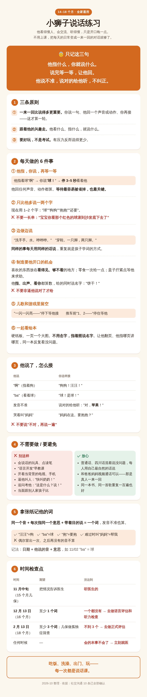

# 问答记录

每次单独问的问题和完整回答。**最新的在最上面**，时间为北京时间。与 `app.html`「问答」页签内容一致；新增问题时两处都加（格式：一句话结论 / 为什么 / 怎么做 / 常见误区 / 何时就医 / 相关图片）。

---

## 2026-10-12 16:22 · 喂养

**问**：之前一般一天拉一次，最多两次。开始喝新奶粉（爱他美）之后，这两天都是一天三次，最近一次是照片里这样（深褐色、糊状、量比较多），有问题吗？

### 1. 一句话结论

没有问题：这是正常范围内的糊状软便，颜色变深、次数变多都符合换奶后的预期；现在先停在转奶的当前这一步，等大便稳定 2–3 天再换下一顿。（置信度 中高）

### 2. 为什么：科学依据

- **照片里的便便：**深褐色为主，夹一些黄色，糊状、成堆，**不是水样**；看不到鲜红色的血丝、黑色柏油样的便，也看不到明显的黏液。白色的是尿不湿的内层。
- **一天 3 次在正常范围。**1–3 岁孩子从一天 3 次到 3 天 1 次都算正常。判断腹泻看的是**性状变稀成水、次数明显超过平时（通常一天 ≥ 3 次的稀水便）**，再加上精神、吃奶、尿量。他是糊状软便，不是水样。
- **为什么次数变多：**新奶粉里的益生元（低聚半乳糖 + 低聚果糖）每天约 7.5 g，是旧奶粉的接近 3 倍，再加上益生菌。益生元在肠道被发酵、吸水，会让大便变软、次数变多。这是这类奶粉很常见的变化，**一般 1–2 周稳定下来**。
- **为什么颜色变深：**新奶粉的铁比旧奶粉高（每 100 ml 1.5 mg，旧的约 0.9 mg），没吸收完的铁会让大便变成深褐、墨绿；蛋白质多、吃牛肉和深色叶菜也会让颜色更深。这和需要警惕的「黑便」不一样：后者是像沥青一样**黑亮、黏稠**的柏油样便。
- **黄色块：**多半是没完全消化的南瓜、红薯、胡萝卜之类，或者便便本身颜色不均，正常。
- **还要看的是全身情况：**精神好、吃奶吃饭正常、尿量正常、体重不掉，就说明肠道只是在适应，不是生病。

出处：

- 2026-10-11 换奶记录与新旧奶粉成分对比（见本页 10/11「换奶」那条）
- 《中国儿童急性感染性腹泻病临床实践指南》（2016）腹泻定义

### 3. 怎么做

**现在（转奶期间）**

- **先停在当前这一步**：已经换了几顿就保持几顿，不急着换下一顿；大便连续 2–3 天稳定（次数不再增加、不变成水样）再往下换
- 每顿照常按标准浓度冲（3 平勺 + 150 ml 水 / 4 平勺 + 200 ml 水），**不要冲稀**
- 这几天先不加新的辅食，也先少给苹果、梨、西梅这类容易让大便变稀的水果，方便看清是不是奶粉的原因
- **护臀**：次数多了，肛周皮肤容易红（他有湿疹，更要注意）——每次便后温水冲洗、拍干，厚涂含氧化锌的护臀膏
- 简单记一下：每天几次、什么样子（糊状 / 稀水）、精神和吃奶怎么样

**全部换完以后（第 1–2 周）**

- 一天 2–3 次糊状软便、精神吃奶都好，可以接受，不用处理
- 两周后通常会回到一天 1–2 次；没回到也不要紧，只要不是水样、体重正常增长
- 每月同一台秤称一次，体重增速 ≥ 0.2 kg/月 就说明吸收没问题

**如果一直偏稀（超过 2 周）**

- 先把转奶速度放慢一步（退回少换一顿），观察几天
- 仍然不行，带着大便照片和奶粉罐去儿保科问，看要不要换益生元少一些的奶粉

### 4. 常见误区

- ✗ 「一天拉 3 次就是拉肚子」 → ✓ 看性状不看次数，糊状软便一天 3 次是正常的。
- ✗ 「颜色变深发黑，是肠道出血」 → ✓ 铁多会让大便变深褐或墨绿；真正要警惕的是黑亮黏稠的柏油样便或带鲜血。
- ✗ 「新奶粉不适应，马上换回去」 → ✓ 换奶后便便变软、变多很常见，先放慢节奏观察，不必立刻换回。
- ✗ 「拉得多就把奶冲稀点」 → ✓ 冲稀会营养不够，不减轻症状，一律标准浓度。
- ✗ 「吃点止泻药或蒙脱石散」 → ✓ 这种情况不需要用药。

### 5. 什么情况需要就医

- 大便变成**水样**，一天 ≥ 3 次
- 大便有**鲜红血丝、果酱样，或黑亮黏稠的柏油样便**；明显的黏液
- 呕吐、发烧、精神差、哭闹不止
- **6–8 小时没有湿尿布**，或嘴唇干、哭时眼泪少
- 肛周红肿破皮、护臀膏处理两三天不好转
- 持续超过 2 周仍然偏稀，或体重不涨、下降

---

## 2026-10-11 22:23 · 日常

**问**：小狮子每顿基本靠大人喂，只有饼、香蕉这类能自己拿着吃。要不要有意识地培养他自己吃饭？

### 1. 一句话结论

要培养，但要慢慢来：每顿饭让他先自己吃一会儿，大人同时喂，两种方式并行；吃没吃够看每月体重，不看一顿吃了多少。（置信度 中）

### 2. 为什么：科学依据

- **这是儿保医嘱的要求。**8/15 一岁儿保写了「每餐 1–2 样手指食物」，我们的一周辅食方案也把它列为每周硬指标之一。
- **他现在的水平在正常范围里。**多数孩子 8–12 个月学会用手抓着吃，12–18 个月开始学用勺（会撒很多），18–24 个月大多能比较独立地自己吃。14 个月只会抓饼、抓香蕉，不算落后。
- **自己吃，就是自己决定吃多少。**国际上推荐的「顺应喂养」（WHO、中国居民膳食指南 7–24 月龄部分）核心是：大人决定给什么、什么时候给；孩子决定吃不吃、吃多少。自己动手吃，是这个原则最自然的落地方式，也和儿保医嘱「不追喂、不劝食」是同一个道理。
- **安全性有随机对照试验的数据。**新西兰 BLISS 研究（Taylor 等，2017，JAMA Pediatrics，206 个家庭）比较了「以孩子自己抓着吃为主」和传统勺喂：自己抓着吃的一组**没有增加噎食**，12 个月和 24 个月时的体重指数也没有差别。前提是食物按要求处理过（软、大小合适）。
- **长期好处的证据还弱。**「从小自己吃，长大就不挑食、不肥胖」这类说法，目前大多来自观察性研究，因果关系没被证实。所以这件事值得做，但不必当成任务，也不用焦虑。
- **为什么不能一下子全放手：**刚开始自己吃，进嘴的少、撒的多。他 5–6 月有过体重下滑，8/15 才回到「中等」。所以要大人喂和自己吃并行，用体重做检验。

出处：

- WHO：婴幼儿顺应喂养原则（Guiding principles for complementary feeding）
- 中国营养学会《中国居民膳食指南（2022）》7–24 月龄婴幼儿喂养指南
- Taylor RW 等, JAMA Pediatrics 2017（BLISS 随机对照试验）
- 2026-08-15 儿保医嘱（每餐 1–2 样手指食物、不追喂、每餐 20–30 分钟）

### 3. 怎么做

**现在（14–18 个月）：手指食物为主，开始练勺**

- **每餐先放 1–2 样手指食物在他面前**，让他自己先吃 5–10 分钟，再开始喂。可选：蒸软的胡萝卜条、西兰花小朵、红薯条、南瓜条，小肉丸，豆腐块，捏紧的小饭团，煮软的意面，切小块的香蕉、牛油果
- **两把勺子法**：他手里一把，你手里一把。你把饭舀好递到他手里，让他自己往嘴里送；你同时也喂
- **饭要稠，才舀得起来。**稠粥、软饭能粘在勺子上，稀粥他根本舀不住——这和我们要的稠度目标正好一致
- **和大人同桌、吃一样的饭菜**（单独做得软一点、不加盐），他会模仿大人
- 每餐 20–30 分钟，到点收；不看屏幕、不追着喂
- 顺带练用杯子喝水：敞口小杯或吸管杯，先从下午那顿奶开始

**18–24 个月：自己用勺为主，大人补**

- 多数饭让他自己用勺，大人只在他明显累了、或者剩下的时候帮几口
- 可以给有边的碗、防滑碗垫，让他更容易舀起来
- 开始让他用杯子喝大部分的水和奶

**2 岁以后：基本独立**

- 自己吃完整一顿；大人的角色变成一起吃饭、示范和聊天
- 可以开始练儿童叉子

**口周湿疹的护理（自己吃一定会弄脏脸）**

- **吃饭前先在口周涂一层润肤霜**，做隔离层
- **别吃一口擦一次嘴**——反复擦比食物本身更伤皮肤
- 吃完用温水轻轻拍洗，拍干后再涂润肤霜
- 暂避草莓、柑橘、番茄、猕猴桃这类酸性水果直接蹭到口周（这是化学刺激，不是过敏）

**怎么判断他吃够了**

- **看体重，不看一顿吃了多少。**每月用同一台秤、穿差不多的衣服称一次
- 增速 ≥ 0.2 kg/月 → 现在的比例没问题，继续
- 增速 < 0.2 kg/月 → 提高大人喂的比例，手指食物照样给，不要取消

### 4. 常见误区

- ✗ 「他自己吃会吃不饱，还是喂省事」 → ✓ 喂确实省事，但他会一直没机会练。**办法是两种方式并行**，不是二选一；吃够没有看体重。
- ✗ 「弄得满桌满脸，太脏了，等大一点再说」 → ✓ 弄脏是这个阶段学习的一部分。铺垫子、戴围兜，吃完一起收拾就行。
- ✗ 「自己吃容易噎着」 → ✓ BLISS 试验里，食物处理得当时噎食没有增加。关键在**食物软、大小对、坐着吃、有人看**。
- ✗ 「他不爱吃，追着多喂几口」 → ✓ 追喂会让孩子更抗拒吃饭，也学不会听自己的饥饱信号。**到点收，下一顿再吃**。
- ✗ 「咳一下就赶紧伸手抠出来」 → ✓ 咳嗽、干呕是正常的保护反应，伸手抠反而可能把东西推得更深。**能咳出声就让他自己咳。**

### 5. 什么情况需要就医

- **真噎住：发不出声音、咳不出来、脸色发紫** → 立即按婴幼儿海姆立克法急救并拨打 120（建议家里大人都学一次）
- 连续 2 个月体重增速 < 0.2 kg/月，或者体重百分位明显往下掉
- 吃饭时经常呛咳、吞咽困难，或者吃完经常吐
- 18 个月以后仍然完全不会用手抓东西吃

---

## 2026-10-11 22:23 · 喂养

**问**：正在把奶粉从飞鹤星飞帆卓睿 2 段换成爱他美澳洲白金 3 段。第一天只换了早上一顿，当天拉了 3 次，后两次比之前稍稀。和新奶粉有关吗？换完以后每天的营养会变吗？辅食要不要调整？

### 1. 一句话结论

可能和新奶粉有关，但这次的便便是正常的软便，不算腹泻，不用停，按顿慢慢换；换完以后每天总热量几乎不变，铁、DHA、碘明显变多，脂肪少了约 5 g，辅食要做三处小调整。（置信度 中）

### 2. 为什么：科学依据

- **便便本身正常。**照片里是黄绿色糊状软便，里面深绿色的碎片是没消化完的绿叶菜。没有水样、黏液或血。1 岁孩子一天拉 1–3 次软便都在正常范围。
- **新奶粉里有两样东西会让大便变软、次数变多。**一是益生元（低聚半乳糖 + 低聚果糖）：新奶粉每 100 ml 约 1.31 g，按每天约 570 ml 算是 **约 7.5 g**，旧奶粉每天只有约 2.6 g，接近 3 倍。益生元在肠道里被细菌发酵，会吸水、让大便变软。二是益生菌（短双歧杆菌 M-16V）。这种变化通常是暂时的，**一般 1–2 周稳定**。
- **但时间上不好下结论。**只换了一顿就有变化，时间太短，也可能是当天吃的水果、菜的影响，属于巧合。
- **过敏的可能很低。**两种奶粉都是牛奶蛋白，他喝了一年配方奶没问题，8/17 牛奶过敏原检测 0.03（阴性）。新奶粉配料里还有大豆卵磷脂和精炼鱼油，这两样含的蛋白极少，而且他大豆、鳕鱼检测也都是阴性。
- **营养为什么会变：**澳洲的「3 段」属于给 1–3 岁孩子的幼儿配方营养补充食品，组成更接近「加了强化的牛奶」——蛋白和钙多、脂肪少，铁和 DHA 加得也多。旧的星飞帆卓睿 2 段是给 6–12 个月宝宝的较大婴儿配方，脂肪更高。
- **每天从奶里得到的（按 10 平勺算）：**能量 406 → 400 kcal（几乎不变）；**铁 5.2 → 8.5 mg**；**DHA 82 → 170 mg**；碘 77 → 100 μg；钙 387 → 635 mg；蛋白质 9.9 → 14.0 g；**脂肪 18.5 → 13.0 g**；维生素 D 413 → 300 IU；维生素 A 387 → 385 μg（不变，加上 AD 制剂仍然超过上限）；钠 95 → 165 mg。
- **所以辅食的三处调整是这样推出来的：**① 脂肪少了约 5 g，所以油从 10 g 加到 12 g，补回一部分；② 奶里的铁已经从 5.2 涨到 8.5 mg，加上肉和谷物蔬菜每天约 11.7 mg（需求约 10 mg），强化铁米粉和鸭血就不再是必需的；③ DHA 已经到 170 mg（推荐约 100 mg），鱼不用再背「补 DHA」的任务。

出处：

- 爱他美澳洲白金 3 段、飞鹤星飞帆卓睿 2 段产品标签（营养成分表、配料表、冲调说明）
- 中国营养学会《中国居民膳食营养素参考摄入量（2023）》1–3 岁铁、维生素 A 上限等数值
- [ESPGHAN 2018 幼儿配方奶立场文件](https://pubmed.ncbi.nlm.nih.gov/29095351/)

### 3. 怎么做

**转奶期（第 1–7 天左右）**

- **按顿换，不按勺掺。**两种奶粉的勺子大小、加水量都不一样（旧：一平勺 8.6 g；新：一平勺 9.2 g 配 50 ml 水），一个奶瓶里掺两种粉很容易冲错浓度
- 他一天 3 顿奶，**每 3 天多换一顿**：第 1–3 天换早上 → 第 4–6 天加上下午 → 第 7 天起全换
- 便便偏稀，就在当前这一步**多停几天**，稳定了再往下换
- 转奶期间别同时加新的辅食，出问题才分得清是什么引起的

**换完以后：怎么冲**

- 07:30：**3 平勺 + 150 ml 水**（约 171 ml）
- 15:30：**3 平勺 + 150 ml 水**（约 171 ml）
- 20:00：**4 平勺 + 200 ml 水**（约 228 ml），喝完再刷牙
- 全天 10 平勺 = 92 g 粉 ≈ 570 ml（儿保医嘱约 600 ml）
- 用煮沸后放凉到 **40 °C 左右**的水（说明书要求，保护益生菌）；冲好 2 小时内喝完，喝剩的倒掉
- **只调勺数，不改浓度**——不要为了凑整多加半勺或少加水

**换完以后：辅食的三处调整**

- **油：每天 10 g → 12 g**（午、晚餐各 6 g）。仍在 5–15 g 的推荐范围内，不违反儿保医嘱的「少油」
- **强化铁米粉、鸭血：改为可选。**想吃就吃，都吃也只有约 14 mg 铁，离 1–3 岁上限 25 mg 很远；米粉拿来增稠仍然好用
- **鱼：**不用再为补 DHA 而加，但等皮肤稳定 1–2 周后，鱼仍排在新食物引入的第一位（好做、检测阴性）。**奶粉里的鱼油不算「已经引入了鱼」**
- **不变的：**红肉每周 ≥ 5 次（牛肉 ≥ 3 次）、深色叶菜每天、不加盐、每餐 1–2 样手指食物

**以后（2 岁前后）**

- 如果将来考虑换纯牛奶，前提和之前一样：查过铁蛋白且正常、鱼规律吃上、湿疹稳定（见 8/28 那条）
- 维生素 A 超量的问题换奶后没改善：**11 月儿保照样要问 AD 制剂还要不要吃**

### 4. 常见误区

- ✗ 「换奶后拉得多，就是不适应 / 过敏，赶紧换回去」 → ✓ 软一点、多一两次很常见，多半是益生元的作用。**看性状和精神**，不是看次数；只有出现下面就医那一栏的情况才需要停。
- ✗ 「拉稀了，把奶冲稀一点让肠胃休息」 → ✓ 冲稀会让他营养不够，也不能减轻腹泻。**无论什么时候都按标准浓度冲。**
- ✗ 「一次换完更省事」 → ✓ 一次全换，出问题分不清原因。按顿换只多花一周。
- ✗ 「新旧奶粉掺在一个瓶里过渡」 → ✓ 勺子和水量不同，掺着冲很容易浓度错。**按顿换**。
- ✗ 「3 段比 2 段营养更好」 → ✓ 段数对应的是年龄段的配方标准，不是好坏。这次换完铁和 DHA 变多、脂肪变少，各有增减，所以辅食要跟着调。

### 5. 什么情况需要就医

- 一天水样便 ≥ 3 次，或稀便持续超过 1–2 周
- 大便里有血或黏液
- 呕吐、发烧、精神差，或者尿明显变少（6–8 小时没有湿尿布）
- 喝完奶 2 小时内出现荨麻疹（风团）、嘴唇或眼睑肿、反复呕吐，或湿疹明显加重 → 停新奶粉并就医
- 体重增速变慢（< 0.2 kg/月）

---

## 2026-10-11 21:43 · 发育

**问**：小狮子 14 个月，走得很稳甚至能快走，但还不会有意识地叫人、说话，只会指着东西发出「啊」「哦」。10 个月时常模糊地叫妈妈、爸爸（无意识），现在平常基本不叫了；只在伤心或要不到东西时偶尔叫「妈妈」，而且奶奶、爸爸带的时候也叫「妈妈」。

### 1. 一句话结论

只是开口说话比一般孩子晚一些，不是倒退。当晚在家核对了社交沟通 10 条，全部都有，所以不需要提前挂号，11 月中旬儿保时告诉医生即可；在家每天多做「一来一回」的对话，按 16 个月、18 个月两个时间点检查。（置信度 中高）

### 2. 为什么：科学依据

- **第一步要分清：是「说得晚」还是「倒退」。**两者的处理完全不同。「已经会的本事不会了」在所有发育预警清单里都是最紧急的一条，CDC 的 15 个月清单也专门问这一句。所以一开始不能只靠描述就放心，而是先在家核对。
- **10 个月时的「妈妈爸爸」不是词。**那是 mamama、bababa 这种叠音式的牙牙学语，孩子在练发音，本身没有指向谁。真正的「倒退」指的是：有意义地用过的词不说了，或者眼神、对名字的反应、笑、模仿这些互动能力消失了。
- **现在难过时叫「妈妈」，反而往前走了一步。**这是带着目的在用（意思是「来帮我」「我要」），比 10 个月时无意识的发音更进一步。对奶奶、爸爸也叫「妈妈」，是早期词汇里很常见的「过度泛化」——先学会「我需要人」这个意思，还没对上具体是谁。
- **10 条全部都有，意味着什么：**会「指给你看」、指完回头看你（共同注意）；叫名字会回头；会对视、会笑；会顺着你的手指看；会拿东西给你看；会模仿；不靠手势也能听懂一部分话；还会发 ba、da、ma、ga；没有任何本事消失；对声音有反应。也就是说，**他看得懂人、会用眼神和手势交流、听得懂、没有倒退**。这个年龄，理解能力和手势交流是「说话晚的孩子能不能追上」最好的预测因素——这两样都好的孩子，大多会追上。
- **按国际里程碑他还在窗口里。**CDC 2022 版里程碑是按「至少 75% 的孩子能做到」来定的：15 个月「除了妈妈爸爸，试着说 1–2 个词」；18 个月「说 3 个以上的词」「指给你看有趣的东西」。也就是说，15 个月还没词的孩子本来就有约四分之一。8/15 的 DST 发育筛查智力分项是 15 个月水平，当时没通过的正是「有意识叫爸妈」，所以这不是新出现的问题。
- **「学走路的时候说话会停一停」——别拿这句话安慰自己。**这个说法证据很弱，甚至有研究方向相反：Walle & Campos 2014 发现，同样月龄里已经会走的孩子词汇反而更多。
- **「贵人语迟」只对一半。**多数说话晚的孩子确实能追上，但从外表看不出谁属于追不上的那一部分。所以要用固定的时间点去检查，而不是一直「再等等」。
- **为什么家里的对话最管用：**Romeo 等 2018 年的研究发现，和孩子语言脑区发育关系最密切的，不是大人一共说了多少词，而是**一来一回的对话轮次**。Sosa 2016（JAMA Pediatrics）观察 10–16 个月的孩子：玩会说话的电子玩具时，家长说话更少、对话轮次更少，孩子自己的发声也更少；看纸板书时最多。
- **16 个月这条线的出处：**经典的孤独症筛查「立即评估」红旗清单（Filipek 等，1999）里有一条是「16 个月仍没有任何单词」。原指南后来已被新版取代，但这个界值仍然被普遍沿用。清单里其他几条（12 个月有牙牙学语、有手势、没有任何技能丢失）他都已经过了，只剩「有没有词」这一条在等。

出处：

- [CDC · 15 月龄发育里程碑](https://www.cdc.gov/ncbddd/actearly/milestones/milestones-15mo.html)
- [CDC 2022 年里程碑修订（按 ≥75% 儿童能做到设定）](https://www.wafb.com/2022/02/24/cdc-updates-developmental-milestones-small-children)
- Romeo RR 等, Psychological Science 2018（对话轮次与语言脑区）
- [Sosa AV, JAMA Pediatrics 2016（电子玩具与亲子交流）](https://www.ovid.com/journals/japed/abstract/10.1001/jamapediatrics.2015.3753~association-of-the-type-of-toy-used-during-play-with-the?redirectionsource=fulltextview)
- Walle EA & Campos JJ, Developmental Psychology 2014（会走与词汇）
- [Filipek PA 等 1999 孤独症筛查与诊断实践参数（「立即评估」指征）](https://autism.unt.edu/images/pauline_filipek_-_typical_and_atypical_development_-_when_should_we_be_concerned-compressed.pdf)

### 3. 怎么做

**现在（14–16 个月）：每天做的 6 件事**

- **他指，你说，再等一等。**他指着球「啊」→ 你说「球！」→ **停 3–5 秒**，看着他等他回应。他回任何声音、动作都算，接着往下说。等待是最容易被省掉、但最关键的一步
- **只比他多说一两个字。**现在用「球」「狗狗」「抱抱」「还要」；等他会说「球」了，再说「红球」「球滚了」。不要一长串
- **边做边说。**洗澡、穿衣、吃饭、出门时用短句：「洗手手。水。哗哗哗。」「穿鞋。一只脚，两只脚。」**同样的事每天用同样的话**，重复就是孩子学词的方式
- **制造需要开口的机会。**把喜欢的东西放在看得见、够不着的地方；零食一次给一点；盖子拧紧点等他来找你。他**指、出声、看你**都算数，给他的同时说出名字。**不要非逼他说对了才给**
- **儿歌和游戏里留空。**「一闪一闪亮——」停下来等他接；推车前数「1、2——」停住等他
- **一起看绘本。**硬纸板、一页一个大图；不用念字，指着图说名字；让他翻页，他指哪页讲哪页，同一本反复看完全没问题

**他说了，怎么接**

- 他「啊」（指着狗）→「狗狗！汪汪！」
- 他「ba」（看着球）→「球！是球！」
- 他发音不准 →「对，**苹果**！」（把对的说一遍，**不纠正**）
- 他哭着叫「妈妈」→「妈妈在这。要抱抱？」（把他的意思说出来）

**在家记词**

- **一个词的标准：**同一个音 + 每次都指同一个意思 + 带着目的说 = 一个词，**发音不准也算**。「汪汪」指狗、「ba」指球、「抱」要抱都算；难过时叫「妈妈」（意思是帮我）可以算 1 个
- 偶尔冒出一次、之后再也没有的音不算
- 拿张纸记：日期 + 他说的音 + 意思，例如 11/02「ba」= 球

**16–18 个月**

- 继续上面的做法；词开始出现后，在他的词后面加一个字扩展（「球」→「球滚了」）
- **12 月 13 日（16 个月）检查：**至少有 1 个词
- **2 月 13 日（18 个月）检查：**至少 3 个词；18 个月儿保会做孤独症筛查（M-CHAT-R）

**18–24 个月**

- 一般这段时间词汇会快速增加；2 岁左右开始把两个词连起来说（「妈妈抱」「还要球」）
- 继续一来一回的对话、读绘本；多问「你要哪个？」这类给选择的问题

**给奶奶和其他带他的人：只记三句**

- 他指什么，你就说什么
- 说完等一等，让他回
- 他说不准，说对的给他听，不纠正

### 4. 常见误区

- ✗ 「贵人语迟，男孩说话都晚，再等等」 → ✓ 多数确实会追上，但看不出谁是例外。**按时间点检查，比一直等更安全。**
- ✗ 「学走路时说话会停一停」 → ✓ 证据很弱，甚至有研究方向相反（会走的孩子词汇更多）。
- ✗ 「普通话和四川话混着说，会让他说话晚」 → ✓ **不会**，多语言环境不是说话晚的原因。每个人用自己最自然的话说就好。
- ✗ 「买会说话的玩具、点读笔、报语言课帮他」 → ✓ 会说话的玩具反而让大人说得少；这个年龄最好的语言输入是家里人跟他一来一回。
- ✗ 「逼他叫人：快叫奶奶！不叫不给」 → ✓ 有压力反而说得更少。把开口变成好玩、有用的事。
- ✗ 「他说错了要纠正」 → ✓ 纠正会打击开口的意愿。**你说一遍对的就够了。**
- ✗ 「开着电视他也在听，算语言输入」 → ✓ 背景电视会挤掉大人跟他说话的时间，2 岁前从屏幕学词的效果远不如真人。视频通话例外，那是真人互动。

### 5. 什么情况需要就医

- **任何时候：会的本事不会了**（不再对名字反应、不再对视、不再模仿、已经会的词不说了）→ 立刻就医，挂儿童保健科或发育行为儿科
- **16 个月（12 月 13 日）还一个词都没有** → 去做正式的语言评估和听力检查
- **18 个月（2 月 13 日）不到 3 个词**，或 18 个月儿保孤独症筛查提示异常 → 正式评估
- 对声音反应变差，或反复感冒后好像「听不太清」→ 查听力（含鼓室图，排除中耳积液）
- 就诊时带上 2–3 段他指东西、被叫名字、玩耍的短视频——医生在诊室只能看到几分钟

### 6. 相关图片

> 后续更新：2026-10-11 22:04：家里核对社交沟通 10 条，全部都有 → 由「可能需要马上查」降为「按时间点检查」。

---

## 2026-10-11 21:43 · 日常

**问**：小狮子平常的餐具、奶瓶需要每次都消毒吗？尤其是紫外线消毒？

### 1. 一句话结论

不需要每次消毒，紫外线消毒也不是必需的；14 个月的健康孩子，每次用完及时彻底洗干净、完全晾干就够了，只在生病、腹泻、新买的时候再消毒。（置信度 中高）

### 2. 为什么：科学依据

- **CDC（美国疾控中心）的建议：**喂养用品每次用完都要清洗；至少每天消毒一次，主要针对 **2 个月以下、早产或免疫力低下**的婴儿；对较大的健康婴儿，**如果每次都认真清洗，消毒可能并不必要**。洗完要自然晾干，不要用抹布擦。
- **为什么大孩子不用天天消毒：**14 个月的孩子到处摸、什么都往嘴里放，免疫系统也比新生儿成熟得多。奶瓶上残留的细菌，主要靠「洗干净 + 晾干」去掉——细菌靠奶垢和水分生长，把这两样去掉就切断了它的条件。
- **紫外线的局限：**紫外线只对直接照得到的表面有效。奶嘴内腔、螺纹、互相遮挡的地方照不到；它也去不掉奶垢和油膜，而细菌恰恰藏在奶垢里。长期照射还可能让部分塑料、硅胶发黄变脆（以各产品说明书为准）。
- **真正的风险在别处：**喂养相关的感染，更常见的来源是冲好的奶放太久、生熟砧板混用、剩饭常温放置。把精力花在这些地方，比每次消毒更有效。
- **按我们的决策方法：**每次消毒要花不少时间，而少做它的下行风险小、可逆，属于「代价大 × 可逆」——不必当成任务。

出处：

- [CDC · 婴儿喂养用品的清洗、消毒与存放](https://www.cdc.gov/hygiene/about/clean-sanitize-store-infant-feeding-items.html)

### 3. 怎么做

**每次用完怎么洗（现在开始一直适用）**

- 用完**马上冲一下**，别让奶干在瓶壁上
- **奶瓶、奶嘴、螺圈、阀门全部拆开**
- 热水 + 洗洁精，用奶瓶刷和奶嘴刷，**重点刷奶嘴孔和螺纹**
- 冲干净 → 放在干净的晾架上**自然晾干**，不用抹布擦 → 完全干了再收起来
- 餐具：正常洗碗即可；洗碗机可以用

**这些时候仍要消毒**

- 他生病、腹泻期间和刚好之后
- 新买的奶瓶、餐具第一次用
- 用水不可靠（比如外出时）
- 方法任选：**煮沸 5 分钟** / 蒸汽消毒器 / 洗碗机高温档

**已经有紫外线消毒柜的话**

- 当**烘干收纳柜**用很好——烘干是它最有用的功能
- 放进去之前必须先洗干净
- 运行时别开门看（紫外线伤眼伤皮肤）

**12–18 个月：从奶瓶过渡到杯子**

- 一般建议 1 岁开始、1 岁半前后完成；8/15 儿保医嘱也写了练用杯子
- 先从下午 15:30 那顿换成吸管杯或敞口杯，再换早上，睡前那顿最后换
- 奶瓶用得少了，消毒这件事自然就小了；睡前抱着奶瓶喝对牙齿的风险也一起降低

**比消毒更值得花精力的**

- 冲好的奶 **2 小时内喝完，喝剩的倒掉**，不留到下一顿
- 生肉和熟食的**砧板、刀分开**
- 剩饭及时冷藏，再吃要热透；开封的鸭血冷藏、3 天内用完

### 4. 常见误区

- ✗ 「不每次消毒就不卫生」 → ✓ 对 14 个月的健康孩子，洗干净 + 晾干就够了。真正容易出问题的是放久的奶和剩饭。
- ✗ 「紫外线柜能杀死所有细菌」 → ✓ 只照得到表面，奶嘴内部、螺纹照不到，也去不掉奶垢。**必须先洗干净**。
- ✗ 「洗完用干净抹布擦干更快」 → ✓ 抹布本身容易带菌。**自然晾干**。
- ✗ 「消毒了就不用洗」 → ✓ 消毒不能代替清洗，奶垢不刷掉，消毒效果也打折。

### 5. 什么情况需要就医

- 这一条本身不涉及就医。如果出现腹泻、呕吐，按腹泻那一条（8/15）的就医标准处理，并在那段时间恢复消毒

---

## 2026-08-31 21:15 · 日常

**问**：小狮子现在用的这款牙膏（KODOMO，含氟 0.05%），他还不会漱口和吐水，会有什么影响吗？应该怎么办？

### 1. 一句话结论

不会吐、不会漱口完全没问题，用量对了吞下去也安全；真正的问题是这支牙膏氟浓度偏低（500 ppm），建议换成 1000–1100 ppm 的含氟牙膏，每次米粒大小，睡前那顿奶之后刷。（置信度 中高）

### 2. 为什么：科学依据

- **吞下去为什么安全——算一笔账：**米粒大小的牙膏约 0.1 g。按 1000 ppm 算，一次含氟 0.1 mg，一天 2 次全部吞下是 0.2 mg。长期摄氟超过约 0.05–0.07 mg/kg/天才有氟斑牙风险，按他约 9.5 kg 算，风险线是 0.47–0.66 mg/天。**全吞下也只有风险线的 30–43%**；现在这支 500 ppm 的只有 15–21%。
- **「米粒大小」本来就是按孩子会吞下设计的。**中华口腔医学会和国际指南都建议 3 岁以下用米粒大小，正是因为知道这个年龄的孩子不会吐。
- **不漱口反而更好。**大孩子和大人的建议是「吐掉，但不漱口」——因为氟要留在牙面上持续起作用，漱口会把它冲走。
- **为什么要换浓度：**Cochrane 系统综述（Walsh 等，2019）汇总了大量随机对照试验：**低于 1000 ppm 的含氟牙膏，防蛀效果和无氟牙膏没有显著差别**；1000 ppm 以上才有明确效果。标签上「氟 0.05%」= 500 ppm。
- **标签怎么换算：**氟 0.10% = 1000 ppm；氟 0.11% = 1100 ppm；**氟化钠 0.22% ≈ 1000 ppm**（氟化钠里氟约占 45%）。很多产品只标氟化钠，别误以为 0.22% 比 0.05% 高很多倍——它就是 2 倍。
- **这支牙膏做对的一点：无香型。**他口周有湿疹，香精和调味剂可能刺激皮肤；没有甜味也减少了「好吃想多吞」的动机。换的时候最好也选无香或低香的。
- **睡前顺序很关键：**如果先刷牙后喝奶，奶会在牙面上留一整夜，而夜里唾液少，是蛀牙风险最高的时段。

出处：

- Walsh T 等, Cochrane Database of Systematic Reviews 2019（不同浓度含氟牙膏防龋）
- 中华口腔医学会儿童口腔保健建议（3 岁以下米粒大小含氟牙膏）

### 3. 怎么做

**现在到 3 岁**

- 换成标签写 **「氟 0.10–0.11%」或「氟化钠 0.22%」**的儿童牙膏，最好无香/低香
- 每次**米粒大小**（约 0.1 g），每天 2 次；**睡前那次最重要**
- **顺序：20:00 喝完睡前奶 → 刷牙 → 睡觉**，刷完只给白水
- **大人刷，不需要他配合。**让他躺下、头枕在你腿上，你从上往下看才看得清；两个大人可以「膝对膝」坐，孩子躺在两人腿上
- 软毛、小头的婴幼儿牙刷；不必追求 2 分钟，**重点是上门牙外侧和牙龈交界处**（这个年龄最容易蛀的地方）
- 他挣扎哭闹很正常，**不要因此跳过**
- 不会吐就不吐，不用教漱口

**3–6 岁**

- 用量增加到**豌豆大小**（约 0.25 g）
- 开始教他吐掉，但**不用清水漱口**
- 仍由大人刷或大人帮着刷第二遍，直到他能自己刷干净（一般 6–8 岁）

**其他护牙习惯**

- **不含着奶瓶入睡**；12–18 个月逐步从奶瓶过渡到杯子
- 1 岁后每半年看一次牙医（儿童口腔科），可以做涂氟

### 4. 常见误区

- ✗ 「孩子会吞，所以要用无氟牙膏」 → ✓ 用量对了吞下去是安全的；无氟牙膏几乎没有防蛀作用。
- ✗ 「儿童牙膏氟越低越安全，越好」 → ✓ 低于 1000 ppm 防蛀效果和无氟差不多，等于白刷。
- ✗ 「要等他学会漱口再用含氟牙膏」 → ✓ 不需要等，米粒量就是为不会吐的孩子设计的；不漱口反而更好。
- ✗ 「先刷牙再喝睡前奶」 → ✓ 奶会留在牙上一整夜。**喝完奶再刷**。
- ✗ 「乳牙反正要换，蛀了没关系」 → ✓ 乳牙蛀了会疼、影响吃饭，还可能影响下面恒牙的发育和排列。

### 5. 什么情况需要就医

- 牙齿上出现**白色粗糙的斑块**（早期蛀牙）、黄褐色或黑色的点、牙洞 → 看儿童口腔科
- 牙龈红肿、出血或有小脓包
- 没有问题也建议 1 岁后每半年看一次儿童口腔科

---

## 2026-08-28 22:16 · 喂养

**问**：小狮子一岁以后继续喝配方奶，还是换纯牛奶？如果换成纯牛奶，辅食和补剂要做哪些调整？

### 1. 一句话结论

暂时继续喝配方奶；等三个条件都满足（查过铁蛋白且正常、鱼已经规律吃上、湿疹稳定）后，可以换全脂纯牛奶，每天不超过 500 ml，同时 AD 制剂变成必需、铁要靠辅食补足。（置信度 中高）

### 2. 为什么：科学依据

- **配方奶不是「更有营养」，是「营养打包器」。**欧洲儿科胃肠肝病与营养学会（ESPGHAN）2018 年的立场文件：1–3 岁儿童没有常规喝幼儿配方奶的必要；它可以作为一种方式，用来提高铁、维生素 D、n-3 脂肪酸（DHA）的摄入。但这些营养也可以从食物、强化食品或补充剂里获得。
- **美国儿科学会（AAP）：**12 个月起可以喝全脂牛奶，作为均衡饮食的一部分；12–24 个月用全脂、无调味的牛奶。
- **为什么对小狮子来说现在不是换的时机：**配方奶打包的这三样——铁、维生素 D、DHA——恰好都是他的薄弱项：① 当时配方奶贡献了他近一半的铁，而**血清铁蛋白从来没查过**，不知道铁储备够不够；② 鱼还没引入，DHA 主要靠奶；③ 他的 25(OH)D 43.29 充足，但有相当一部分是配方奶撑着的。
- **中国的纯牛奶和国外不一样：**国外资料默认牛奶强化了维生素 D（美国是强制的），**中国的纯牛奶大多不强化**。
- **纯牛奶对铁不友好：**纯牛奶几乎不含铁（每 500 ml 约 0.5 mg），钙含量高还会抑制辅食里非血红素铁的吸收；每天喝太多（超过 500–600 ml）还和幼儿隐性肠道失血、缺铁有关。
- **一个反直觉的好处：**换纯牛奶会让维生素 A 从约 987 降到约 735 μg（因为牛奶里的维生素 A 比配方奶少），这是维生素 A 超量问题的一个解决方向。但同时 AD 制剂就从「可能多余」变成「必需」（为了维生素 D）。

出处：

- [ESPGHAN 2018 幼儿配方奶立场文件](https://pubmed.ncbi.nlm.nih.gov/29095351/)
- [AAP · Older Infant-Young Child "Formulas"（Pediatrics 2023）](https://publications.aap.org/pediatrics/article/152/5/e2023064050/194469/Older-Infant-Young-Child-Formulas)
- [Feeding Infants and Children from Birth to 24 Months · 现行推荐汇总](https://www.ncbi.nlm.nih.gov/books/NBK561312/)

### 3. 怎么做

**现在（1–1.5 岁）：继续配方奶**

- 按现行方案冲（现在是爱他美澳洲白金 3 段，3 + 3 + 4 平勺，水 150/150/200 ml）
- **11 月儿保查血清铁蛋白**——这是换不换的第一个前提
- 皮肤稳定 1–2 周后开始引入鱼，并规律吃上

**三个条件都满足后：怎么换纯牛奶**

- **选：**全脂；配料表只有「生牛乳」；巴氏杀菌或常温奶都可以
- **不要：**调制乳、含乳饮料、「儿童成长奶」（多数加糖、加香精）
- **一顿一顿换：**先换一顿（比如下午那顿），观察 3–5 天，再换下一顿
- **每天总量不超过 500 ml**，用杯子喝

**换了以后：辅食和补剂怎么调**

- **维生素 D：**AD 制剂必须每天吃，确认维生素 D ≥ 400 IU
- **铁：**红肉每天有、牛肉优先；强化铁米粉每天 20–25 g；鸭血每周 2–3 次；每餐配西兰花、彩椒等富含维生素 C 的蔬菜；奶和正餐隔开。**问医生要不要加补铁剂**
- **DHA：**每周 2–3 次富脂鱼（三文鱼这类，鳕鱼的 DHA 低得多）
- **能量：**纯牛奶比配方奶每天少约 80 kcal，油维持 10–12 g、加餐略加
- **换完后复查血常规**，看血红蛋白和红细胞大小有没有变化

**2 岁以后**

- 可以考虑低脂奶（有肥胖或心血管家族史时尤其）
- 奶量每天 300–500 ml 即可，更多营养来自正餐

### 4. 常见误区

- ✗ 「配方奶比纯牛奶营养好，能喝多久喝多久」 → ✓ 1 岁后它不是必需品，是营养打包工具。能从食物拿到铁、维 D、DHA，纯牛奶完全够用。
- ✗ 「纯牛奶越多越好，补钙长个」 → ✓ 超过 500 ml 会挤掉辅食、影响铁吸收，和缺铁有关。
- ✗ 「儿童成长奶是专门给孩子的，更好」 → ✓ 多数是调制乳，加了糖和香精，营养反而不如纯牛奶。
- ✗ 「国外说喝牛奶就够维 D 了」 → ✓ 国外牛奶强化了维 D，**国内大多没有**，换了牛奶就得靠 AD 制剂。

### 5. 什么情况需要就医

- 换奶后出现面色苍白、乏力、食欲下降 → 查血常规和铁蛋白（可能缺铁）
- 换奶后反复腹泻、便血、呕吐、皮疹 → 停换并就医
- 复查血红蛋白下降或红细胞变小（MCV 降低）→ 换回配方奶或在医生指导下补铁

> 后续更新：2026-10 已换成爱他美澳洲白金 3 段（幼儿配方），铁和 DHA 都比原来的奶粉高，这条结论不变。

---

## 2026-08-24 02:49 · 用品

**问**：小狮子在这个阶段，有什么值得买的玩具吗？

### 1. 一句话结论

玩具不会让他更聪明，买它的理由就是好玩、能一起玩；如果只买三样，买套杯、几本厚纸板书、一个带阻尼的推行玩具，要明确避开的是会说话的电子玩具和几类危险品。（置信度 中）

### 2. 为什么：科学依据

- **玩具不会让孩子更聪明。**具体技能的练习有效——给他球，他会更会玩球——但效果只局限在那项技能，不会泛化成「更聪明」。认知训练研究里「远迁移」一再失败，所以「早教玩具」「潜能开发」不值得花钱。
- **但不是说不用买。**买玩具的理由可以就是他玩得开心、我们一起玩——亲子一起玩本身就是目的。
- **唯一有实证的一条：别买电子发声玩具。**Sosa 2016（JAMA Pediatrics）观察 10–16 个月的孩子和家长在家玩：玩电子玩具时，家长说的词、对话轮次、回应都更少，孩子自己的发声也更少；看纸板书时最多。样本 26 对，但每对亲子三种都玩过，比较可靠。**会说话的玩具，恰恰在替大人说话**——这对正在练说话的小狮子尤其相关。
- **学步车和推行玩具不一样：**学步车是孩子坐进去、带轮子滑，和摔伤、运动发育延迟有关（加拿大已立法禁售），儿保医嘱也写了「不用学步车」；推行玩具是孩子站在后面推，医嘱推荐防侧翻的。
- **毛绒玩具：**是尘螨的主要藏身处，他有湿疹、妈妈有过敏性鼻炎。但避开尘螨能否改善湿疹证据弱，所以不是不能买，而是少而精、选能机洗的。

出处：

- [Sosa AV, JAMA Pediatrics 2016（玩具类型与亲子交流）](https://www.ovid.com/journals/japed/abstract/10.1001/jamapediatrics.2015.3753~association-of-the-type-of-toy-used-during-play-with-the?redirectionsource=fulltextview)
- 2026-08-15 儿保医嘱（防侧翻助步推车，不用学步车）

### 3. 怎么做

**现在（12–18 个月）**

- **套杯**：叠、套、装进倒出，练手
- **几本厚纸板书**：一页一个大图，他能自己翻
- **带阻尼、防侧翻的推行玩具**：练走路
- 球、能敲的小鼓、装进拿出的盒子；家里的锅碗瓢盆也是好玩具
- 毛绒玩具少而精，选能整只机洗的；优先木质、硅胶、塑料这类好清洁的

**18–24 个月**

- 大颗粒积木、形状配对盒、2–4 块的简单拼图
- 玩具餐具、娃娃，开始假装游戏
- 粗的、可水洗的蜡笔涂鸦

**2–3 岁**

- 更多块的拼图、搭建积木、滑板车或平衡车（戴头盔）
- 角色扮演、简单的桌面游戏

**比玩具更重要的**

- **大人陪着一起玩**，边玩边说，这也是语言练习
- 玩具不用多，轮换着拿出来更能吸引他

### 4. 常见误区

- ✗ 「早教玩具能开发智力」 → ✓ 没有证据支持。
- ✗ 「会说话、会唱歌的玩具能教他说话」 → ✓ 研究显示反而让大人和孩子都说得更少。
- ✗ 「学步车能帮他早点走」 → ✓ 和运动发育延迟、摔伤有关，医嘱写了不用。
- ✗ 「玩具越多越好」 → ✓ 太多反而分散注意力，少而轮换更好。

### 5. 什么情况需要就医

- **怀疑误吞纽扣电池** → 立即去急诊，几小时内就可能损伤食道
- **误吞 2 颗以上磁力珠** → 立即急诊（会隔着肠壁互相吸引造成穿孔，症状常延迟出现）
- 误吞小件后呛咳、呼吸困难、流口水、拒食、呕吐 → 急诊
- 预防：家里不放磁力珠；带电池的玩具确认电池仓要用螺丝刀才能打开；3 岁前不给能整个穿过卫生纸筒芯（约 4 cm）的小件

---

## 2026-08-23 16:46 · 用品

**问**：这个年龄的宝宝需要用枕头吗？如果需要应该用什么枕头？

### 1. 一句话结论

1 岁不需要枕头，不给就是最好的选择；真要给，等到 2 岁前后，选薄、平、偏硬的，任何年龄都不要用婴儿定型枕。（置信度 高）

### 2. 为什么：科学依据

- **解剖上就不需要。**大人需要枕头，是因为肩比头宽，平躺时头会往后仰。小孩正好相反：头相对大、肩窄，**平躺时头本身就是最高点，平面就是他的中立位**。垫个枕头反而把头顶起来，让脖子往前弯。
- **颈椎弧度是自己长出来的。**脖子那个向前的弧度，是随着抬头、坐、爬、走自然形成的，不需要枕头去「塑造」。所以常听的「不用枕头会影响颈椎发育」方向是反的。
- **安全：1 岁是分界线，但不是「需要」的分界线。**12 个月前国内外安全睡眠建议一致是空床（无枕头、无被子、无床围、无毛绒玩具）。12 个月后窒息风险明显下降（会翻身、会挪开东西），但不是零。**风险下降只说明给了不至于出事，不说明需要给。**
- **定型枕有明确的安全警告。**美国 FDA 2022 年 11 月发布安全通告：婴儿定型枕（号称能睡出好头型的枕头）是未经批准的医疗器械，**没有任何医疗获益，有窒息和死亡风险**。
- **按我们的决策方法：**不给枕头代价几乎为零，以后想给随时能给；给枕头的好处没被证实，下行风险里有窒息这种不可逆的事。这种情况不需要等更多证据就能定。

出处：

- [FDA 婴儿定型枕安全通告（2022-11）· AAP News 报道](https://publications.aap.org/aapnews/news/22583/Infant-head-shaping-pillows-can-cause-suffocation)
- [Stanford Children's Health · 安全睡眠环境](https://healthier.stanfordchildrens.org/en/creating-a-safe-sleep-environment-for-your-baby/)

### 3. 怎么做

**现在（1–2 岁）**

- **不用枕头**，直接睡在平整、偏硬的床垫上
- 怕出汗：在床单上**平铺**一条纯棉薄毛巾（平铺，不是团起来垫在头下），脏了就换
- 床上尽量少放软东西（大毛绒玩具、厚靠垫、床围）

**2 岁前后到 3 岁**

- 如果他转到儿童床后自己老往软东西上凑，可以给一个枕头
- 选：**薄（压实后 2–3 cm 左右）、平、偏硬**、透气、能整个机洗
- 不选：定型枕、中间凹的「护头枕」、荞麦壳等容易漏出小颗粒的

**3 岁以后**

- 枕头高度大致和他侧躺时肩到耳的距离差不多，随身高调整

### 4. 常见误区

- ✗ 「不用枕头会驼背、影响颈椎」 → ✓ 方向反了，小孩平躺时平面就是中立位。
- ✗ 「定型枕能睡出好头型」 → ✓ FDA 明确警告：没有获益，有窒息风险。
- ✗ 「出汗多要用枕头吸汗」 → ✓ 平铺一条薄毛巾就行，比枕头简单也安全。
- ✗ 「1 岁以后就该用枕头了」 → ✓ 1 岁后只是风险下降，不代表需要。

### 5. 什么情况需要就医

- 头型明显不对称、一侧扁平且越来越明显，或者总是偏向一侧睡、脖子转动受限 → 看儿保科或小儿骨科（可能是斜颈）
- 医生因为反流等原因建议抬高头部时，做法是**把整个床垫一端垫高**，不是垫枕头

---

## 2026-08-17 23:05 · 喂养

**问**：基于现在所有的情况，重新安排一个一周的辅食计划表（之后又追问了：早餐和加餐能不能换、作息、酸奶和配方奶能不能一起、鸭血买哪种、奶粉怎么冲、蓝莓给多少、米面要不要称干重、牛油果不爱吃怎么换）。

### 1. 一句话结论

不钉死菜单，守住每周几条硬指标，具体吃什么按能买到的、他爱吃的换；一天 3 顿奶 + 3 顿饭 + 加餐，饭要稠（勺子舀起来能立住），完整的一页版见辅食页。（置信度 中高）

### 2. 为什么：科学依据

- **依据的是 8/15 儿保医嘱：**奶约 600 ml、3 正餐 + 2 加餐、少油少盐少糖、不追喂、每餐 20–30 分钟、每餐 1–2 样手指食物。
- **为什么不钉死菜单：**家长提的一点很对——孩子有不爱吃的（比如牛油果），市场上能买到的东西也在变。真正决定营养的是几个「量」（铁、油、蛋白、稠度），不是具体哪道菜。所以改成「配餐公式 + 食材库 + 每周硬指标」，示例周只当参考。
- **为什么稠度是第一位：**一岁孩子一顿胃容量约 250–270 ml，装不下更多体积。稀到滴水的粥约 0.35–0.5 kcal/g，勺子能立住的稠粥或软饭约 0.9–1.1 kcal/g——**同一碗，热量差一倍**。之前体重停滞，追不回来的主要原因就在这里。
- **为什么酸奶奶酪不和配方奶同一顿：**同一顿既给配方奶又给酸奶，奶制品总量和钙会集中在一顿，还会挤掉别的食物。所以酸奶、奶酪放在 10:00 那顿（那顿本来没有配方奶）。——这个问题是我第一版计划里自己排错的，家长指出后改了。
- **铁是这份计划最要盯的一项。**当时奶从 720 减到约 600 ml，奶里的铁跟着减少，所以靠强化铁米粉（每周 5 次）和鸭血（每周 2 次）补。鸭血一开始我按《中国食物成分表》约 30 mg/100 g 推荐，实际能买到的产品（象大厨嫩鸭血，鲜鸭血 ≥ 50%）标注 14.9 mg/100 g——一半是水，所以用量提到 30 g，重算铁账，周平均约 10.5 mg/天（需求约 10 mg）。
- **不用肝脏补铁：**配方奶 + AD 制剂的维生素 A 已经超过 1–3 岁上限（约 700 μg），猪肝每 100 g 约 5000 μg，不能再叠加。
- **窒息安全：**整颗蓝莓、葡萄的大小形状正好能堵住幼儿气道，必须切开。——第一版计划里我漏标了这一条。

出处：

- 2026-08-15 儿保医嘱
- 中国营养学会《中国居民膳食指南（2022）》7–24 月龄婴幼儿喂养指南
- 《中国食物成分表（第 6 版）》
- 象大厨嫩鸭血产品标签（铁 14.9 mg/100 g，钠 219 mg/100 g）

### 3. 怎么做

**每天的时间表（按他的作息：约 7:30 醒、13–15 点午睡、约 21 点睡）**

- 07:30 早餐：配方奶 + 冷食（全麦面包条、香蕉、蒸南瓜条），**早上不用开火**
- 10:00 加餐：水果 / 无糖全脂酸奶 100 g / 婴儿奶酪 10 g（**酸奶奶酪只放这一顿**）
- 11:45 午餐：正餐
- 15:30 加餐：配方奶 + 少量水果或蒸薯条
- 17:30 晚餐：正餐
- 20:00 睡前：配方奶 → 刷牙 → 约 21:00 睡

**每顿正餐怎么配**

- 公式：**主食 ＋ 蛋白 30–35 g ＋ 蔬菜 35–50 g ＋ 油 6 g**
- 主食任选：软饭（大米 20 g，米水比 1:2.5~3）、稠粥（米水比 **1:4~5，不是 1:10**）、面条（挂面 20 g，剪成 1–2 cm）、软面片、小馄饨
- 南瓜、山药、土豆、红薯算主食，不算蔬菜；用它们时主食减半
- 蛋白任选：牛肉、猪瘦肉、鸡腿肉、鸭肉、鸭血、北豆腐 50 g；剁碎成小块，不用打成泥
- 蔬菜任选：小白菜、油菜、菜心、菠菜（焯水）、西兰花、彩椒、胡萝卜、西葫芦、蘑菇；深色叶菜优先，西兰花和彩椒配肉能帮助吸收铁
- 勺子测试：舀起来能立住、慢慢往下坠才合格

**每周要守的硬指标（菜可以随便换）**

- 红肉每周至少 5 次，其中牛肉至少 3 次
- 深色叶菜每天至少 1 次
- 油每天 12 g（2026-10 换奶后由 10 g 调整）
- 每餐 1–2 样手指食物
- 强化铁米粉、鸭血：2026-10 换奶后改为可选

**加餐和分量**

- 香蕉半根；蓝莓 10–15 颗，**每颗纵向切开**；蒸南瓜条、红薯条 40–50 g
- 无糖全脂酸奶 100 g（配料只有生牛乳 + 菌种）；婴儿奶酪 10 g
- 牛油果不爱吃就换掉：换奶酪，或者把正餐的油稍微多放一点

**鸭血怎么买、怎么用**

- 看配料表：只有鸭血、水、少量盐或凝固剂的才买；淀粉排前面、添加剂多的火锅血旺不要
- 冷藏盒装、正规品牌，**必须彻底煮透**，切 0.5 cm 小块
- 开封后冷藏、3 天内用完、**不能冷冻**；用不完分给大人吃
- 钠偏高（30 g 约 66 mg），吃鸭血那天不再加盐；买不到就用猪血

**以后（18–24 个月）**

- 逐渐过渡到和大人吃差不多的家常饭（少盐少糖少油炸），切小块
- 手指食物比例越来越高，最终自己用勺吃完整顿

### 4. 常见误区

- ✗ 「吃不下就多喂几口」 → ✓ 胃容量是硬约束，**要加的是稠度和油，不是量**。
- ✗ 「少油就是只放几滴」 → ✓ 1–2 岁推荐每天 5–15 g 油，几滴远远不够。
- ✗ 「猪肝补铁最好，每周吃」 → ✓ 他维生素 A 已经超上限，不用肝脏。
- ✗ 「菜单要严格照着做」 → ✓ 守住硬指标就行，具体菜可以按季节和他的喜好换。
- ✗ 「酸奶和配方奶一起喝更有营养」 → ✓ 分开放，避免一顿奶制品过量、挤掉别的食物。

### 5. 什么情况需要就医

- 连续 2 个月体重增速 < 0.2 kg/月，或百分位明显下降
- 吃完某种食物 2 小时内出现荨麻疹、嘴唇眼睑肿、反复呕吐 → 停这种食物并就医；有呼吸困难立即急诊
- 持续拒食、吞咽困难、经常呛咳

> 后续更新：2026-10 换爱他美后：奶的冲法改为 3+3+4 平勺、水 150/150/200 ml；油 10 → 12 g；强化铁米粉和鸭血改为可选。完整一页版见同文件夹的 feeding-week.html。

---

## 2026-08-17 22:36 · 皮肤

**问**：特应性皮炎治疗进入第三阶段，上周三开始只擦克立硼罗，周四从嘴唇周围开始泛红起疹子，这两天逐渐扩展到脸和脖子，眼睛肿，是不是复发了？（补充：饮食完全没变、没加新食物；没有水疱、没有明显发热，摸头有时比平常热一点；医生让连用 3 天艾洛松）

### 1. 一句话结论

饮食没有任何变化，所以判断是从激素维持一步跳到只用非激素药之后的复发；医生开的艾洛松方向是对的，要用够量、用满 3 天，之后一级一级往下减，同时皮肤稳定 1–2 周前不加任何新食物。（置信度 中高）

### 2. 为什么：科学依据

- **先排除了食物过敏。**「从嘴唇周围开始 → 扩展到脸和脖子 → 眼睛肿」这个顺序，也是食物过敏反应的典型样子，而当时刚讨论过恢复鸡蛋，所以第一步是问有没有加新食物。家长确认饮食完全没变，这个可能性就基本排除了。
- **为什么是复发：**治疗从「每周 2 次激素维持」直接换成「只擦克立硼罗」（非激素药，抗炎强度比激素弱），第二天就开始起疹。皮肤看起来好了，并不代表炎症完全消失——皮肤底下常常还有看不见的炎症，药一减得太快就会冒出来。
- **艾洛松是对的药。**艾洛松（糠酸莫米松）属于强效外用激素，一天只用一次，抗炎强、皮肤变薄的风险相对低，儿科皮肤科常用。短期用它把急性期压下去是标准做法，**不代表治疗失败**。
- **最常见的错误是涂太少。**很多家长怕激素，量给得不够，结果压不住、拖很久，累计用药反而更多。「涂够量、短疗程」比「涂太少、拖很久」更安全。
- **为什么要提防疱疹性湿疹：**他 5 月的处方里有伐昔洛韦（抗疱疹病毒药），说明当时很可能得过疱疹性湿疹——这是湿疹的严重并发症，得过的孩子会再发，皮肤屏障被削弱时风险更高。当时照片上没看到成簇水疱，但要盯着。
- **为什么不加新食物：**一是发炎的皮肤更容易通过皮肤途径致敏；二是正在出疹时加新东西，出了问题分不清是哪个引起的。
- **「摸着比平常热」不准。**哭过、被抱着、屋里热、刚活动完，摸着都会热。发烧是判断疱疹性湿疹和细菌感染的关键分水岭，所以要用体温计量。

出处：

- 中华医学会皮肤性病学分会《中国特应性皮炎诊疗指南》
- 美国皮肤病学会（AAD）特应性皮炎外用治疗指南（主动维持治疗）
- 2026-08-17 皮肤科医嘱（艾洛松每日 1 次 × 3 天）

### 3. 怎么做

**急性期（这次的 3 天）**

- **艾洛松每天 1 次，用满医嘱的 3 天**，不要看到好转就提前停
- **量要够：**按「指尖单位」——从直径约 5 mm 的管口挤出、从食指指尖到第一个指节那么长为 1 个单位。1 岁孩子脸 + 脖子约 1.5 个单位
- 先涂药，过一会儿再涂润肤霜；润肤霜每天多次、厚涂
- 量体温：安静时量腋温，**≥ 37.3 °C 算发烧**；接下来几天早晚各量一次记下来

**之后：一级一级减（每一步听医生的）**

- 每天 1 次 → 隔天 1 次 → 每周 2 次（比如周三、周六）在易发部位维持
- 维持阶段要不要换成克立硼罗、什么时候换，问医生；**不要再一步从激素跳到停**
- 「看着好了」不等于炎症没了，按计划减，不凭感觉停

**日常护理（一直适用）**

- 润肤霜每天至少 2 次，洗澡后 3 分钟内全身厚涂
- 洗澡用温水，5–10 分钟，少用沐浴露
- 穿纯棉、宽松的衣服；屋里别太热，出汗会加重痒
- 指甲剪短，减少抓破
- 吃饭前口周先涂润肤霜做隔离，吃完用温水轻拍、拍干再涂；暂避草莓、柑橘、番茄、猕猴桃碰到口周（化学刺激，不是过敏）

**新食物什么时候恢复引入**

- 皮肤基本平静、回到每周 2 次维持、并稳定 1–2 周后再开始
- 顺序：**鱼 → 蛋黄（先问医生）→ 全蛋（医生指导）→ 花生酱 → 虾蟹**
- 一次只加一样，白天加、从少量开始、至少间隔 3 天

### 4. 常见误区

- ✗ 「激素伤身体，能少用就少用、能早停就早停」 → ✓ 外用激素按医嘱短期规范使用是安全的；用不够、停太早反而拖得更久、总量更多。
- ✗ 「复发了说明治疗失败」 → ✓ 特应性皮炎本来就会反复，减药过程中复发很常见，重新压下去再慢慢减就是正常流程。
- ✗ 「湿疹是吃出来的，要多忌口」 → ✓ 没有证据支持特应性皮炎需要常规忌口；这次饮食根本没变。过度忌口反而影响营养。
- ✗ 「摸着热就是发烧」 → ✓ 手感不可靠，要用体温计量。
- ✗ 「用湿巾把脸擦干净」 → ✓ 反复擦和湿巾里的成分都会刺激皮肤，用温水轻拍。

### 5. 什么情况需要就医

- **立即就医：成簇的小水疱、密集的「打孔样」小破溃**，尤其伴发烧 → 可能是疱疹性湿疹，需要当天用抗病毒药
- **立即急诊：嘴唇或舌头肿、呼吸费力、喘、声音嘶哑、反复呕吐、精神差**（严重过敏反应）
- 发烧（腋温 ≥ 37.3 °C）+ 皮疹变化
- 大片渗液、蜜黄色结痂、按压疼（细菌感染）
- 用满 3 天没有明显好转，或者减药过程中反复复发 → 回皮肤科调整方案

> 后续更新：2026-08-18：用了 1 天就控制住，没有再加重。教训记入档案：以后减药不能一步从激素跳到停。

---

## 2026-08-17 22:20 · 检查

**问**：腹泻已经好了。把最近几次检查结果（过敏原复查、血常规、维生素 D、儿保报告等）发你，帮忙识别、记录一下。

### 1. 一句话结论

三个明确好转：鸡蛋过敏指标从 1.01 降到 0.35（降了 65%，正好卡在阴性线上），血常规全部正常（血红蛋白 117 → 127，嗜酸性粒细胞回到正常），生长回到「中等」；新发现的轻度 O 型腿和前囟已闭都属于正常范围，不需要治疗。（置信度 高）

### 2. 为什么：科学依据

- **这次的对比是可靠的：**和 3 月是同一家医院、同一种检测方法，前后数字能直接比。
- **鸡蛋：**蛋清/蛋黄 sIgE 从 1.01（2+）降到 **0.35（1+）**，报告的分级是「阴性 < 0.35」，所以 0.35 就是阴性和阳性的分界线本身。婴儿期鸡蛋致敏的典型自然过程就是自己慢慢消退。其余九项（牛奶、花生、大豆、小麦、鳕鱼、虾、蟹、牛肉、羊肉）全部阴性，而且比 3 月更低。
- **血常规：**血红蛋白 117 → 127 g/L，平均红细胞体积（MCV）76.7 → 79.8，平均血红蛋白量（MCH）25.3 → 25.7，三项同向上升，说明铁的状况在改善、**没有缺铁性贫血**。嗜酸性粒细胞绝对值 1.20（偏高）→ 0.36（正常），说明过敏性炎症被压下去了，印证湿疹治疗有效。
- **但血常规正常 ≠ 铁储备够。**血清铁蛋白会在血红蛋白下降之前先掉，而它到现在还没查过。
- **维生素 D：**25(OH)D 43.29 ng/ml，充足（> 30 就够）。
- **生长（8/15 儿保，医院按卫健委图表）：**体重 9.48 kg，P25–P50，z −0.51；身长别体重 z −0.52——这两项都从 6/13 的「中下」回到「中等」。身高 76.0 cm、头围 46.5 cm 也都是「中等」。
- **轻度 O 型腿：**1 岁左右的轻度 O 型腿是正常发育阶段，几乎所有孩子都会经历：出生到 18 个月 O 型腿 → 18–24 个月逐渐变直 → 2–4 岁反过来变成轻度 X 型腿 → 6–7 岁接近成人。病理性的主要有两种，他都不支持：佝偻病（维生素 D 充足、骨强度正常）；胫骨内翻（多见于肥胖、过早走路、两边不对称，他不胖、不矮、对称）。
- **前囟已闭：**1 岁闭合偏早，但在正常范围（常见 12–18 个月，可以在 9–24 个月）。判断有没有问题只看一个指标：头围是不是还在正常长。他两个月长了 1.0 cm，百分位还在往上走，说明颅骨没有限制大脑生长。

出处：

- 2026-03-13 与 2026-08-15/17 化验单、2026-08-15 儿保报告
- 国家卫健委儿童生长标准（医院评价所用图表）

### 3. 怎么做

**现在**

- **O 型腿：**按医嘱去小儿骨科看一次就够，预期是「观察就行」。**不补钙、不绑腿、不买矫正鞋垫或矫正鞋**
- **前囟：**不用处理，儿保时照常量头围
- **鸡蛋：**证据在往「可以恢复」倾斜，但已经停了 5 个多月，而且蛋黄耐受 ≠ 蛋清耐受（这次仍是合并检测）。**怎么恢复请医生定**；皮肤稳定前先不加
- **铁：**继续每天有红肉；11 月儿保查血清铁蛋白

**18–24 个月**

- O 型腿应该逐渐变直；每次儿保让医生看一眼腿型
- 2 岁后出现轻度 X 型腿也是正常阶段

**下次儿保（11 月，15 个月）要补的检查**

- 血清铁蛋白 + CRP
- 可以问能否做卵类粘蛋白（Ovomucoid）组分检测，帮助判断蛋清能否耐受

### 4. 常见误区

- ✗ 「O 型腿是缺钙，要补钙」 → ✓ 他维生素 D 充足、骨强度正常、钙也够，没有可补的。
- ✗ 「绑腿能把腿绑直」 → ✓ 不能防治 O 型腿，还可能影响髋关节发育、伤皮肤。
- ✗ 「前囟闭得早是补钙补多了」或「是缺钙」 → ✓ 两种说法都没有依据，前囟闭合时间和钙摄入没有确定的关系。
- ✗ 「过敏原降到 0.35 就可以随便吃鸡蛋了」 → ✓ 方向是好的，但停了很久、蛋清耐受还没确认，**由医生定怎么开始**。
- ✗ 「血常规正常，铁就肯定够」 → ✓ 铁蛋白会先掉，血常规是后反应的。

### 5. 什么情况需要就医

- O 型腿：两条腿明显不对称、越来越重、走路疼或跛、身材明显矮小、2 岁后仍然很明显 → 尽快看小儿骨科
- 头围增长变慢或停止、头型异常 → 看儿保科或神经外科
- 面色苍白、乏力、食欲下降 → 查血常规和铁蛋白

---

## 2026-08-15 21:23 · 日常

**问**：小狮子今天拉了 5 次大便，前面有水样便（基本只有水）和稀便，第 5 次有馊臭味，帮我分析下原因。（补充：没吐、没发烧、精神状态良好）

### 1. 一句话结论

这是可以在家处理的急性腹泻，最可能是病毒性肠炎，或者辅食加得太快、水果太多引起的饮食性腹泻；最重要的是补口服补液盐防脱水、继续正常喂、补锌，并按就医标准观察。（置信度 中）

### 2. 为什么：科学依据

- **没吐、没烧、精神好，排除了三件最担心的事：**① 食物蛋白诱导的小肠结肠炎（FPIES）——它的典型表现是吃后 1–4 小时剧烈反复呕吐，没吐基本就不是；② 细菌性肠炎（沙门菌、志贺菌等）——通常发烧、常有血便；③ 现在已经脱水——精神状态是最灵敏的脱水指标，精神好说明现在没脱水。
- **可能的原因排序：**① 病毒性肠炎（基础概率最高；腺病毒正是「以腹泻为主、少吐少烧」的那一类）；② 饮食性/渗透性腹泻——不烧、不吐、精神好、**有馊臭味**（碳水在肠道里被细菌发酵的典型气味），这个组合很符合；③ 暂时性乳糖不耐受，通常是前两种之后继发的。
- **我自己的疏漏：**12 天前是我建议大幅增加辅食（3 餐 + 加餐、油加到 10 g、加水果）的。增加能量密度是对的，体重也确实涨回来了，但**「加得多快」「加什么水果」我没说清楚**。苹果、梨、西梅含山梨醇，果汁更强，都会导致渗透性腹泻。
- **为什么用口服补液盐，不用白开水：**拉水样便丢的是水和电解质，白开水补不了电解质，喝多了还可能稀释血钠。口服补液盐 III 是低渗配方，WHO 和国内指南都推荐。
- **为什么不能禁食：**「让肠道休息」是错的，禁食会延长病程、加重营养损失。他当时刚从体重停滞里追回来，更不能饿回去。
- **为什么补锌：**WHO 和《中国儿童急性感染性腹泻病临床实践指南》推荐 6 个月以上腹泻时每天元素锌 20 mg、连续 10–14 天，能缩短病程、减轻程度，并降低之后 2–3 个月的复发率。

出处：

- WHO / UNICEF 腹泻管理：低渗口服补液盐 + 补锌
- 《中国儿童急性感染性腹泻病临床实践指南》（2016）

### 3. 怎么做

**腹泻当天到好转（任何年龄的幼儿都适用）**

- **口服补液盐 III：**严格按包装说明冲（通常一袋兑 250 ml 温水），不能浓也不能稀；2 岁以下每拉一次稀便补 50–100 ml；**少量多次**，每 1–2 分钟喂 5–10 ml；吐了就停 10 分钟再从更小量开始
- **继续喂：**配方奶照常，**按正常浓度冲，不要冲稀**；辅食继续，清淡一点
- **补锌：**元素锌每天 20 mg，连续 10–14 天（药店有葡萄糖酸锌等，按元素锌含量算剂量）
- **暂停 48 小时：**所有水果（尤其苹果、梨、西梅）、果汁；油暂时减半
- **护臀：**每次便后用温水冲洗，不用湿巾反复擦；拍干或晾干；厚涂含氧化锌的护臀膏（厚到看得见白色）
- **防传染：**换完尿布用洗手液 + 流水洗手（酒精凝胶对诺如病毒效果差）
- 第二天早上空腹称一次体重，和最近的体重比

**好了以后怎么加回来**

- 48 小时内明显好转 → 多半是饮食性的；之后**一次只加一样，隔 3 天**慢慢加回去
- 撤掉了还是照拉，或拉到第 4–5 天 → 更像感染性，按病程走（多数 5–7 天自己好）

**预防**

- 新加的食物和增加的量要慢慢来
- 1 岁以内不给果汁，1 岁后也尽量吃整个水果而不是喝果汁
- 外出、饭前便后洗手；生熟分开

### 4. 常见误区

- ✗ 「拉肚子要禁食，让肠胃休息」 → ✓ 会延长病程、损失营养，**要继续喂**。
- ✗ 「把奶冲稀一点」 → ✓ 冲稀让他营养不够，也不减轻腹泻。
- ✗ 「多喝白开水就行」 → ✓ 补不了电解质，**要用口服补液盐**。
- ✗ 「赶紧吃止泻药」 → ✓ 幼儿腹泻一般不用止泻药，可能掩盖病情。
- ✗ 「拉肚子是乳糖不耐受，要换无乳糖奶粉」 → ✓ 大多数短期腹泻不需要换奶粉；持续 2 周以上再考虑，并问医生。

### 5. 什么情况需要就医

- **6–8 小时没有湿尿布**，或尿很少、很黄
- 精神变差、嗜睡、叫不醒，或者哭闹不止
- **大便带血**
- 开始呕吐、喝不进去
- 发烧超过 38.5 °C
- 腹泻超过 7 天
- 体重比病前掉了超过 3%（他约 0.28 kg）

> 后续更新：2026-08-17 前已经好了，没有复发。

---

## 2026-08-15 15:42 · 检查

**问**：这是今天 1 岁儿保检查的结果（儿保报告、DST 发育筛查、超声骨密度），解读一下。

### 1. 一句话结论

体重问题已经解决，回到「中等」；发育筛查正常；骨密度正常——不需要补钙，也不需要因为「运动落后 1 个月」加任何训练。（置信度 高）

### 2. 为什么：科学依据

- **体重：只拿医院的秤比医院的秤。**4/17 8.80 kg → 6/13 8.80 kg（两个月零增长）→ **8/15 9.48 kg**。6/13 到 8/15 这 2.07 个月涨了 0.68 kg，约 0.33 kg/月，正是这个月龄的正常增速。医院按卫健委图表评价：体重 P25–P50、z −0.51，从「中下」回到「中等」。
- **两件要诚实说的事：**① 8/1 家里称 9.0 kg，8/15 医院 9.48 kg，14 天涨 0.48 kg——家用秤和医院秤本来有 0.2–0.4 kg 的差，加上真的在追赶，两者分不开，不能用来算增速。② 6/13 到 8/15 的大部分时间在 8 月初调整辅食之前，**不能把回升算成那次调整的功劳**——时间上挨着不等于因果。当时我按 WHO 标准估体重约 P45，医院按卫健委图表给的是 P25–P50，**我估高了，以医院为准**。
- **DST 发育筛查：**发育商 DQ 99（平均 100），智力指数 MI 108，**都正常**。分项：智力 15 个月水平、社会适应 12 个月、运动 11 个月。运动差 1 个月在筛查工具的误差范围内，没有临床意义。
- **「未通过：走得好、有意识叫爸爸妈妈」：**独走的正常范围是 9–18 个月，第一个有意义的词约 10–15 个月，12 个月时这两项没通过都正常。（之后走路已过关；说话这一项延续到 14 个月，见 10/11 那条。）
- **骨密度：**Z 值 −0.9，报告自己的标准是 Z ≥ −1 属于正常。「百分比 17」和 Z −0.9 说的是同一件事，不是异常。他维生素 D 充足、钙摄入够、骨强度正常，**没有任何需要纠正的**。
- **这项检查本身价值有限：**超声骨密度不是测骨密度的金标准（DXA），在婴幼儿里标准化程度低、误差大，国际临床骨密度学会（ISCD）不推荐用它诊断儿童骨病；报告自己也注明「仅供临床参考」。

出处：

- 2026-08-15 一岁儿保报告、DST 报告、超声骨强度报告
- 国际临床骨密度学会（ISCD）儿科立场声明

### 3. 怎么做

**现在**

- **不补钙**；继续现在的喂养
- **不报「运动训练」课**；报告里那张训练指导是通用模板（搭积木、命名物体、涂画），当作日常一起玩的点子就行，别抄成待办清单
- 每月用同一台家用秤称一次，看趋势

**以后的儿保**

- 15 个月（11 月中旬）、18 个月按时去
- 套餐里如果又有超声骨密度，可以说不做
- 体重增速保持在每月约 0.2–0.3 kg 就好

### 4. 常见误区

- ✗ 「骨密度百分比 17 太低，要补钙」 → ✓ Z −0.9 在正常范围，维 D 和钙都够，补钙没有用处。
- ✗ 「运动落后 1 个月，要做训练」 → ✓ 在测量误差范围内，没有临床意义。
- ✗ 「12 个月还不会走、不会叫爸妈就是落后」 → ✓ 都在正常范围中间。
- ✗ 「体重涨回来了，说明某个方法有效」 → ✓ 时间挨着不等于因果，持续观察趋势更重要。

### 5. 什么情况需要就医

- 体重连续 2 个月增速 < 0.2 kg/月，或百分位跨过两条主线往下掉
- 18 个月还不会独走
- 说话按 10/11 那条的时间点检查（16 个月没词、18 个月不到 3 个词）
- 任何时候已经会的本事不会了

---

## 2026-08-04 00:26 · 喂养

**问**：社交媒体上有个观点「粥永远都是最差的辅食」（附了视频来源和详细说明），用最科学严谨的方法判断一下这个观点。

### 1. 一句话结论

这个说法内核是对的、结论被夸大了：问题不在「粥」，而在「稀」——稀粥热量太低，挤占了胃容量；但当时小狮子吃的正是稀到勺子舀起来滴水的粥，所以对他来说这个提醒是成立的。（置信度 中高）

### 2. 为什么：科学依据

- **核心道理（对的部分）：能量密度。**一岁孩子一顿胃容量约 250–270 ml。稀到滴水的粥约 0.35–0.5 kcal/g，勺子能立住的稠粥或软饭约 0.9–1.1 kcal/g。同一碗，稀的热量只有一半。孩子吃饱了（胃装满了），但热量和营养不够，就会出现体重停滞——世界卫生组织的辅食指导也强调辅食要有足够的稠度和能量密度。
- **夸大的部分：「永远」「最差」。**稠粥加肉、加菜、加油，就是一顿合格的辅食；在胃口差、生病时，粥也有它的用处。把一种食物说成「永远最差」是传播用语，不是科学结论。
- **怎么判断这类说法（我们的方法）：**看它的依据是生理机制（胃容量、能量密度——这部分是可靠的）还是绝对化的结论（「永远」「最差」——这部分没有证据支持）；再看它对你家孩子适不适用。
- **为什么对小狮子成立：**家长补充说明，实际吃的粥和面「比照片稀不少，勺子舀起来会滴下水」，油只加几滴，每天只有 2 顿。算下来全天热量约 630–710 kcal，需求约 750–850，缺口 100–200 kcal。这正是那条视频描述的失败模式。——我最初在不知道实际稠度时判断「你描述的吃法不属于失败模式」，**这个判断是错的**，后来改了。

出处：

- WHO：辅食喂养指导原则（稠度与能量密度）
- 中国营养学会《中国居民膳食指南（2022）》7–24 月龄婴幼儿喂养指南

### 3. 怎么做

**现在（1–2 岁）**

- **勺子测试：**舀起来能立住、慢慢往下坠 = 合格；会滴水 = 太稀
- 粥的米水比 **1:4~5**（不是 1:10）；也可以直接做软饭（米水比 1:2.5~3）
- 每顿加肉 30–35 g、菜 35–50 g、油约 6 g
- 稀粥里可以拌强化铁米粉增稠
- 面条煮好别留太多汤

**生病、胃口差的时候**

- 可以暂时给软一点的粥，但仍然加肉末和少量油，不要只给白粥

**2 岁以后**

- 逐步过渡到和家人一样的米饭（煮软一点），粥只是偶尔的选择

### 4. 常见误区

- ✗ 「粥好消化，最适合宝宝」 → ✓ 好消化不等于营养够，稀粥热量太低。
- ✗ 「粥永远是最差的辅食，一口都不能给」 → ✓ 稠粥加肉菜油完全可以是好辅食，问题在稀。
- ✗ 「多喂几碗稀粥就能补上」 → ✓ 胃容量装不下，只能靠提高稠度。
- ✗ 「白粥配咸菜/肉松就行」 → ✓ 太咸、蛋白和铁都不够。

### 5. 什么情况需要就医

- 体重增长缓慢或停滞（连续 2 个月 < 0.2 kg/月）
- 吃得很少、经常拒食，或吞咽稠一点的食物时容易呛 → 看儿保科

> 后续更新：后来家长把粥改稠、加到 3 顿正餐，现行做法见 8/17「一周辅食计划」那条。

---

## 2026-08-03 23:11 · 皮肤

**问**：5 月底开始的分阶段湿疹治疗（口服伐昔洛韦、复方甘草酸苷；外用卤米松、莫匹罗星、克立硼罗等），会不会影响营养吸收和体重增长？

### 1. 一句话结论

不会。口服药和强效外用激素实际都只用了 2 周，不足以影响生长；体重停滞的触发是 5 月湿疹加重本身，追不回来是因为当时辅食太稀、太少。（置信度 中高）

### 2. 为什么：科学依据

- **用药时间很短：**复方甘草酸苷、伐昔洛韦（口服）和卤米松、莫匹罗星（外用）都只在 5/28 开始的第一个疗程用了 2 周，早就停了。之后是克立硼罗（非激素药）和每周 2 次的维持。
- **为什么排除药物：**甘草酸类药物的副作用（类似醛固酮增多：水钠潴留、低血钾）主要见于长期大剂量使用；急性期短期用强效外用激素是规范做法。2 周的疗程不足以解释生长停滞，也不需要专门查血钾。
- **真正的触发：**4/13 麻腮风疫苗后约一周食欲差 → 4 月底感冒 → **5 月中下旬湿疹重度加重**。大面积皮肤炎症会提高身体消耗，瘙痒会打断睡眠，这些都会拖住体重。
- **为什么追不回来：**急性打击是一次性的，恢复需要「盈余」。当时辅食只有 2 顿、稀到滴水、油只有几滴，热量每天差 100–200 kcal，所以每次打击之后都补不回来。
- **反过来说：**把湿疹规范控制住，本身就是在帮孩子生长——8/15 化验里嗜酸性粒细胞回到正常、体重回到「中等」，都印证了这一点。

出处：

- 2026-05-28 起皮肤科处方与用药时长（家长提供）
- 2026-08-15 儿保与化验结果

### 3. 怎么做

**现在和以后**

- **不要因为担心影响生长而自行减药或停药**，按皮肤科方案规范治疗
- 外用激素按医嘱的量和疗程用，减药一级一级来（见 8/17 湿疹那条）
- 生长的问题从饮食上解决：稠度、油、顿数（见 8/17 一周辅食那条）
- 每次换药或加口服药时，问医生疗程多长、有什么需要观察的副作用

### 4. 常见误区

- ✗ 「激素会让孩子长不高」 → ✓ 外用激素短期规范使用不会影响生长；长期大面积、大剂量使用才需要警惕，这由医生把关。
- ✗ 「药吃多了伤脾胃，所以不长肉」 → ✓ 2 周疗程不足以解释，而且时间线对不上。
- ✗ 「不治湿疹、靠忌口和偏方」 → ✓ 湿疹控制不住反而更影响睡眠和生长。

### 5. 什么情况需要就医

- 长期（数月以上）需要口服药或大面积用强效激素时，请医生评估对生长的影响
- 用药期间出现浮肿、尿少、明显乏力 → 联系医生
- 体重增长持续缓慢 → 儿保科评估

---

## 2026-08-03 18:35 · 喂养

**问**：1 岁宝宝的辅食应该怎么配？现在主食是粥、软饭、面条，搭配叶子菜和肉（猪肉、鸡肉、鸭肉、少量牛肉）。另外宝宝 2 个多月起有特应性皮炎，过敏原检查只有鸡蛋有一点，所以没吃鸡蛋，保险起见海鲜也都没吃。

### 1. 一句话结论

当时的主要问题是辅食太稀、顿数太少、油太少，不是食物种类；海鲜三项检测都是阴性，爷爷对海鲜过敏不等于他也会过敏，不需要因此回避；鸡蛋怎么恢复要问医生。（置信度 中高）

### 2. 为什么：科学依据

- **喂养结构的问题：**当时每天 3 × 240 ml 配方奶 + 2 顿辅食，辅食稀到滴水、只加几滴油。按能量算，全天约 630–710 kcal，需求约 750–850 kcal，差 100–200 kcal。体重百分位 2.3 个月里从 53.8% 掉到 28.8%。
- **过敏原报告怎么读：**3 月的 10 项食物 sIgE 里只有蛋清/蛋黄 1.01（2+，在 2+ 档最低端）；鳕鱼 0.07、虾 0.07、蟹 0.08 都贴着检测下限，是阴性。**海鲜回避在报告出来那天就已经被同一张报告否定了。**
- **「对什么过敏」不会遗传：**遗传的是过敏体质（父母都有过敏史、他有湿疹），不是对具体某种食物过敏。爷爷对海鲜过敏，不代表他也会。
- **回避反而有风险：**对有湿疹的高危孩子，LEAP（Du Toit 等，2015，NEJM）和 PETIT（Natsume 等，2017，Lancet）研究显示，**早一点规律吃花生、鸡蛋能降低以后对它们过敏的风险**；长期回避反而可能让孩子失去耐受。
- **鸡蛋要谨慎一点：**他曾吃过 ¼ 个蛋黄没反应，但后来停了几个月；蛋黄耐受不等于蛋清耐受。所以恢复鸡蛋要在医生指导下进行。
- **猪肝不再推荐：**配方奶 + AD 制剂的维生素 A 已经超过上限，改用牛肉补铁（血红素铁吸收好，也不带来额外维生素 A）。

出处：

- Du Toit G 等, NEJM 2015（LEAP：早期引入花生）
- Natsume O 等, Lancet 2017（PETIT：分步引入鸡蛋）
- 2026-03-13 过敏原 sIgE、血常规、总 IgE 化验单

### 3. 怎么做

**当时（12 个月）的调整**

- 粥改稠或换软饭（勺子测试：能立住）
- 从 2 顿增加到 3 顿正餐 + 加餐
- 油从几滴加到每天 10 g（2026-10 换奶后为 12 g）
- 南瓜、山药、土豆算主食，另外每顿保证绿叶菜
- 猪肝换成牛肉；先加辅食，体重涨了再按医嘱减奶（顺序不能反）

**新食物怎么引入（皮肤稳定 1–2 周后开始）**

- 顺序：**鱼 → 蛋黄（先问医生）→ 全蛋（医生指导）→ 花生酱 → 虾蟹**
- 一次只加一样，白天加，从少量开始，至少间隔 3 天，确认没反应再加下一样
- 花生只给稀释的花生酱调进辅食，**绝不给整颗花生**
- 加进去以后要**规律地吃**（比如每周几次），不是吃一次就停

**2 岁以后**

- 大部分常见食物都应该已经在吃；如果还有回避的，和医生一起评估能不能恢复

### 4. 常见误区

- ✗ 「有湿疹就要忌口，越少越安全」 → ✓ 没有证据支持常规忌口；回避过多会影响营养，也可能增加以后过敏的风险。
- ✗ 「爷爷海鲜过敏，孩子也要躲着」 → ✓ 遗传的是体质，不是对哪种食物过敏；他的检测是阴性。
- ✗ 「过敏原检测阳性就是不能吃」 → ✓ sIgE 阳性只说明「致敏」，不等于吃了一定会过敏，要结合实际吃的反应和医生判断。
- ✗ 「猪肝补铁最好」 → ✓ 他维生素 A 已经超上限，改用牛肉。

### 5. 什么情况需要就医

- **立即急诊：**吃某种食物后出现嘴唇或舌头肿、呼吸困难、喘、声音嘶哑、反复呕吐、面色苍白、精神差（严重过敏反应）
- 吃后 2 小时内出现全身荨麻疹、眼睑肿 → 停这种食物并就医
- 恢复鸡蛋前先问医生；最好在儿保或过敏专科门诊讨论具体怎么开始

> 后续更新：2026-08 湿疹复发后改为：所有新过敏原等皮肤稳定 1–2 周后再按顺序引入（原来说的「海鲜马上恢复」相应推迟）。辅食现行做法见 8/17「一周辅食计划」那条。
